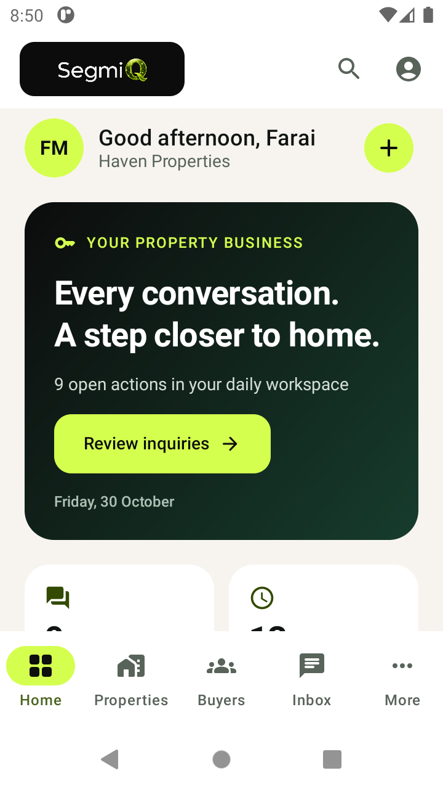

# Phase 3 — Real Estate shell and security gates

Date: 2026-10-30. Scope delivered: Milestone A. Milestones B–E are gated, not completed.
This is not a production-readiness declaration.

## Preflight

- Read all 12 reports in `docs/android-audit/`, root implementation/delivery/QA documentation, the current auth/bootstrap/network/session/live repositories, feature ViewModels, navigation and tests.
- The audit and root delivery documents describe the original demo. No Phase 2 implementation report was present. Current source supersedes that snapshot: password/MFA authentication, Keystore-backed sessions, server bootstrap, organisation/user scope validation, shared live sales reads and authorised writes already exist. They were preserved.
- Existing stack: AGP 9.0.1, Kotlin 2.3.20, Compose BOM 2026.03.01, Navigation Compose 2.9.0, lifecycle 2.10.0, compile/target SDK 36, min SDK 26, Java bytecode 17, manual application container, ViewModel/StateFlow, OkHttp 4.12.0, Kotlinx Serialization and DataStore. No new dependency was added.
- Reviewed backend `docs/android-integration/01-auth-and-bootstrap.md` (schema 1) and actual API guards/listing/buyer-search/viewing/offer/transaction route source.
- Backend local main and remote HEAD independently agree at `b3e5e695eae098baf8cd7313d6513ba7b84c1db8` (“prepare SegmiQ backend for Android sales app integration”). This commit adds auth/bootstrap readiness; it does not establish completion of all Real Estate mobile/security prerequisites.
- The configured host is `https://www.segmiq.com`. A production-host account login and authorised inquiry/daily-work reads were observed in this session before changes. This was the user-supplied test account. Its email naming is not evidence of a server demo flag; local demo and authenticated server workspaces remain separate.
- A deployed commit/build identifier was not supplied or independently attested. GitHub HEAD is not proof of deployed version. No unverified Real Estate endpoint was exercised with customer credentials.
- Baseline `assembleDebug testDebugUnitTest lintDebug --offline`: **PASS**, 6m06s, before implementation.
- Android directory is untracked in the parent Git repository. No commit, staging operation, backend change or unrelated app modification was made.

## Implemented

- Server-selected Real Estate tabs: **Home / Properties / Buyers / Inbox / More**, filtered by granted modules and destinations. No preference can enable this experience.
- General and Solar navigation definitions remain unchanged. Unknown experience still falls back to General per contract.
- More exposes verified destination identifiers for Inquiries, Viewings, Introductions, Offers, Transactions, Acquisitions (`OPPORTUNITIES`), Inspections, Owners, Mandates, Commissions, Tasks and shared Copilot when granted, plus supported system dialer and account settings.
- Compliance and Recordings are not fabricated as granted destinations: bootstrap contract/source does not currently supply those independent destinations. Recorder capture is still unavailable. No operational recording control was added.
- Dedicated Agent Home: official wordmark, organisation identity, profile/settings access, dark forest hero, ivory surroundings, daily inquiry/follow-up metrics, live priorities, shared Copilot review access, contextual quick-action sheet, refresh/loading/empty/error and stale-data states.
- Metrics retain their actual meaning. Active deals are not relabelled active buyers; missing viewings/offers are not represented as zero. No AI match percentages, portraits, property photos, transcripts, notification counts or recommendations were invented.
- Home actions reuse inquiry creation, system phone dialer and task routes. No new business logic or customer-data model.
- Authorised but unimplemented modules have clear native entry screens with approved web destination links. They make **no property/buyer/viewing/offer/transaction request**. External browser sign-in may be required.
- Fixed primary module tab selection and bottom-bar visibility. Each module now has a distinct NavHost destination, retaining existing route strings, so saved tab state cannot restore Properties when the user selects Buyers or Inbox. An emulator regression test caught this shared-pattern restoration defect.
- Settings shows server-provided identity/configuration and confirmed sign-out; no industry switch.
- Fictional, isolated Compose previews: compact, large text, tablet and dark. Preview fixtures never enter a live repository.

## Phase 2 foundation defect found during emulator checks

The instrumented suite exposed `NetworkOnMainThreadException` in the existing HTTP client. OkHttp asynchronously received response headers, but the caller then read `ResponseBody.string()` and decoded JSON on the UI thread. Small buffered production responses had previously masked the fault. The complete request/response processing now runs under `Dispatchers.IO`, including response-body reads, decoding and resource closure. Android StrictMode remains enabled.

The first full instrumented run had 4 failures: 2 data-loading tests affected by this defect, and 2 demo entry tests affected by retained Application session state. Tests now explicitly reset local sign-in state without revoking server sessions. MockWebServer tests use its own returned URL rather than assuming a loopback address. Original assertions remain.

## Files changed / components

- `app/src/main/kotlin/com/segmiq/sales/core/bootstrap/LiveWorkspace.kt`: Real Estate routes, module/destination gating.
- `app/src/main/kotlin/com/segmiq/sales/features/live/LiveSalesApp.kt`: industry dispatch, persistent primary module navigation, settings/profile.
- `app/src/main/kotlin/com/segmiq/sales/features/live/LiveHomeScreens.kt`: agent terminology and consistent More rows; General UI retained.
- `app/src/main/kotlin/com/segmiq/sales/features/realestate/RealEstateHome.kt`: Agent Home, EstateHero, EstateMetric, EstateModuleRow, EstateNotice.
- `app/src/main/kotlin/com/segmiq/sales/features/realestate/RealEstateScreens.kt`: EstateBrandTitle, EstateModuleEntry, EstateSettings.
- `app/src/main/kotlin/com/segmiq/sales/features/realestate/RealEstatePreviews.kt`: labelled fictional previews only.
- `app/src/test/kotlin/com/segmiq/sales/live/BootstrapTest.kt`: industry and access regression coverage.
- `app/src/androidTest/kotlin/com/segmiq/sales/RealEstateShellTest.kt`: native navigation, blocked-request, empty/error and large-text coverage.
- `app/src/main/kotlin/com/segmiq/sales/core/network/SegmiqHttp.kt`: fix UI-thread response reading/decoding.
- `app/src/androidTest/kotlin/com/segmiq/sales/LiveFoundationTest.kt`: use MockWebServer URL.
- `app/src/androidTest/kotlin/com/segmiq/sales/SalesNavigationTest.kt` and `SimulatedCallTest.kt`: deterministic local session setup.
- This report and the emulator screenshot.

## Existing APIs reused

| API | Use | Status |
|---|---|---|
| POST /api/sales/app/auth | Existing login | Preserved; runtime login observed before changes |
| POST /api/auth/mfa/login | Existing MFA | Mock-tested foundation; no live MFA test |
| GET /api/sales/app/bootstrap | Experience, identity, capabilities, scope/config | Existing authenticated bootstrap preserved |
| GET /api/sales/dashboard | Daily inquiry/follow-up metrics | Existing live read |
| GET /api/sales/dashboard/workspace | Daily actions | Existing live read |
| GET /api/sales/tasks?view=mine | Tasks and Copilot review state | Existing live read |
| Existing lead/contact/note/follow-up/Copilot routes | Shared native destinations | Preserved; no production writes performed in Phase 3 |

All use the existing Bearer client. No Supabase Android SDK, project, schema, key, cookie bridging, proxy or privileged credential was added. Existing cache remains in-memory and scoped to organisation plus user; durable Real Estate caching/outbox is deferred.

## Blocking backend findings

| Module | Verified source | Gate before live integration |
|---|---|---|
| Properties | GET /api/clients/[clientId]/listings uses Bearer-capable tenant guard, then tenant-wide select; fallback also tenant-wide. POST uses getServerSession | Prove and test role/ownership/draft visibility including fallback, define mobile detail DTO and authorised photo URLs, verify deployed behavior. No listing call enabled. |
| Buyers | buyer-searches GET/POST use request-aware client guard and BuyerActor | Verify complete buyer ownership/introduction rules and DTOs with cross-agent/cross-tenant tests. Not claimed insecure solely because integration is gated. |
| Viewings | Route imports cookie-only getServerSession; known private-buyer booking issue not demonstrated resolved by readiness commit | Bearer support plus explicit private-buyer booking denial tests and deployed verification before any creation or confirmation. |
| Offers | GET/POST use cookie-only getServerSession; GET passes scopeOwn for SALESPERSON | Bearer support; verify all list/detail/history paths and selling-manager behavior, competing-offer privacy and transitions. scopeOwn alone is not proof of full remediation. |
| Transactions | GET uses cookie-only getServerSession | Bearer DTOs, participant/document access and transitions before integration. |
| Introductions / compliance / documents | No complete mobile contract verified this milestone | Verify endpoints, decision permissions, self-approval denial, reassignment/single-decision rules and protected document access. |

UI hiding is not server security. No client-side filter is used to “repair” an unsafe endpoint. No live writes, viewing notifications, introduction decisions, offer transitions or uploads were attempted.

## Verification

- Baseline build, existing unit tests and lint: passed.
- Post-change assembleDebug, testDebugUnitTest and lintDebug: **PASS**, 4m39s, exit 0. Instrumented checks follow below.
- Added unit checks: required Real Estate tabs; General/Solar regression; missing capability/destination hides module; unknown modules hidden; business type/flags cannot override resolved experience.
- Added instrumented checks: shared API Bearer requests only, no client-module request on blocked navigation, primary bottom navigation persists, authorised More/settings routes, 150% text empty/error states and denied action absence.
- Existing mock auth/session tests include revocation, organisation mismatch/cache clearing, restored bootstrap, subscription blocking, MFA and offline demo isolation.
- Physical-device verification: **none**. Real phone, audio, lock-screen, Bluetooth, telephony, recording and background service behavior are outside this milestone.

## Feature classification

| Feature | Visually implemented | Functional demo | Backend integrated | Runtime verified | Physical device |
|---|---|---|---|---|---|
| Real Estate shell / home | Yes | Labelled Compose fixtures | Existing daily-work services | Session restoration and Agent Home live reads observed on API 30 emulator | No |
| Inquiries / tasks / Copilot | Existing shared screens | Existing local General demo preserved | Existing repositories reused | Earlier live read observed; no Phase 3 production writes | No |
| Settings / profile | Yes, read-only settings | Preview identity only | Bootstrap + existing sign-out | Settings navigation and profile/config display verified with synthetic emulator data | No |
| Properties / Buyers / Inbox | Entry states only | No fictional customer data in live mode | No module data integration | Emulator navigation passed; no customer-module API requests | No |
| Viewings / introductions / offers / transactions | Entry states only | No workflow simulation added | Gated | No live module operation | No |
| Property gallery / matching / document upload / compliance | No | No | No | No | No |
| Recorder | Existing non-operational entry preserved | Clearly unavailable | No | No audio capture | No |

## Design comparison and limitations

Official source-derived SegmiQ artwork is reused unmodified, including its network Q. Native Material components use ivory, near-black, forest and restrained lime. Separate typography hierarchy, rounded cards, meaningful icons, reachable actions and scalable text replace the old generic Real Estate dashboard.

The referenced approved concept image was not available as an attachment or identified repository asset, so no pixel comparison is claimed. Property photography, carousels, async loading/image cache and buyer portraits are deferred with Milestone B; adding arbitrary stock property photos to a live account would violate this brief. No licensed custom typography asset was identified; the existing Android sans-serif scale was retained.

## Next milestone

Milestone B begins only after listing scope/draft visibility, buyer privacy, mobile detail/image contracts and deployed endpoint version are verified. Then implement native list/detail/search/filter/image caching against those contracts. Next, unlock C–E in sequence after their Bearer/privacy gates pass. Do not treat this shell as completion of the full Phase 3 product.

## Final verification and screenshots

The APK installed successfully on the Android 11 emulator (720×1280 px, 360dp width).
Cold launch restored the secure session without asking for credentials, resolved Real Estate through bootstrap and loaded daily work. Properties retains the selected tab and bottom bar, clearly explains that live listing data is disconnected, and offers the verified web destination.

All **9 instrumented tests passed** on the API 30 emulator after the HTTP threading and module destination corrections, with 0 skipped and 0 failed. The original General Home mock-data test, General navigation, demo persistence, simulated call review and recording-unavailable state all pass. New Real Estate tests verify Properties → Buyers → Inbox → More → Settings, Bearer headers, exactly three shared home requests and no client-module requests. The 150% text empty/error/denied-action test also passes.

Solar experience selection/navigation and absence of Real Estate modules are unit-tested; no live Solar account or physical device was tested. Tablet/dark layouts have Compose previews, not a claimed full tablet/device certification. Image-loading tests remain deferred because no authorised property image loader is implemented.

Instrumented secure-storage/demo tests clear the emulator's locally stored login; they do not revoke server sessions or delete customer records. Final combined command: `assembleDebug testDebugUnitTest lintDebug connectedDebugAndroidTest --offline --console=plain` — **BUILD SUCCESSFUL**, exit 0, 3m51s. No test was disabled, and Android StrictMode was not relaxed. The test runner removed the test installation afterward; the verified debug APK was reinstalled and launched, and the user-supplied account signed in successfully again to the server-resolved Real Estate Home. No password or token is stored in this report or the implementation fixtures.
