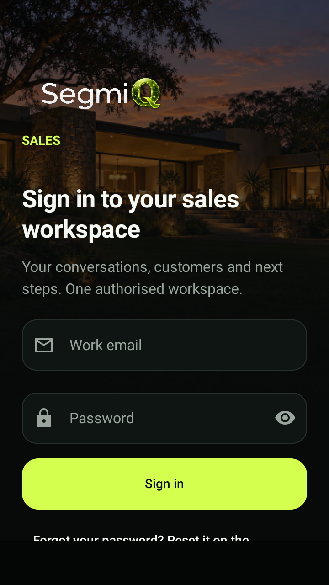
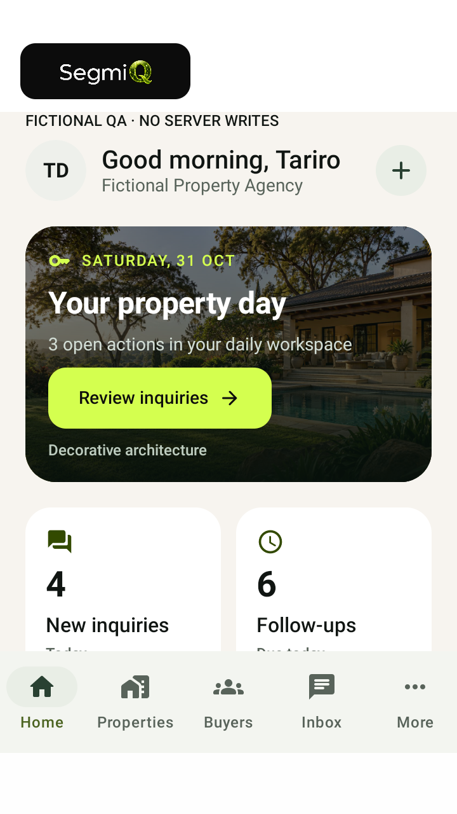
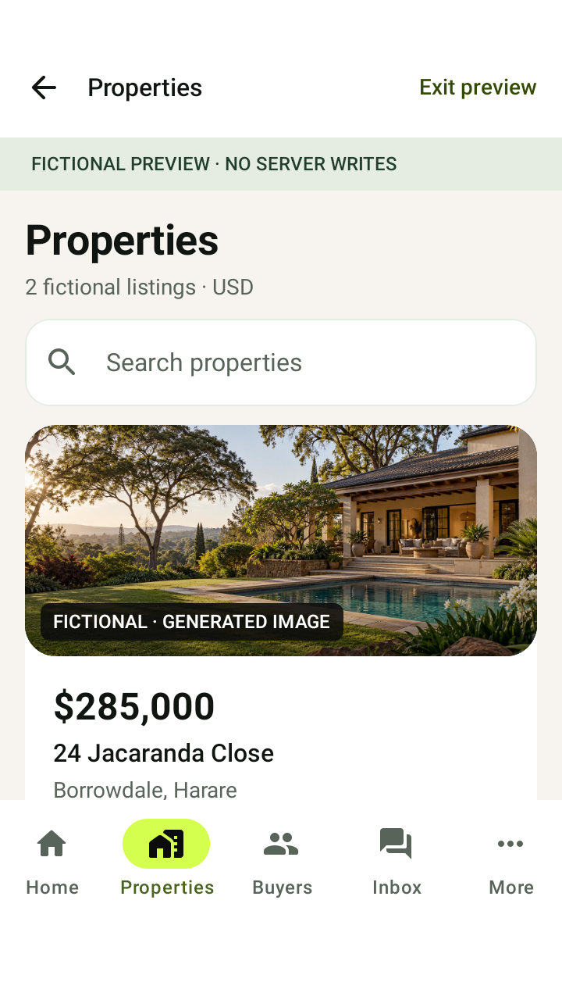
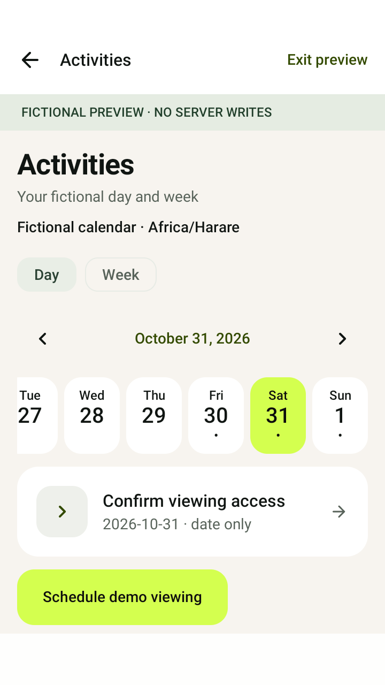
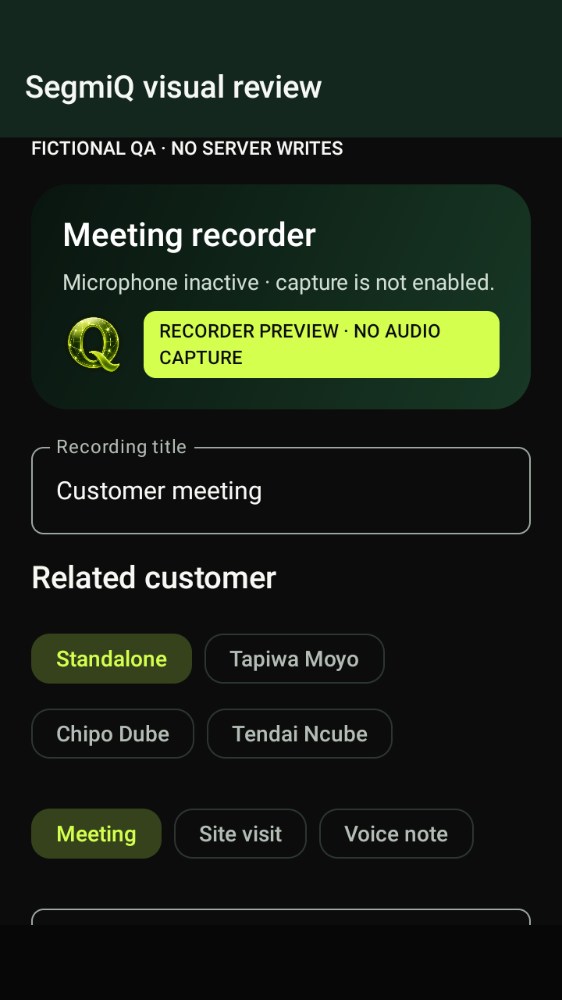
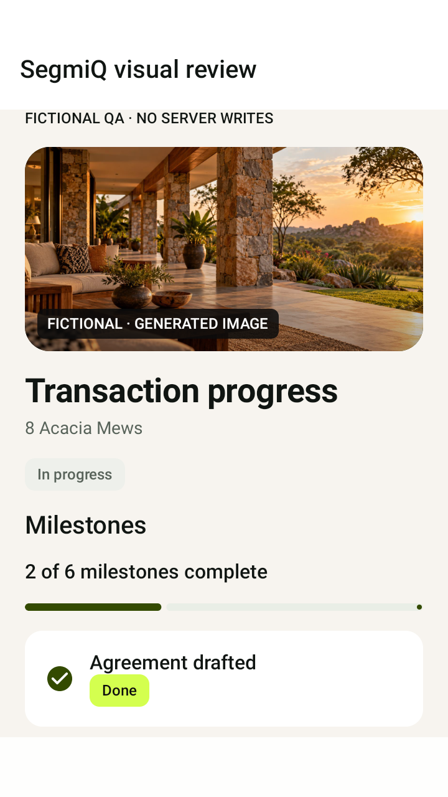

# Premium UI emulator gallery

2026-10-31 · 53 actual native-app PNGs · Android 11 emulator, 720×1280 / 360dp baseline.

These captures come from the implemented Compose screens using isolated fictional QA fixtures and no server writes. They are not generated marketing mockups or proof of live backend connectivity. Generated decorative/property images are labelled in the application. Active recording is intentionally absent because no recorder is connected.

Latest refinement: debug build, all unit tests, lint and all 16 instrumented tests passed (shell-34, 12m43s, exit 0). All 53 PNGs were re-exported from this run. Most images use post-draw Compose PixelCopy; 32/33 include the native OS keyboard. These now show the complete Sign in / Save draft on device action above the keyboard, with a geometry assertion against the native keyboard boundary. The QA host matches production edge-to-edge/adjustResize settings. A host-runner Netty teardown exception appeared after tests completed; no test failed and Gradle reported success.

393dp, 412dp and tablet images use injected Compose density/constraints on the same emulator, not separate physical devices. Font150/font200 exercise text scaling. Landscape images use actual Activity rotation. No system animation setting was modified during the latest refinement. The earlier premium baseline also exercised disabled motion.

## Selected screens

| Login | Agent Home |
|---|---|
|  |  |

| Properties | Calendar |
|---|---|
|  |  |

| Recorder unavailable | Transaction |
|---|---|
|  |  |

## All captures

- [01 login light 360dp](01-login-light-360dp.png)
- [02 home light 360dp](02-home-light-360dp.png)
- [03 properties light 360dp](03-properties-light-360dp.png)
- [04 property light 360dp](04-property-light-360dp.png)
- [05 buyers light 360dp](05-buyers-light-360dp.png)
- [06 buyer light 360dp](06-buyer-light-360dp.png)
- [07 inquiries light 360dp](07-inquiries-light-360dp.png)
- [08 calendar light 360dp](08-calendar-light-360dp.png)
- [09 viewing light 360dp](09-viewing-light-360dp.png)
- [10 dialer light 360dp](10-dialer-light-360dp.png)
- [11 review light 360dp](11-review-light-360dp.png)
- [12 recorder light 360dp](12-recorder-light-360dp.png)
- [13 recordings light 360dp](13-recordings-light-360dp.png)
- [14 copilot light 360dp](14-copilot-light-360dp.png)
- [15 inbox light 360dp](15-inbox-light-360dp.png)
- [16 thread light 360dp](16-thread-light-360dp.png)
- [17 offers light 360dp](17-offers-light-360dp.png)
- [18 offer light 360dp](18-offer-light-360dp.png)
- [19 introductions light 360dp](19-introductions-light-360dp.png)
- [20 transaction light 360dp](20-transaction-light-360dp.png)
- [21 compliance light 360dp](21-compliance-light-360dp.png)
- [22 document light 360dp](22-document-light-360dp.png)
- [23 tasks light 360dp](23-tasks-light-360dp.png)
- [24 properties dark 360dp](24-properties-dark-360dp.png)
- [25 calendar dark font150](25-calendar-dark-font150.png)
- [26 login font200](26-login-font200.png)
- [27 properties 393dp](27-properties-393dp.png)
- [28 buyer 412dp](28-buyer-412dp.png)
- [29 home tablet dp constraints](29-home-tablet-dp-constraints.png)
- [30 property font200 action](30-property-font200-action.png)
- [31 image failure](31-image-failure.png)
- [32 login keyboard](32-login-keyboard.png)
- [33 thread keyboard](33-thread-keyboard.png)
- [34 properties landscape](34-properties-landscape.png)
- [35 primary navigation font200](35-primary-navigation-font200.png)
- [36 property landscape action](36-property-landscape-action.png)

## Typed API captures

The following use synthetic local HTTP responses through the actual Android repositories. They do not prove production deployment acceptance or expose real customer data.

- [40 Agent Home](40-agent-home-synthetic-api.png)
- [41 Properties](41-api-properties.png)
- [42 Property detail](42-api-property-detail.png)
- [43 Buyers](43-api-buyers.png)
- [44 Buyer detail](44-api-buyer-detail.png)
- [45 Matches](45-api-matches.png)
- [46 Viewings](46-api-viewings.png)
- [47 Viewing detail](47-api-viewing-detail.png)
- [48 Introductions](48-api-introductions.png)
- [49 Introduction detail](49-api-introduction-detail.png)
- [50 Offers](50-api-offers.png)
- [51 Offer detail](51-api-offer-detail.png)
- [52 Transactions](52-api-transactions.png)
- [53 Transaction detail](53-api-transaction-detail.png)
- [54 Calendar](54-api-calendar.png)
- [56 Empty](56-api-empty.png)
- [57 Error](57-api-error.png)

See [implementation report](../../phase-ui-premium-upgrade.md) for changes, backend gates and remaining verification.
