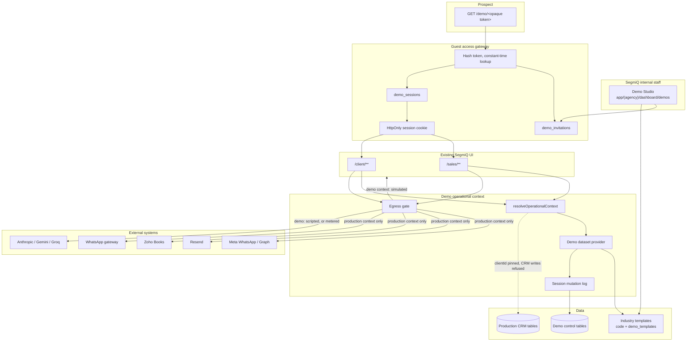

# SegmiQ Operational Demo Engine — Phase 1 Architecture Audit

**Status:** Audit only. No application code, schema, RLS, auth, or integration behaviour was changed.
**Date:** 12 October 2026
**Scope:** Existing SegmiQ repository, inspected from source. Live database contents, deployed environment flags, and production row counts were not queried.

This report distinguishes three kinds of statement:

- **Verified** — read from source in this repository.
- **Proposal** — an architecture recommendation, not something that exists today.
- **Unknown** — cannot be confirmed without a live environment or a file that was not present.

The filename follows the existing `docs/SEGMIQ_*.md` convention. The brief asked for `docs/SEGM IQ_DEMO_ENGINE_PHASE1_ARCHITECTURE_AUDIT.md`; a space in the name would break that convention, so this path is the one created.

---

## Section A — Executive Summary

The Operational Demo Engine is **feasible inside the existing SegmiQ application**. A first version of that idea is already in the codebase. It is not the product described in this brief.

**Compatibility: requires targeted refactoring.** The UI, route trees, aggregators, and a demo data provider can be reused. Guest access, per-visitor state, multi-industry templates, and a complete side-effect boundary cannot be added as configuration on top of the current Rossi Tyres workspace.

**Recommended approach.** Keep one Next.js application and the existing screen tree. Keep fictional operational records out of production CRM tables, which is what the current provider already does. Add a server-side guest session, a per-visitor mutation log, and a single egress gate that every external caller must pass. Do not stand up a Supabase project per prospect. Do not copy the CRM into `/demo`. Do not insert demonstration leads, messages, quotations, or inventory movements into the production `leads`, `deals`, `quotations`, or `whatsapp_messages` tables.

**Biggest obstacles.**

1. CRM authorisation assumes a real `public.users` row, a NextAuth JWT, and a live `user_sessions` row. A prospect with no account cannot enter `/sales` or `/client` today.
2. Demonstration changes are stored once per organisation (`demo_workspace_mutations.client_id`). Three people opening the same workspace overwrite one shared log.
3. Demo behaviour is opt-in at selected read aggregators and a few send wrappers. Many write paths, the bare Resend client, campaign template sends, the agent tool executor, WhatsApp connection management, and the cron workers do not consult demo mode.
4. Almost every database call uses the Supabase service role, which bypasses row-level security. Tenant isolation is an application invariant. A guest session that can influence `clientId` is a production-data incident.
5. The only registered dataset is Rossi Tyres. Actor keys, company brain, and mutation ids are Rossi-specific. Wholesale, solar, construction, and real estate do not have demo datasets. Older solar and real-estate seeds insert real CRM rows and real login users.

---

## Section B — Current SegmiQ Architecture

### B.1 Stack and application shape

| Layer | What exists | Evidence |
|---|---|---|
| Web app | Next.js 14.2.35 App Router, React 18, Tailwind | `package.json` |
| Auth | NextAuth 4 credentials provider, JWT strategy, bcrypt against `public.users.password` | `package.json`, `lib/auth.ts`, `app/api/auth/[...nextauth]/route.ts` |
| Database | Supabase Postgres, accessed with the service-role key | `lib/supabase/admin.ts` lines 17–37 |
| Browser data client | None. No `@supabase/ssr`, no anon-key browser client found | `lib/supabase/admin.ts` is the only Supabase client factory |
| Primary API | Route handlers under `app/api/**` | App Router tree |
| Server actions | Sparse (marketing contact, a few agency actions) | `app/(marketing)/contact/actions.ts` |
| Postgres RPCs | Used from the service-role client for selected aggregates | Called via `.rpc` from server code |
| Edge Functions | None under `supabase/functions` | Directory absent |
| Background work | Vercel cron routes plus `waitUntil` in `lib/background.ts` | `vercel.json` lines 2–26 |
| Files | Cloudflare R2 is the tenant document store (`lib/storage/r2.ts`). Supabase Storage is limited to public buckets such as avatars and landing-page images | `docs/SEGMIQ_TENANT_SECURITY.md` |
| Realtime | No Supabase Realtime channel usage found in application TypeScript | Search for `.channel(` / realtime subscribe returned none |
| Mobile | Separate `sales-app` and `field-app` packages; API bearer tokens share the NextAuth secret | `package.json` scripts, `lib/auth/resolveApiAuth.ts` |
| WhatsApp QR | Separate Node process `services/whatsapp-gateway` (Baileys) | `package.json` `gateway:whatsapp` |

Route trees that matter for a demo:

| Tree | Who middleware admits | Role |
|---|---|---|
| `app/(marketing)/**`, `app/blog/**` | Public | Marketing site |
| `app/(agency)/dashboard/**` | `SUPER_ADMIN` only, and not while impersonating | Internal SegmiQ console |
| `app/client/**` | `CLIENT_MANAGER` | Manager CRM |
| `app/sales/**` | `SALESPERSON`, or `CLIENT_MANAGER` with `also_sells` | Salesperson CRM |
| `app/solo/**` | `SALESPERSON` whose client mode is `solo` | Solo CRM |
| `app/cloud/**` | Separate Cloud product | Not the CRM demo surface |
| `app/portal/**`, `app/quote/**`, `app/lead/[token]`, `app/proposal/**`, `app/onboard/**` | Token or OTP, not a CRM session | Customer-facing links |
| `app/d/[slug]` | Public, then redirects to `/client/dashboard` | Meta WhatsApp short link. **Not available as the demo URL** |

Middleware public exceptions are listed in `middleware.ts` around lines 195–234. `/demo` is not among them. An unauthenticated request to `/sales` or `/client` is redirected to `/login` (`middleware.ts` lines 247–251).

### B.2 Request path

```text
Browser
  → Next.js page or route handler
    → NextAuth JWT cookie, or mobile Bearer JWT
      → resolveApiAuth / getAuthFromRequest
        → validateAuthClaims (user row, role, client_id, session_version, user_sessions)
          → createAdminClient()  [service role, RLS bypassed]
            → application filter on session.clientId
              → Postgres tables, R2, or an external provider
```

The tenant rule is documented and implemented:

```7:13:docs/SEGMIQ_TENANT_SECURITY.md
User.client_id  →  clients.id   (tenant boundary)
```

```3:7:lib/auth/tenant-context.ts
 * SECURITY INVARIANT:
 * Tenant context for organisation-owned data must come from the authenticated
 * server-side session (or an explicit SUPER_ADMIN platform action).
 * Never treat a request body/query `clientId` as authorization by itself.
```

`requireTenantClientId` exists (`lib/auth/tenant-context.ts` lines 31–36) but most routes read `session.clientId` directly and then call `createAdminClient()`. RLS is not what protects a signed-in user. Enabling RLS with no policies, which is the dominant CRM pattern (for example `supabase/migrations/048_customer_hub_contacts.sql`), only stops the anon and authenticated Data API. The application never uses those roles.

### B.3 Identity, organisation, and permissions

Verified tables and columns:

| Object | Role |
|---|---|
| `public.clients` | Organisation. `mode` is `team` or `solo`. `workspace_mode` is `production` or `demo`. `demo_industry` and `demo_scenario` select a dataset. |
| `public.users` | One user, at most one `client_id`. Roles are `SUPER_ADMIN`, `CLIENT_MANAGER`, `SALESPERSON`. `also_sells` lets a manager open `/sales`. |
| `public.user_sessions` | Server-side session row. Middleware rejects a JWT whose session is dead (`middleware.ts` lines 297–300). |
| `support_access_grants` | Time-boxed platform read access to one organisation. Separate from impersonation. |

There is no organisation-membership table. A user cannot belong to two companies.

Permission catalogue: `lib/auth/rbac/permissions.ts`. Resolution is default-deny in `lib/auth/rbac/resolve.ts`. Salesperson write access to a lead still depends on `assigned_to_id === session.userId` (`lib/auth/permissions.ts`). Platform permissions (`platform.clients.manage`, `platform.impersonate`, and the rest of `PLATFORM_PERMISSIONS`) are super-admin only.

Impersonation (`app/api/agency/impersonate/route.ts`) mints a JWT whose effective user is a real tenant user and whose `realUserId` is the super admin. It is a support tool, not a prospect login.

Commercial module switches already exist as organisation flags in `lib/commercial/flags.ts`: products, inventory, packages, quotation product picker, inventory external sync, and documents. These are the right kind of switch for “which modules this demonstration enables”. They do not by themselves load fictional data.

### B.4 What assumes a real CRM user

These assumptions hold on every normal CRM page and API:

| Assumption | Where it is enforced | What a guest breaks |
|---|---|---|
| Email and bcrypt password on `public.users` | `lib/auth.ts` `verifyCredentials` | No account means no NextAuth login |
| JWT `userId`, `role`, `clientId`, `sessionVersion`, `sessionId` | `lib/auth.ts` JWT callback, `types/next-auth.d.ts` | No claims to validate |
| Matching `user_sessions` row | `lib/auth/session-validation.ts`, `middleware.ts` lines 284–300 | Cookie without a session row is logged out |
| Role is one of three CRM roles | `middleware.ts` lines 303–331 | A “guest” role is redirected away from `/sales` and `/client` |
| `clientId` comes from `users.client_id` | Login in `lib/auth.ts` | A token that is not a user has no tenant |
| Lead and deal ACLs compare `assigned_to_id` to `session.userId` | `lib/auth/permissions.ts` | No user id means no assignment match |
| Billing suspension can lock the portal | `middleware.ts` lines 333–337 | A demo client with a suspended subscription would be locked like a customer |
| MFA enrolment can restrict the session | `middleware.ts` lines 265–270 | A real demo user can be pushed into MFA setup |

Surfaces that already work without a CRM user, and must stay separate from the demo engine:

- Marketing pages and the contact form (`type: "demo"` there means “book a demo”, not a workspace).
- Magic lead links (`/lead/[token]`), public quotes (`/quote/[token]`), proposals, and onboarding tokens.
- Customer portal OTP (`lib/portal/auth.ts`).
- Cron routes authenticated with `CRON_SECRET` (`middleware.ts` lines 184–192).

None of those establish a CRM guest session.

### B.5 State and data fetching

Server components and route handlers load data on the server. The browser then uses SWR in interactive clients (`swr` is a dependency). There is no global client store that owns CRM records. Zustand is present; it is not the system of record.

The important seam for demos is server-side and already named:

```10:22:lib/demo/provider.ts
export type DataProvider =
  | { kind: "production" }
  | { kind: "demo"; industry: string; scenario: string };

export function getDataProvider(workspace: DemoWorkspaceRef | null | undefined): DataProvider {
  const mode = workspace?.workspace_mode ?? workspace?.mode;
  if (mode !== "demo") return { kind: "production" };
  return {
    kind: "demo",
    industry: workspace?.demo_industry ?? workspace?.industry ?? "tyres",
    scenario: workspace?.demo_scenario ?? workspace?.scenario ?? "rossi",
  };
}
```

Aggregators that call `loadDemoDatasetForClient` return early and skip production tables. UI components are not forked. That is the correct reuse pattern, and it is only applied on the routes listed in Section C.

### B.6 Feature configuration that a template can reuse

| Mechanism | What it configures | Demo relevance |
|---|---|---|
| `clients.mode` `team` / `solo` | Which portal shell | Keep `team` for company demos. Do not overload this column. The demo docs already forbid it (`docs/demo-workspaces.md` lines 7–8). |
| `clients.workspace_mode` | Production vs demo provider | Correct organisation-level switch. Insufficient for a visitor session. |
| `clients.demo_industry`, `clients.demo_scenario` | Dataset selector | Correct template key. Only `tyres` / `rossi` is implemented. |
| `lib/commercial/flags.ts` | Products, inventory, packages, documents | Use as the module allow-list inside a demo workspace. |
| `users.also_sells` | Manager may open the sales shell | Rossi’s manager is seeded with `also_sells: false` (`scripts/seed-rossi-demo.ts` lines 84–92), so manager and salesperson are different logins, not one session. |
| Industry modules | `lib/sales/solar-workflow`, `lib/real-estate`, tyre copy inside the Rossi dataset | Workflow code is real. Demo data for solar and real estate is not on this provider. |

---

## Section C — Existing Demo Infrastructure

### C.1 The current demo workspace system

**Verified.** Documented in `docs/demo-workspaces.md`. Implemented under `lib/demo/**`.

Detection is an organisation property, not a cookie and not an environment flag.

```17:20:lib/demo/mode.ts
export function isDemoWorkspace(workspace: { workspace_mode?: string | null; mode?: string | null } | null | undefined): boolean {
  if (!workspace) return false;
  return workspace.workspace_mode === "demo" || workspace.mode === "demo";
}
```

`getWorkspaceConfig` reads `clients.workspace_mode`, `demo_industry`, and `demo_scenario` with the service role and caches the result for 30 seconds. A missing column fails closed to production (`lib/demo/mode.ts` lines 33–64). That fail-closed behaviour must be preserved.

`isDemoWorkspace` also treats `clients.mode === "demo"` as demo. The docs say `clients.mode` must stay `team` or `solo`. The compatibility branch is a foot-gun if a future writer sets `mode` instead of `workspace_mode`.

**Dataset.** `materializeDemoDataset` (`lib/demo/provider.ts` lines 24–38) returns a dataset only when industry is `tyres` and scenario is `rossi`. Anything else returns null, and the caller falls through. If `workspace_mode` is `demo` but the industry is unset, `loadFromConfig` defaults the pair to `tyres` / `rossi` (lines 90–92).

**Canonical records** are built in code by `buildRossiDataset` (`lib/demo/industries/tyres/rossi/dataset.ts`). Ids are deterministic SHA-256 UUIDs (`lib/demo/ids.ts`). Dates are recomputed from “today” in `Africa/Harare` (`lib/demo/dates.ts`). The dataset is not inserted into CRM tables. The Rossi seed states this explicitly (`scripts/seed-rossi-demo.ts` lines 1–4).

**Mutations** are one JSON array per organisation:

```20:24:supabase/migrations/20260924120000_demo_workspaces.sql
create table if not exists public.demo_workspace_mutations (
  client_id uuid primary key references public.clients(id) on delete cascade,
  mutations jsonb not null default '[]'::jsonb,
  updated_at timestamptz not null default now()
);
```

RLS is enabled and no policies are created, so the Data API cannot read the table. The service role can. `lib/demo/store.ts` also keeps a process-local `Map`. If the database upsert throws, the memory copy is kept and the error is swallowed (lines 36–48). On more than one server instance that is a split brain: one instance can reset or append while another serves a stale list.

Mutation types (`lib/demo/types.ts` lines 102–119): deal stage, won, lost, field patch, follow-up complete, follow-up create, message, assign.

Writers found:

| Action | Wired? | File |
|---|---|---|
| Deal stage, won, lost, fields, follow-up create | Yes | `app/api/deals/[dealId]/route.ts` around lines 141–196 |
| WhatsApp-style reply on a lead | Yes | `app/api/leads/[leadId]/send-message/route.ts` lines 20–31 |
| Follow-up complete, assign | Apply logic exists | `lib/demo/mutations.ts`. No route calls `appendDemoMutation` for these types |
| Lead PATCH (status, follow-up date from the tasks UI) | No | `app/api/leads/[leadId]/route.ts` has no demo branch |
| Create or edit a quotation | No demo mutation writer found | Quotation list and workspace are read adapters only |
| Mark notification read | No-op success | `app/api/notifications/mark-read/route.ts` |

**Auth for Rossi.** `npm run seed:rossi` upserts one `clients` row (`slug: rossi-tyres`, `workspace_mode: demo`) and four `public.users` rows with emails at `@rossi.demo`. The password comes from `DEMO_ROSSI_PASSWORD`. These are normal CRM logins. There is no guest token, no demo cookie, and no middleware exception.

Actors are a fixed union: `"tendai" | "tinashe" | "rudo" | "tanaka"` (`lib/demo/actors.ts` line 16). `resolveActors` maps those emails to real user ids (`lib/demo/provider.ts` lines 47–81). A second industry cannot add staff without changing this type. Company brain for every demo client returns the Rossi brain (`lib/company-brain/store.ts` lines 406–411), ignoring `demo_industry`.

**UI.** `components/demo/DemoWorkspaceChip.tsx` calls `GET /api/demo/status`. `ResetDemoPanel` is exposed to a demo organisation’s own manager via `POST /api/demo/reset`, which allows `CLIENT_MANAGER` or `SUPER_ADMIN` (`app/api/demo/reset/route.ts` lines 12–14). That is acceptable for an internal rehearsal account. It is the wrong authorisation boundary once the person in the manager chair is a prospect.

**Tests.** `tests/demo-workspace.test.ts` covers mode selection, Rossi materialisation, visibility, relative dates, mutation apply, and `demoBlocksExternalSend`. It does not cover guest tokens, cross-session isolation, or unguarded egress.

**Production safety of this system.**

| Property | Assessment |
|---|---|
| CRM tables not written by the provider | Sound, and should remain the rule |
| Fail closed when the column is missing | Sound |
| External send guard on the canonical WhatsApp, Twilio, and logged-email wrappers | Partial. See Section G |
| Shared mutation log | Unsafe for the three-visitor case in this brief |
| Real login users in the same `users` table as customers | Acceptable for staff rehearsal. Not acceptable as the prospect credential |
| `workspace_mode = 'demo'` on a real customer | Would hide their CRM and block their sends. Setting the flag is a privileged write and must be audited |
| In-memory mutation fallback | Unsafe once more than one instance serves traffic |

**Reuse verdict:** reuse the provider, adapters, relative dates, deterministic ids, ACL lookups, and the “do not write CRM tables” rule. Replace the shared mutation primary key, the Rossi-only actor type, the staff-login requirement, and the scattered send checks before this is a prospect-facing engine.

### C.2 Routes that already branch into the demo provider

Verified call sites of `loadDemoDatasetForClient` or an equivalent early return:

| Surface | File |
|---|---|
| Salesperson dashboard aggregator | `lib/sales/get-sales-dashboard-data.ts` ~707 |
| Manager dashboard aggregator | `lib/sales/get-company-sales-dashboard-data.ts` ~545 |
| Company leads | `lib/sales/get-company-leads-page-data.ts` ~306 |
| Company pipeline | `lib/sales/get-company-pipeline-page-data.ts` ~150 |
| Sales pipeline page | `app/sales/pipeline/page.tsx` ~144 |
| Customers | `lib/sales/get-company-customers-page-data.ts` |
| Quotations list | `lib/sales/get-company-quotations-page-data.ts` ~176 |
| Quotation workspace | `lib/quotations/workspace-data.ts` ~109 |
| Sales leads API | `app/api/sales/leads/route.ts` ~41 |
| Sales quotes API | `app/api/sales/quotes/route.ts` ~30 |
| Products list | `lib/products/service.ts` ~29 |
| WhatsApp inbox list | `lib/inbox/fetch-conversations.ts` ~105 |
| Inbox messages | `app/api/inbox/conversations/[leadId]/messages/route.ts` |
| Nav badges | `lib/sales/nav-badges.ts` ~30 |
| Notifications list | `app/api/notifications/route.ts` ~17 |
| Weekly reports | `app/api/reports/weekly/route.ts`, `app/api/reports/weekly/[reportId]/route.ts` |
| Company brain | `lib/company-brain/store.ts` ~407 |
| Lead/deal/quote ACL | `lib/demo/acl.ts` |

Social inbox for salespeople is explicitly unsupported:

```36:40:app/sales/social-inbox/page.tsx
  const { isDemoWorkspaceId } = await import("@/lib/demo/mode");
  const { DEMO_UNSUPPORTED } = await import("@/lib/demo/provider");
  if (await isDemoWorkspaceId(session.clientId)) {
```

The manager social inbox page does not have this block. A demo manager can still open the production social UI, which then reads production tables (empty for a Rossi org that has no social rows) and can reach OAuth and Graph calls.

Dashboard pages still query live `notifications` and user rows for unread chrome even when the aggregator is in demo mode. That is harmless only while the demo organisation has no production notification rows.

### C.3 Older “demo” artefacts that are a different system

| Artefact | What it actually does | Verdict |
|---|---|---|
| `scripts/seed-demo.ts` (`npm run seed:demo`) | Inserts a SunVolt Solar client, login users, and CRM rows (leads, contacts, call logs). Header at lines 1–14. Does not set `workspace_mode`. | Do not extend. Do not run against a database that contains customers. Treat as a legacy fixture. |
| `scripts/seed-haven-properties-demo.sql` | Inserts a Haven Properties real-estate client, users, listings, and leads. The file comment documents a shared password and the script stores a bcrypt hash. | Do not use for the demo engine. Remove the password from the repository when implementation starts. Do not copy that password into this report or into chat. |
| `lib/agent/learning/fixtures.ts` | Test fixture named like a demo solar company | Test-only. |
| Marketing “Book a demo” | `components/marketing/ContactForm.tsx`, `marketing_submissions` type `demo` | A sales enquiry, not a workspace. |
| `docs/SEGMIQ_SALES_PARTNER_PLAYBOOK.md` | Tells partners to rehearse on “a demo account” | Operational advice, not a product surface. |
| `app/d/[slug]/page.tsx` | Redirects to the manager dashboard for WhatsApp buttons | Occupied route. Do not reuse `/d/` for prospect links. |

**Unknown.** Whether Rossi, SunVolt, or Haven rows exist in the deployed database. This audit did not connect to Supabase.

### C.4 Rossi dataset shape, versus the brief’s tyre example

The brief’s tyre example wants four branches and two salespeople per branch. The shipped Rossi dataset does not model branches. It has one organisation name, one manager (Tendai), and three salespeople (Tinashe, Rudo, Tanaka). Customer locations are Harare suburbs and nearby towns, stored as a string on each spec, not as branch records. The spec list in `dataset.ts` is on the order of fifty fictional customers (the `key:` count in that file is 56, which includes non-customer keys; the customer list itself is the `SPECS` array starting at line 60). Conversations are a handful of scripted threads (`hilux`, `brian`, `westgate`, `nyathi`, `short`). Totals are derived from those records by `lib/demo/totals.ts`, which is the right reporting approach.

---

## Section D — Architecture Recommendation

### D.1 Decision

Build the Operational Demo Engine **inside this application**, as a second operational context beside production. Do not fork the frontend.

The context object, proposed, is resolved once per request on the server:

```text
OperationalContext =
  | { kind: "production", actor: CrmUser, clientId }
  | { kind: "demo", actor: DemoGuest, workspaceId, sessionId, personaActorId, clientId }
```

`clientId` on a demo context is the demo workspace’s `clients.id`, and that client row must have `workspace_mode = 'demo'`. Every production query helper continues to receive a client id. Demo reads resolve through `loadDemoDatasetForSession`. Demo writes append a session mutation or return a typed “not available in this demonstration” error. They do not insert into CRM tables.

Scattering `if (demo)` through components is how the current code will rot. The rule for new work:

- Pages and visual components stay unaware of the industry.
- Server aggregators already branch once, at the top. Extend that pattern rather than adding a second branch inside the JSX.
- Mutations and external calls branch inside shared server functions (`appendDemoMutation`, `simulatedExternalSend`), not inside buttons.

### D.2 Why this isolation model

Three options were compared against the code that exists, not against a generic SaaS diagram.

| Criterion | A. Demo tenants as real CRM rows in production | B. Dedicated demo Supabase project | C. Same app, fictional records kept out of CRM tables, control tables beside production |
|---|---|---|---|
| Security against a missed `.eq("client_id")` | Weak. Demo and customer rows share `leads` and `whatsapp_messages`. | Strong for data, because the demo key cannot see production. | Strong for operational records, because they are not in those tables. Control-plane rows still need service-role discipline. |
| Fit with current code | Fights the provider. Rossi was built to avoid this. | Fights `createAdminClient()`, which is a process-wide singleton bound to one URL and one service-role key (`lib/supabase/admin.ts` lines 17–24). | Matches `getDataProvider` and `docs/demo-workspaces.md`. |
| RLS | Does not help the app, which never presents a user JWT to Postgres. | Same limitation unless the demo app stopped using the service role. | Same. Isolation stays in the provider and the guest context. |
| External side effects | Highest risk. Crons select active clients and will eventually see demo rows. | Crons on production cannot see demo rows. Demo project still needs its own kill switch. | Production crons see demo client ids. They must exclude `workspace_mode = 'demo'` even while CRM tables are empty. |
| Cost and operations | Lowest infrastructure cost, highest blast radius. | Second project, second migration stream, second set of secrets. | One deployment, one migration stream, a small set of demo tables. |
| Release alignment | Automatic. | Schema drift between projects becomes a demo outage. | Automatic, because the same build serves both contexts. |
| Per-visitor isolation | Possible with a copied `client_id` per visitor. Expensive and leaky. | Same copy problem inside the demo project. | Natural: immutable template plus a mutation log keyed by session. |
| 1,000 workspaces | Large CRM tables, index pressure, backup of fiction mixed with customers. | Isolated, but still large if every module is copied as rows. | Template is code or one JSON document. Session logs grow with visitor actions, not with a full CRM clone. |

**Choose C.** Promote it to B only if a later module cannot be expressed through the dataset provider and someone proposes inserting real rows “temporarily”. That proposal should be rejected. The module stays disabled in demo until it has an adapter, or the whole demo data plane moves to a dedicated project together. A dedicated project for every prospect is not appropriate.

Do not put the service-role key, or a second service-role key, in the browser. The guest session is an HttpOnly cookie interpreted by the Next.js server. The server continues to use the service role, scoped by the demo context’s `clientId` and `sessionId`.

### D.3 Component diagram



### D.4 Pieces

| Piece | Responsibility |
|---|---|
| Demo Studio | Super-admin UI to create a workspace from a template, name the prospect company, pick modules, mint and revoke links, reset a session, read engagement. Lives under the existing agency console. |
| Template engine | Versioned industry builders that return a `DemoDataset` plus module flags, pipeline stages, and persona definitions. Rossi becomes template `tyres/rossi` version 1, after actors stop being a global TypeScript union. |
| Guest-access gateway | One public route. Verifies the invitation, creates a session, sets the cookie, redirects into the existing shell. |
| Operational demo session | Cookie plus `demo_sessions` row. Holds workspace, persona, expiry. Persona switch updates the row. It does not create a second mutation log. |
| Data services | Existing aggregators call the provider. Missing writers gain mutation types. Unsupported modules return `DEMO_UNSUPPORTED` on the server, not only in the page. |
| Data storage | Templates immutable. Session mutations append-only. No CRM inserts. |
| Permissions | Demo context can only assume a persona defined on that template. It can never be `SUPER_ADMIN`. It cannot call platform routes. |
| Simulated integrations | `simulatedExternalSend` becomes mandatory at every egress function, including paths that skip it today. |
| Analytics | Append-only `demo_engagement_events` (page, module, action). No message bodies in analytics. |
| Cleanup | Scheduled job deletes expired sessions, their mutations, and engagement events past the retention window. Invitations can be revoked without deleting the template. |

### D.5 Prospect URL

Use `/demo/<token>`.

`/d/<slug>` is already the WhatsApp dashboard short link (`app/d/[slug]/page.tsx`). `/quote/`, `/lead/`, `/proposal/`, `/onboard/`, `/portal/`, `/p/`, `/f/`, and `/l/` are occupied public token surfaces. `/demo` matches the product language and is free in `middleware.ts`.

The token in the URL is an invitation secret. After redemption the browser holds a separate session cookie. Reloading the CRM must not require the invitation token on every request, and the invitation token must not be stored in local storage or in the NextAuth JWT.

### D.6 What “reuse the real application” excludes

- A parallel component library under `app/demo/**` that reimplements dashboards.
- Hardcoded industry branches inside `SalesDashboardMain` or the pipeline board.
- Browser-only state for quotations or pipeline moves. Those actions must survive a refresh and show up in the manager view of the same session, which means the server mutation log.
- Giving the prospect the Rossi password, or any `public.users.password`.

---

## Section E — Database Architecture

No migration is proposed for this phase. The shapes below are the implementation contract.

### E.1 Keep

| Object | Keep because |
|---|---|
| `clients.workspace_mode`, `demo_industry`, `demo_scenario` | Already the provider switch. A demo workspace remains a `clients` row so `client_id` foreign keys and commercial flags have a place to point. The row must not accumulate operational CRM children. |
| `demo_workspace_mutations` | Replace its primary key. Do not drop it until session-scoped storage is reading and writing. Today’s Rossi reset depends on it. |

A demo `clients` row should have no WhatsApp connection, no Meta page token, no Zoho OAuth connection, no website API key, and no billing subscription that can suspend the shell. Those are application invariants to enforce when Studio creates the row.

### E.2 Proposed control tables

Names are candidates.

**`demo_templates`**

| Column | Purpose |
|---|---|
| `id` | Template id |
| `industry` | `tyres`, `wholesale`, `solar`, `construction`, `real_estate`, `services` |
| `scenario` | `rossi`, and later others |
| `version` | Immutable once a workspace is pinned to it |
| `module_flags` | Subset of `CommercialFlags` plus an explicit allow-list of CRM modules |
| `personas` | JSON: key, display name, role, branch |
| `pipeline_stages` | Stage ids the dataset and the existing deal enum can both represent |
| `parameter_schema` | What Studio may change: company name, branch names, city. Not free-form SQL |

The heavy fictional graph can stay in code (`lib/demo/industries/<industry>/<scenario>/dataset.ts`) for as long as datasets are curated by engineers. A JSON snapshot column is useful once Studio must clone a template without a deploy. Do not start with a snapshot editor.

**`demo_workspaces`**

One row per prospect demonstration. Points at `clients.id` (the demo organisation), `demo_templates.id`, display name, branch parameter values, status (`draft`, `active`, `archived`), and `created_by` (a `SUPER_ADMIN` user id).

**`demo_invitations`**

| Column | Purpose |
|---|---|
| `id` | Invitation id |
| `workspace_id` | Which demonstration |
| `token_hash` | SHA-256 of the opaque token. Never store the raw token |
| `expires_at` | Link lifetime |
| `revoked_at` | Immediate kill |
| `created_by` | Staff user id |
| `max_sessions` | Optional cap |
| `bind_rules` | Optional: nothing in v1 beyond expiry. Email OTP and IP allow-lists are later restrictions, not the default |

**`demo_sessions`**

| Column | Purpose |
|---|---|
| `id` | Session id, also the mutation partition |
| `workspace_id` | Parent demonstration |
| `invitation_id` | Which link created it |
| `persona_key` | Current salesperson or manager persona |
| `expires_at` | Sliding or absolute. Recommend absolute 12 hours, configurable per invitation, hard cap 7 days |
| `revoked_at` | Staff or cleanup |
| `created_ip_hash` | Abuse signal. Store a hash, not the raw address, if retention is the concern |

**`demo_session_mutations`**

Primary key `session_id`. `mutations jsonb` in the same union `lib/demo/types.ts` already defines, extended for quotation create/update and task complete. This replaces the organisation-wide log for prospect sessions. Staff rehearsal on Rossi can keep using the old table until it is migrated.

**`demo_engagement_events`**

`session_id`, `workspace_id`, `occurred_at`, `module`, `action`, `object_type`. No phone numbers, message text, or quotation line items.

**`demo_workspace_config`**

The harmless projection that may later seed a real organisation: industry, branch names, enabled modules, pipeline stage labels, timezone. No contacts.

### E.3 Relationships

```text
demo_templates 1──* demo_workspaces *──1 clients
demo_workspaces 1──* demo_invitations 1──* demo_sessions
demo_sessions 1──1 demo_session_mutations
demo_sessions 1──* demo_engagement_events
demo_workspaces 1──1 demo_workspace_config
```

`clients.id` for a demo workspace is a container and a foreign-key anchor. It is not permission to read any other `clients.id`.

### E.4 RLS and privileged access

Follow the existing demo migration: enable RLS, create no anon policies, read and write only through the server. Do not add a policy that trusts `auth.uid()`. The application does not issue Supabase Auth JWTs, and `project_milestones` already has an `auth.uid()` policy that the real access path never uses (`supabase/migrations/023_project_milestones.sql`).

### E.5 What must never be stored as demo rows in production CRM tables

`leads`, `deals`, `quotations`, `quotation_line_items`, `contacts`, `whatsapp_messages`, `message_logs`, `call_logs`, `notifications` that would page a real device, `inventory_movements`, `work_projects`, Zoho draft ids, WhatsApp connection credentials, social OAuth tokens.

---

## Section F — Feature Compatibility Matrix

Classifications:

- **Directly reusable** — current demo provider already drives the real screen, with the session-key change still required before prospects share a link.
- **Reusable with adaptation** — screen can stay; server read or write path is incomplete.
- **Requires simulated integration** — the feature’s value depends on an external system that must be stubbed.
- **Requires significant refactoring** — data model or write path is production-table-shaped and has no adapter.
- **Not currently suitable** — do not expose in a prospect demo until a later phase.

| SegmiQ module | Existing architecture | Demo compatibility | Required changes | Risk |
|---|---|---|---|---|
| Salesperson dashboard | `getSalesDashboardData` early-returns through `buildDemoSalesDashboard` | Directly reusable | Key mutations by session. Stop the page from treating live notification queries as the demo unread source | Low, once session-scoped |
| Manager dashboard | `getCompanySalesDashboard` → `buildDemoCompanyDashboard` | Directly reusable | Same session key. Persona switch must change `userId` used by visibility filters | Low |
| Leads list and directory | Company and sales aggregators and `app/api/sales/leads` | Reusable with adaptation | Lead PATCH does not append mutations, so status edits from the lead API hit Supabase and no-op or 404 on synthetic ids | Medium |
| Pipeline and deals | Read adapters plus deal PATCH mutations | Reusable with adaptation | Stage, won, and lost already mutate. New deals and assignment are typed but assignment is not wired | Medium |
| Customers | `get-company-customers-page-data.ts` demo branches | Reusable with adaptation | Creating a customer must become a mutation. Today a create would target CRM tables | Medium |
| WhatsApp Sales Hub, read and scripted reply | Inbox fetch and message route use the dataset. `sendCanonicalWhatsAppText` and `sendWhatsApp` call `simulatedExternalSend` first (`lib/whatsapp/message-service.ts` ~105, `lib/messaging/provider.ts` ~27) | Requires simulated integration | Keep the guard. Block connection create, QR start, and template registration for demo client ids. Do not render the live connect button as if it can link a phone | High if the connect API is left open |
| WhatsApp QR gateway | `services/whatsapp-gateway`, `lib/whatsapp/gateway-client.ts`, connection row via `app/api/whatsapp/connection/route.ts` | Not currently suitable | Gateway process is a real device session. Demo context must refuse to create or display a QR pairing | Critical if a prospect can open pairing |
| Social inbox | Sales page returns `DEMO_UNSUPPORTED`. Send path in `lib/social-inbox/providers.ts` ~51 short-circuits. Manager page does not block. Graph sync and OAuth are live | Requires significant refactoring | Hide the module unless a fictional thread adapter exists. Server-deny OAuth and Graph writes for demo client ids. A send stub without conversations is not a demo | High |
| Quotations, list and open | List, sales API, and workspace adapters. Zoho draft helper returns 403 for demo quotes (`lib/zoho-books/draft-access.ts` lines 12–15) | Reusable with adaptation | Create, edit, totals, and status changes need mutation types. PDF renderer (`lib/quotations/quotation-pdf.tsx`) has no demonstration mark | Medium |
| Products | `listProducts` returns dataset products | Directly reusable | Catalogue edits, if exposed, must be mutations. Stock changes must not call inventory movements | Low |
| Tasks and follow-ups | `lib/sales/tasks/sales-tasks-data.ts` reads `leads.follow_up_date` and `call_logs` from Supabase. No `loadDemoDatasetForClient` | Requires significant refactoring | Adapter over `dataset.followUps`. Wire `followup.complete`. Reschedule must not PATCH `/api/leads/:id` into CRM | High for the brief, because the brief treats this as a core action |
| Sales Copilot | `app/api/sales/copilot/conversations/[leadId]/route.ts` loads `sales_copilot_jobs` and calls `runDueCopilotJobs`. No demo branch | Requires simulated integration | Deterministic work items from the thread script. Do not call the model provider on a prospect session by default | High (cost, data leaving the workspace, tool side effects) |
| Lead intelligence | `lib/lead-intelligence.ts` calls Claude and stores `lead_intelligence` | Requires simulated integration | Serve the score and reasons already on the dataset spec | Medium |
| Weekly manager report | `lib/demo/adapters/weekly.ts` builds the report from `summariseDemo` | Directly reusable | Keep computing from records. `aiStatus: "demo"` is already set in the adapter | Low |
| Company brain | Any demo client receives `rossiCompanyBrain` | Reusable with adaptation | Select brain by template id | Medium if a second industry ships before this is fixed |
| AI agent tools | `lib/agent/tools/execute.ts` runs registered tools with no demo check. `quotation_send` is `riskLevel: "HIGH"` and customer-visible (`registry.ts` ~322) | Not currently suitable | Demo context must refuse mutating and customer-visible tools, or route them through the mutation log and the egress gate | Critical |
| Inventory and packages | `lib/inventory/service.ts`, flags default inventory on (`lib/commercial/flags.ts`) | Requires significant refactoring | Leave the flag off in demo templates until movements are simulated. External sync flag is already default off | High if enabled |
| Work projects and installations | `lib/work-projects/**`, field service can send WhatsApp | Not currently suitable | No dataset. WhatsApp send happens to be guarded if it goes through `sendWhatsApp`, but job rows would be production rows | High |
| Customer portal | OTP WhatsApp in `lib/portal/service.ts` | Not currently suitable | Portal is a different auth realm. Do not issue portal OTPs from a demo | High |
| Solar workflow | `lib/sales/solar-workflow/**`, solar PDF layout | Requires significant refactoring | Real module, no demo dataset. SunVolt seed is the wrong foundation | Medium |
| Real estate | `lib/real-estate/**`, viewing reminder cron | Requires significant refactoring | Haven SQL seed writes production-shaped rows. Build a dataset instead | High if the SQL seed is reused |
| Wholesale | No `lib/**/wholesale` module found | Not currently suitable as a distinct module | Achievable as a template on the generic pipeline, products, and quotations once those writes are session-scoped. There is no separate wholesale engine to embed | Low if scoped as data, not a new product |
| Construction and trades | No dedicated module found in this audit | Not currently suitable as a distinct module | Same as wholesale: a template on shared CRM objects, plus tasks once tasks are adapted | Low if scoped honestly |
| Billing and payments | `lib/billing/**`, manual proof workflow, no Stripe SDK found | Not currently suitable | Demo clients must not enter the billing gate or create receipts | Medium |
| Documents and R2 uploads | `lib/storage/r2.ts` `putObject`, document intelligence readers | Not currently suitable | Refuse uploads, or write under a demo prefix that cleanup deletes. Never accept a prospect file into a customer prefix | High |
| Notifications delivery | List is adapted. Outbound goes through `lib/notifications.ts` toward WhatsApp and email | Requires simulated integration | In-app list from the dataset. Delivery functions must hit the egress gate | Medium |
| Marketing campaigns | `lib/marketing/send-campaign-template.ts` posts to Graph and does not call `simulatedExternalSend` | Not currently suitable | Exclude demo clients in the campaign cron. Do not enable the module | Critical |
| Email via `sendEmail` | `lib/email/resend.ts` lines 18–44 has no demo check. Used by invites, billing, proposals, password reset | Requires simulated integration | Route staff-facing mail through a wrapper that refuses demo-context recipients, or never hold real prospect staff emails on demo user rows | Critical |
| Email via `sendEmailWithLog` | `lib/messaging/email.ts` calls `simulatedExternalSend` | Requires simulated integration | Already guarded. Keep it as the only email path reachable from CRM actions | Low |
| Calendar | Real tables and callbacks | Requires significant refactoring | Not on the Rossi dataset. Hide until a mutation-backed calendar exists | Medium |

Persona switching is not a module. Today it is a second login. Rossi’s manager cannot open `/sales` because `also_sells` is false. The guest session must be allowed to set `persona_key` to any persona on the template, and middleware must admit `/sales` or `/client` from that persona’s role without a second password.

---

## Section G — Security and Isolation Assessment

### G.1 Guest access

**Proposal.**

1. Staff create a workspace in Demo Studio. The server generates 32 bytes from a CSPRNG, encodes them (base64url), and stores only `sha256(token)`.
2. The prospect opens `https://<host>/demo/<token>`.
3. The route is public in middleware, rate-limited by IP and by token hash (failure count). Comparison against stored hashes should not leak whether the token existed, beyond a single generic 404.
4. On success the server inserts `demo_sessions`, sets an HttpOnly, Secure, SameSite=Lax cookie containing the session id and a signature (or an opaque session secret whose hash is stored). The raw invitation token is not the cookie.
5. The response redirects to `/sales/dashboard` or `/client/dashboard` according to the default persona.
6. `resolveApiAuth` gains a branch: if the demo session cookie is valid, return an `ApiAuth`-compatible object whose `userId` is the persona’s synthetic id, `role` is the persona’s role, `clientId` is the demo workspace client, and a new `demoSessionId` is set. `validateAuthClaims` must not require a `public.users` password for this branch. It must require the `demo_sessions` row to be unexpired and unrevoked, and the parent client’s `workspace_mode` to be `demo`.
7. A request that presents both a normal NextAuth session and a demo cookie is rejected. Mixing a staff session with a prospect cookie is how impersonation bugs happen. Staff preview uses a demo session of their own, or the existing impersonation tool against the internal Rossi users, not both at once.
8. Middleware allows `/sales` and `/client` for a demo cookie and continues to forbid `/dashboard` (the agency console). Demo personas cannot satisfy `isSuperAdminRole`.
9. Link revocation sets `demo_invitations.revoked_at` and revokes child sessions. Expiry is checked on every request, not only at redemption.
10. Cleanup deletes expired session mutations. Invitation hashes of revoked links can be deleted after the retention window.

**Do not** mint a Supabase anonymous user. **Do not** put a synthetic user into `auth.users`. **Do not** sign a long-lived NextAuth JWT that passes `validateAuthClaims` by inserting a passwordless row that can also use `/login`. If an implementation shortcut creates `public.users` rows for personas, those rows need a random unusable password, `is_active` controlled by the session, no email that Resend can reach, and a guard so the credentials provider refuses `@*.demo` addresses that were not explicitly seeded for staff. The cleaner design is a demo session that never enters `verifyCredentials`.

Optional later restrictions, not required for the first secure version: one session per invitation, email gate before the cookie, or an expiry of a few hours. Rate limiting belongs at the gateway. The application does not appear to have a shared rate-limit store for this; that is an implementation dependency (platform middleware or a small table of attempt counters).

### G.2 Production data exposure

The guest context is safe only if all of the following are true:

- `clientId` is taken from the session row, never from the query string or body. `resolveAuthorizedClientId` already ignores a mismatched id for non-super-admins (`lib/auth/tenant-context.ts` lines 48–54). The demo actor must not take the super-admin branch.
- Demo mode fail-closed stays in place. A missing `workspace_mode` column means production behaviour, which for a guest must mean **access denied**, not a fall-through into live CRM reads. Today `loadDemoDatasetForClient` returns null and callers query Postgres. A guest whose workspace fails to load as demo must receive 404, not an empty production query that might later drop its filter.
- `lookupDemoLead` already requires `row.client_id === clientId` (`lib/demo/acl.ts` lines 16–21). Keep that check on every object type.
- Agency routes, support-access routes, impersonate, user invite, password reset, billing, and WhatsApp connection routes reject `demoSessionId`.
- Service-role queries inside a demo request are wrapped so a bug that omits `.eq("client_id", …)` cannot run. The practical version of that wrap is: demo requests never call the production repositories. They call the dataset provider. A denylist of table names in a demo execution context is a useful assertion in tests.

**Current weakness to fix before any prospect link exists:** service-role access is universal, and demo detection is per call site. A new route that forgets the branch reads production data for whatever `clientId` the session holds. If the session is a guest pinned to a demo client, the blast radius is that demo client’s real child rows (which should be none) plus any query that forgets the filter entirely. The test suite must include a route-level check that a demo session requesting another company’s id receives 404 and performs no select without the demo client id.

### G.3 Demo state isolation

**Verified gap.** `readDemoMutations` / `writeDemoMutations` key only on `client_id` (`lib/demo/store.ts` lines 10–44). Visitor A marking a deal won changes the dataset Visitor B reads.

**Proposal.** The immutable base is `materializeDemoDataset` for the workspace’s template and parameters, rebuilt with relative dates on each load so “today” stays believable. The mutable overlay is `demo_session_mutations` for that `demo_sessions.id`. `applyDemoMutations` already clones the base and folds the log (`lib/demo/mutations.ts` lines 33–38). Point it at the session log.

Persona changes do not copy the log. `visibleDeals` and `visibleLeads` already filter by actor. After a switch, the manager persona sees the salesperson’s won deal in the same session. A different browser, or the same link opened after a new session is minted, starts from the template again.

Copy-on-write of a full JSON snapshot per session is acceptable as an optimisation if the log becomes large. It is not required to get isolation right. Memory-only state is not acceptable: the manager dashboard is a server render, and a refresh must show the quotation the prospect just created.

Reset of one session clears that session’s log. Reset of the workspace, from Studio, revokes sessions. It does not delete the template.

### G.4 Side-effect boundary

A React flag is not a boundary. `DemoWorkspaceChip` only reflects `/api/demo/status`.

**Verified guards**

| Path | Guard |
|---|---|
| Template WhatsApp `sendWhatsApp` | `simulatedExternalSend` before Meta (`lib/messaging/provider.ts` lines 27–29) |
| Canonical session text | `lib/whatsapp/message-service.ts` lines 105–107 |
| Meta helper used by the provider | `lib/messaging/meta-whatsapp.ts` ~106, second check |
| Twilio legacy | `lib/messaging/twilio.ts` ~60 |
| Logged email | `lib/messaging/email.ts` ~23 |
| Social send | `lib/social-inbox/providers.ts` ~51 |
| Zoho quotation draft | `lib/zoho-books/draft-access.ts` lines 12–15 |
| Manual inbox reply | Mutation instead of provider (`send-message` route) |

**Verified gaps**

| Path | Why it matters |
|---|---|
| `sendEmail` in `lib/email/resend.ts` | Invites, billing, onboarding, proposal send, password reset, weekly digest. No workspace check |
| `sendCampaignTemplate` in `lib/marketing/send-campaign-template.ts` | Direct Graph call. Campaign cron ` /api/cron/whatsapp-campaigns` every 5 minutes has no demo filter |
| `lib/zoho-books/http.ts` | OAuth and sync can still run if a demo client is ever connected. Only the draft route is blocked |
| WhatsApp connection and gateway client | Pairing a real handset is a side effect even when message send is simulated |
| `lib/agent/tools/execute.ts` | Tools can update leads, create deals, prepare and send quotations. No demo branch under `lib/agent` |
| Model providers | `lib/agent/provider.ts` (Anthropic), `provider-gemini.ts`, `provider-groq.ts`, `provider-gateway.ts`, `lib/ai/claude.ts`. Copilot and lead intelligence call them |
| Cron `check-followups` | Runs follow-up WhatsApp, viewing reminders, proactive agent, learning worker, document processing. Safety today depends on demo orgs having no CRM rows |
| R2 `putObject` | Writes are real even when the bytes are fictional |
| Inbound webhooks | `app/api/facebook/webhook/route.ts` and the gateway event route are not demo-aware. They are safe only if demo clients have no subscribed page and no gateway session |

Database triggers found in this audit update timestamps, slugs, and contact lifecycle. No `pg_net` or outbound HTTP trigger was found. Side effects are in application code and crons, which is the enforceable layer.

**Proposal.** One function, `assertProductionEgress(clientId, channel)`, called inside `sendEmail`, `sendCampaignTemplate`, the Zoho HTTP client, the gateway client, and the agent executor. Demo mode returns a simulated result or a typed refusal before any socket is opened. Crons add `.neq("workspace_mode", "demo")` or, safer, select candidate clients through a helper that drops demo workspaces. AI calls from a demo session use scripted outputs unless Studio has enabled a metered live model for that workspace, with a hard token cap and no tool that sends.

`simulatedExternalSend` returns null when `clientId` is null (`lib/demo/external.ts` lines 18–19), and `sendWhatsApp` then falls through to Meta for platform notifications (`provider.ts` lines 34–35). Demo code must not call send functions without a client id.

### G.5 Weaknesses that block a prospect-facing release

1. Guest identity does not exist. Shipping Rossi passwords to prospects shares one mutable workspace and creates real user rows.
2. Egress is not central. Campaign sends and bare Resend are open.
3. Service-role queries are the data plane. Demo requests need a structural refusal of production repositories, plus tests.
4. Mutation durability is per organisation and can silently degrade to process memory.
5. Legacy seeds can plant real CRM data labelled as demo. They must not be the template engine.
6. Reset is available to the organisation manager. A prospect in the manager persona must not wipe the workspace or see Studio.

---

## Section H — Implementation Phases

Order is dependency order. Studio’s full UI waits until a session can be created safely. A minimal staff-only script or API to mint one invitation can exist in phase 1 so the gateway is testable. That script is not the productised Studio.

### Phase 1 — Secure demonstration foundation

**Dependencies:** none beyond this audit.
**Deliverables:**

- `OperationalContext` resolved in `resolveApiAuth` and middleware.
- Public `GET /demo/[token]` with hashed invitations, HttpOnly session, expiry, revocation.
- Session-scoped mutation log. Rossi staff logins keep working during the transition.
- `assertProductionEgress` on Resend, campaign template send, Zoho HTTP, and the gateway client.
- Cron helper that skips `workspace_mode = 'demo'`.
- Demo requests denied on agency, billing, invite, password, connection, and impersonation routes.
- Tests listed in Section K for authz and egress.

**Acceptance:** a token opens `/sales` without a password; a second browser on a new session does not see the first browser’s deal move; a demo request cannot select another `client_id`; campaign send and `sendEmail` do not leave the process; revoked and expired tokens fail closed.
**Risk:** middleware and `validateAuthClaims` are security-critical. A bug here is a production auth bypass. Ship behind an environment kill switch that refuses to mint invitations until the tests are green.

### Phase 2 — Operational module compatibility

**Dependencies:** phase 1 context, so new writers know the session id.
**Deliverables:**

- Mutation types and API branches for quotation create/update, follow-up complete, lead status, and task completion.
- Tasks page reads `dataset.followUps`.
- Social inbox, inventory, projects, portal, billing, and WhatsApp pairing return server-side unsupported for demo sessions.
- PDF banner or footer stating the document is a demonstration, in `lib/quotations/quotation-pdf.tsx` and any other PDF entry used by demo quotes.
- Persona switch endpoint that updates `demo_sessions.persona_key` only.

**Acceptance:** create quotation → it appears on the quotation list and in the manager pipeline totals of the same session; complete follow-up → tasks view updates; switch persona → prior actions remain; unsupported modules cannot be reached by typing the URL.
**Risk:** partial adapters that fall through into `createAdminClient()` writes. Each adapted route needs a test that zero rows were inserted into the CRM table.

### Phase 3 — Industry datasets and scenarios

**Dependencies:** phase 2 writers, and actor keys generalised beyond `DemoActorKey`.
**Deliverables:**

- Template contract: personas, branches as labels on records, products, pipeline, conversations, tasks.
- Rossi refactored to that contract without changing its story.
- One additional template. Wholesale is the smallest if it uses only products, leads, quotes, and tasks. Solar and real estate need their workflow screens or an honest decision to demo them on the generic pipeline first.
- Relative dates remain the only clock (`lib/demo/dates.ts`). Reports call `summariseDemo` or an equivalent fold over the mutated dataset. No hand-typed KPI that is not a function of records.
- Company brain selected by template.

**Acceptance:** two workspaces with different `demo_industry` render the same React pages with different records; a date rollover in Africa/Harare does not break ids; won-deal totals match the won records.
**Risk:** generalising actors touches every Rossi adapter. Do it before the second dataset, not after.

### Phase 4 — Internal Demo Studio

**Dependencies:** phases 1–3 so Studio does not mint links into a broken workspace.
**Deliverables:** agency pages for create, template, prospect name, modules, personas, preview, invitation, expiry, revoke, session list, reset, archive. Permission `platform.demo.manage`, granted only inside the super-admin profile. Customer `CLIENT_MANAGER` does not receive it. The in-product Reset Demo button is removed from the prospect-facing settings screen.
**Acceptance:** a non-super-admin token cannot open Studio; a customer manager cannot; creating a workspace does not insert leads; revoking a link kills active sessions.
**Risk:** Studio reuses client-create email (`app/api/clients/route.ts` sends mail). The demo create path must not call that email.

### Phase 5 — Guided demonstrations and engagement analytics

**Dependencies:** phase 4 for a place to read analytics, phase 1 for the session id.
**Deliverables:** optional step script stored on the template, engagement events, a simple staff view (opened, modules touched, session length). No recording of message content.
**Acceptance:** events are scoped to the session; a prospect cannot read another session’s events; analytics survive refresh.
**Risk:** low, if events stay metadata.

### Phase 6 — Production hardening and release readiness

**Dependencies:** phases 1–4 at minimum.
**Deliverables:** load test plan from Section J executed, cleanup job, retention, audit log of invitation create/revoke, removal or lockdown of `seed-demo.ts` and `seed-haven-properties-demo.sql`, pen-test checklist for tenant escape, kill switch documented in the incident runbook.
**Acceptance:** the tests in Section K are in CI; a chaos check disables the demo flag and confirms production clients are unchanged; backup restore does not require demo session logs.
**Risk:** cleanup deleting a production client. Cleanup predicates must include `workspace_mode = 'demo'` and a `demo_sessions` id, never a raw `clients` delete by name.

---

## Section I — Files That Will Need Changes

Not created in this audit. This is the plan.

### I.1 Reuse as-is, or with a session-id parameter

| Path | Why |
|---|---|
| `lib/demo/ids.ts`, `lib/demo/dates.ts`, `lib/demo/totals.ts` | Deterministic ids, relative dates, record-derived totals |
| `lib/demo/mutations.ts` | Fold function is pure. Call it with the session log |
| `lib/demo/acl.ts` | Tenant check on synthetic rows |
| `lib/demo/adapters/lists.ts`, `records.ts`, `workspace-views.ts`, `weekly.ts` | Screen data without a UI fork |
| `lib/demo/industries/tyres/rossi/dataset.ts` | First template, after actors are decoupled |
| `components/demo/DemoWorkspaceChip.tsx` | Staff and prospect indicator. Copy should say the data is fictitious |
| Sales and company pages that already call the aggregators | No duplicate routes |
| `lib/commercial/flags.ts` | Module switches |
| `lib/auth/tenant-context.ts` | Fail-closed client id. Extend with an explicit demo actor type |
| `lib/auth/rbac/permissions.ts` | Add `platform.demo.manage` beside the other `PLATFORM_*` permissions |
| `app/(agency)/dashboard/**` | Host Studio. Middleware already restricts this tree to super admins |

### I.2 Modify

| Path | Change |
|---|---|
| `middleware.ts` | Public `/demo/:token`. Admit demo cookie to `/sales` and `/client` only. Never to `/dashboard` |
| `lib/auth/resolveApiAuth.ts`, `lib/auth/session-validation.ts` | Demo session branch that does not require a password user |
| `lib/demo/mode.ts` | Fail closed for guests. Stop treating `clients.mode === "demo"` as workspace mode once data is cleaned |
| `lib/demo/provider.ts` | `loadDemoDatasetForSession`. Remove the silent default that every demo is Rossi when industry is null; null industry should refuse to load |
| `lib/demo/actors.ts`, `lib/demo/types.ts` | Generic persona list instead of four Rossi keys |
| `lib/demo/store.ts`, `lib/demo/actions.ts` | Session key. Surface write failures instead of swallowing them |
| `lib/demo/external.ts` | Shared egress assertion used by every sender |
| `lib/email/resend.ts` | Refuse or no-op when the caller is a demo context. Password reset and billing must not be reachable there anyway |
| `lib/marketing/send-campaign-template.ts` | Egress gate before Graph |
| `lib/zoho-books/http.ts` | Egress gate |
| `lib/whatsapp/gateway-client.ts` and connection write routes | Refuse demo client ids |
| `lib/agent/tools/execute.ts` | Refuse customer-visible and mutating tools in demo, or route them through mutations |
| `lib/company-brain/store.ts` | Template brain, not always Rossi |
| `app/api/leads/[leadId]/route.ts` | Demo mutation or 404, never a CRM update for a synthetic id |
| `lib/sales/tasks/sales-tasks-data.ts` | Dataset adapter |
| `app/sales/social-inbox/page.tsx` and `app/client/social-inbox/page.tsx` | Both must deny |
| `app/api/demo/reset/route.ts` | Staff-only, or session-reset that cannot clear another visitor |
| Cron routes under `app/api/cron/**` | Skip demo workspaces |
| `lib/quotations/quotation-pdf.tsx` | Visible demonstration label |
| `scripts/seed-rossi-demo.ts` | Remains the staff rehearsal seed. Must not be the prospect path |

### I.3 New modules

| Path | Purpose |
|---|---|
| `app/demo/[token]/route.ts` or `page.tsx` | Invitation redemption |
| `lib/demo/session.ts` | Cookie sign/verify, load session, persona switch |
| `lib/demo/egress.ts` | Single production-egress guard if `external.ts` should stay a thin wrapper |
| `lib/demo/templates/` | Template registry once Rossi is not hard-coded in `materializeDemoDataset` |
| `app/(agency)/dashboard/demos/**` | Studio UI |
| `app/api/agency/demos/**` | Studio API, super-admin only |
| Industry builders under `lib/demo/industries/<industry>/<scenario>/` | One folder per template, same as the existing doc |

### I.4 Migrations likely required

1. `demo_templates`, `demo_workspaces`, `demo_invitations`, `demo_sessions`, `demo_session_mutations`, `demo_engagement_events`.
2. RLS enabled, no anon policies, service role only. Same comment style as `20260924120000_demo_workspaces.sql`.
3. Optional later: backfill Rossi’s existing `demo_workspace_mutations` into a staff session, then stop writing the old table.

Do not add policies that grant the `authenticated` role access to these tables.

### I.5 Tests to add

See Section K. Extend `tests/demo-workspace.test.ts` rather than replacing it. Add route-level tests next to `tests/security-phase1.test.ts` and `tests/security-adversarial.test.ts`, which are the existing security suites.

---

## Section J — Risk Register

| ID | Risk | Rank | Likelihood | Impact | Mitigation |
|---|---|---|---|---|---|
| R1 | Guest session accepted as a normal user, or a demo cookie able to set `role` to `SUPER_ADMIN` | Critical | Medium, if the auth branch is bolted on carelessly | Full platform access | Separate actor type. Middleware tests. Demo actor constructor refuses platform roles |
| R2 | Demo request reads another tenant because a service-role query omits `client_id` | Critical | Medium. The pattern already exists as a documented hazard in `docs/SEGMIQ_TENANT_SECURITY.md` | Customer data disclosure | Demo code path does not call production repositories. Adversarial tests with a second client id |
| R3 | Campaign cron or `sendCampaignTemplate` sends a WhatsApp from a demo client that was given a real WABA | Critical | Low today, because Studio must be forbidden from saving tokens. Becomes likely if someone connects Meta on a demo client | Message to a real customer | Egress gate plus “no credentials on demo clients” constraint at create time |
| R4 | Bare `sendEmail` sends onboarding or digest mail | Critical | Medium if demo user rows have real inboxes | Email to a real address, or a password reset for a demo login | Egress gate. No deliverable email on persona records. Credentials provider rejects prospect sessions |
| R5 | Prospect opens WhatsApp QR pairing | Critical | Medium if the connection screen is visible | SegmiQ or the prospect’s phone linked to the workspace; later sends could be real | Server refuse on connection writes. Hide the screen |
| R6 | Shared mutation log shows one visitor’s work to another | High | Certain, with the current table, as soon as two people use one workspace | Confusing demo, and a confidentiality issue if two prospects were ever pointed at one Rossi org | Session primary key before any shared prospect link |
| R7 | In-memory mutation fallback diverges across instances | High | High under more than one Node process | Lost or resurrected demo actions; a reset that does not stick | Fail the write if the database upsert fails. Do not catch and continue |
| R8 | `workspace_mode = 'demo'` set on a paying client | High | Low, but the column is a single update | That customer’s CRM reads disappear and their sends are swallowed as “success” | Studio is the only writer. Audit log. UI confirmation. Never infer demo from the company name |
| R9 | Agent tool `quotation_send` or lead update runs against production tools using demo-looking ids, or worse, real ids | High | Medium if copilot is left on | External send or CRM write | Executor checks demo context first and returns before `EXECUTORS` |
| R10 | AI provider call includes a prospect’s typed text plus template data, and incurs cost | High | High if copilot stays live | Data leaves SegmiQ; unbounded tokens | Scripted intelligence by default. Explicit cap if live models are enabled |
| R11 | Legacy SunVolt or Haven seed run in production | High | Low operationally, severe if run | Fictional rows and known credentials in the customer database | Document as forbidden. Remove plaintext password from the Haven script in phase 6 |
| R12 | Relative dates shift historical “won this month” logic incorrectly | Medium | Medium at month boundaries | Reports look wrong, not unsafe | Tests already cover relative dates. Extend them for month boundaries in `Africa/Harare` |
| R13 | PDF without a demonstration mark is forwarded as a real quote | Medium | High, once quote create works | Commercial confusion | Watermark in phase 2, before quote create is enabled |
| R14 | Session cleanup deletes too much | Medium | Low if predicates are tight | Data loss | Delete by `demo_sessions.id` only. Dry-run counts in logs |
| R15 | 1,000 session logs slow dashboard materialisation | Medium | Unknown until measured | Slow demos | Cap mutation count per session. Snapshot if profiling says so. See Section on scalability |
| R16 | Social inbox manager route left open | Medium | Certain today | Empty or, if tokens exist, live Graph | Deny on the server in phase 2 |
| R17 | Demo-to-customer conversion copies fictional people into the new tenant | Medium | Medium once sales asks for “convert” | Fake customers inside a paying org | Conversion copies `demo_workspace_config` only |
| R18 | Rate-limit absence on `/demo/[token]` | Medium | High once the URL is public | Token grinding, cost | Gateway limits before the database lookup becomes a problem. Tokens are 256-bit, so guessing is not the realistic attack; scraping and replay are |

Likelihood and impact above are engineering judgements from the code structure. They are not measured incident rates.

---

## Scalability

No benchmark was run. The following is a capacity argument from the data model, with the test that should be run before promising a number.

| Scale | Expected pressure | Why |
|---|---|---|
| 10 workspaces | Negligible | One `clients` row each, no CRM children, templates in code |
| 100 workspaces | Still small if sessions are short-lived | Control tables are thousands of rows, not millions |
| 1,000 workspaces | Dominated by session logs and engagement events, not by templates | A full CRM clone per workspace would be the expensive design. The recommended design avoids it |
| Multiple visitors per workspace | Linear in active sessions | Isolation is a row per session, not a copy of the organisation |
| Concurrent sessions | Node and Postgres connections, same pool as the CRM | Demo reads should not hold transactions. Materialise in memory from one JSON read |
| Large conversation histories | CPU to clone and fold the dataset per request | Rossi is small. A template with tens of thousands of messages should be paginated inside the provider. Do not load the entire thread list into the dashboard aggregator |
| AI | Cost, not database | Default off. If enabled, cap per workspace per day |
| Realtime | None today | Do not add a Supabase Realtime channel for demo. Polling or router refresh matches the current CRM |
| File storage | Near zero if uploads are refused | If demo PDFs are stored, prefix `demo-sessions/{sessionId}/` and delete with the session |
| Workers | Cron cost is a full scan of clients today | Skipping demo workspaces removes them from WhatsApp, agent, and reminder work |
| Connection pooling | Service role already pools through the Supabase HTTP API from serverless functions | Demo should not open a second pool |

**Proposed test, not a result:** seed 100 sessions each with 200 mutations against a Rossi-sized base, render the manager dashboard and the inbox, and record p95 server time and the number of Postgres calls. Pass if p95 stays within the current dashboard budget (measure the production dashboard first; this audit does not know that number) and the handler performs a constant number of queries rather than one query per lead.

**Cleanup assumption:** sessions older than their `expires_at` plus 24 hours are deleted nightly. Engagement events retained 90 days. Templates retained indefinitely. These numbers are policy choices, not measurements.

---

## Section K — Testing Strategy

Existing coverage to keep green: `tests/demo-workspace.test.ts`, `tests/security-phase1.test.ts`, `tests/security-adversarial.test.ts`.

| Area | Test |
|---|---|
| Guest-link authorisation | Unknown token, expired token, revoked token, reused token after revoke, token of workspace A cannot set cookie scope to workspace B |
| Cookie | Missing cookie, tampered signature, expired session, session bound to a client whose `workspace_mode` was flipped back to production (must deny, not fall through) |
| Tenant isolation | Demo session requests `/api/...` with another `clientId` in the body, query, and path. Expect 404 and assert the admin client was not asked for that id. Include a production user session in the same test file to show the two actors cannot be combined |
| RLS and API permissions | Direct PostgREST call with the anon key against `demo_session_mutations` returns no rows. This matches the current mutations table’s intent |
| Cross-session isolation | Two sessions, one workspace. Session A won-deal is absent from session B’s pipeline and present in A’s manager persona |
| Role switching | Complete a task as the salesperson persona, switch to manager, task stays complete. Manager-only report is hidden from the salesperson persona. Persona key not on the template is rejected |
| Cross-module consistency | Create quotation, move deal to won, complete follow-up. Dashboard counts, pipeline, quotation list, and tasks all change, and all match `summariseDemo` |
| External blocking | For a demo context, spies on `fetch` to `graph.facebook.com`, Resend, Zoho hosts, and `WHATSAPP_GATEWAY_URL` record zero calls when invoking `sendEmail`, `sendCampaignTemplate`, `sendWhatsApp`, gateway connect, and `quotation_send` |
| Demo reset | Session reset clears only that session. Workspace archive revokes invitations. Production client mutation table is untouched |
| Expiration and revocation | Request after `expires_at` redirects to an ended-demo page and does not render CRM data |
| Concurrent sessions | Two parallel appends to the same session do not lose a mutation (database row lock or compare-and-swap on the JSON array) |
| Cron | A demo client id is absent from the recipient set of follow-up reminders and campaign processing |
| Accessibility and mobile | Prospect shells are the existing sales and company layouts. Verify the demo banner, persona switch, and ended-link page at the breakpoints the sales shell already supports. Keyboard access to the pipeline move and the end-demo state. This is a browser pass, not a unit test |
| Demo-to-customer | Conversion function given a workspace id creates a new production client and copies only config fields. Assert zero leads copied. Assert the new client’s `workspace_mode` is `production` |
| Regression | Production client fixture still reads Postgres, still sends through the real provider when the provider is stubbed at the boundary, and is unaffected by a demo session cookie on a different browser |

Do not use live Meta, Zoho, Resend, or model credentials in these tests.

---

## Demo-to-customer conversion

The sales path is enquiry → discovery → personalised demo → proposal → onboarding → paying organisation.

A demonstration workspace must not be “upgraded” by flipping `workspace_mode` to `production`. That client id has been used as a fiction container. Flipping the flag would suddenly point the real CRM at an empty organisation and, if any child rows had leaked in, would publish them.

**Proposal.**

1. Onboarding continues to create a new `clients` row through the existing client-create path (`app/api/clients/route.ts` and `lib/onboarding/**`), with `workspace_mode` left at its default `production`.
2. A nullable `demo_workspaces.converted_client_id` records the link for the sales team. It is an audit pointer, not a data pipe.
3. Fields allowed to copy, from `demo_workspace_config` only: industry label, timezone, branch names as settings, enabled commercial flags, pipeline stage labels if they map onto the existing stage enum, assignment mode.
4. Fields forbidden to copy: contacts, leads, deals, quotations, messages, tasks, activities, AI summaries, uploaded files, engagement events, persona names, any phone number or email that appeared in the fiction.
5. The prospect’s real users are invited with the existing user-invite email after the production client exists. They do not inherit demo session cookies.

Fictional records remain readable to staff until the workspace is archived, then only as long as the retention policy keeps the template parameters. They never become the customer’s book of business.

---

## Section L — Final Recommendation

1. **Should we build this inside the existing SegmiQ application?** Yes. The screens, aggregators, and `lib/demo` provider are the engine. A second CRM would drift immediately.
2. **Which architecture is safest and easiest to maintain?** Same deployment, same database, fictional operations kept out of CRM tables, guest state in session-scoped control tables, egress denied in server functions. A separate Supabase project per prospect is the wrong cost. A single separate demo project is a later escape hatch, not the first build.
3. **Can we reuse existing UI and workflows?** Yes for dashboards, pipeline, leads, inbox reads, products, quotations views, and weekly reports. Not by copying components. By feeding them the demo provider.
4. **How can guest access work without CRM credentials?** Opaque invitation token, stored as a hash, exchanged for an HttpOnly session cookie that `resolveApiAuth` accepts as a demo actor pinned to one demo `clientId`. No password, no Supabase anonymous user, no service-role key in the browser.
5. **What infrastructure changes are required?** New control tables and a public `/demo/[token]` route. No second Supabase project. No Edge Functions. A cleanup cron. An egress guard in the existing Node process. Optionally a rate-limit store.
6. **Which modules need refactoring?** Tasks and follow-ups, quotation writes, lead writes, actor identity, company brain selection, social inbox (deny or rebuild), agent tools, campaign send, bare Resend, WhatsApp pairing. Inventory, projects, portal, solar, and real estate stay out until they have datasets.
7. **Can one engine support multiple industries?** Yes, if industry differences stay in template data and module flags. The provider already has the extension point (`lib/demo/industries/<industry>/<scenario>/dataset.ts`). The type system does not, until Rossi’s actor union is generalised. Wholesale and construction can be templates on the shared CRM. They are not separate applications waiting in the repo.
8. **Can demo visitors safely modify data?** Yes, inside their session mutation log, after phase 1 and 2. They cannot safely modify data today, except as authenticated Rossi users sharing one organisation-level log, and only for the actions that are wired.
9. **Can we prevent real integration side effects?** Yes, if the guard sits in the send functions and the crons, and demo clients are forbidden from storing provider credentials. The current guards are necessary and not sufficient.
10. **What should we build first?** The guest session, the session-scoped log, and the egress gate. Not a second industry, and not Studio’s full UI. Those depend on a session that cannot see another company and cannot send.

---

## Unknowns

| Item | Evidence that would close it |
|---|---|
| Whether migration `20260924120000_demo_workspaces.sql` is applied in every environment | Supabase migration history |
| Whether any production client already has `workspace_mode = 'demo'` | A read-only count, not performed in this audit |
| Whether Rossi users have been seeded, and whether `DEMO_ROSSI_PASSWORD` is a shared secret in a team password manager | Operator confirmation |
| p95 of the current company dashboard | A trace from the deployed app |
| Whether any demo client has a WhatsApp connection or Meta token stored | A read-only check of `whatsapp_connections` and client integration columns for rows whose parent `workspace_mode` is `demo` |
| Full inventory of every `createAdminClient()` call site that forgets `client_id` | A dedicated query audit. This report did not re-litigate the whole tenant-security backlog in `docs/SEGMIQ_TENANT_SECURITY.md` |

---

## Audit method

Static reading of the repository on 12 October 2026. No migrations were applied. No external API was called. No customer record was queried. Secrets were not copied into this document.
