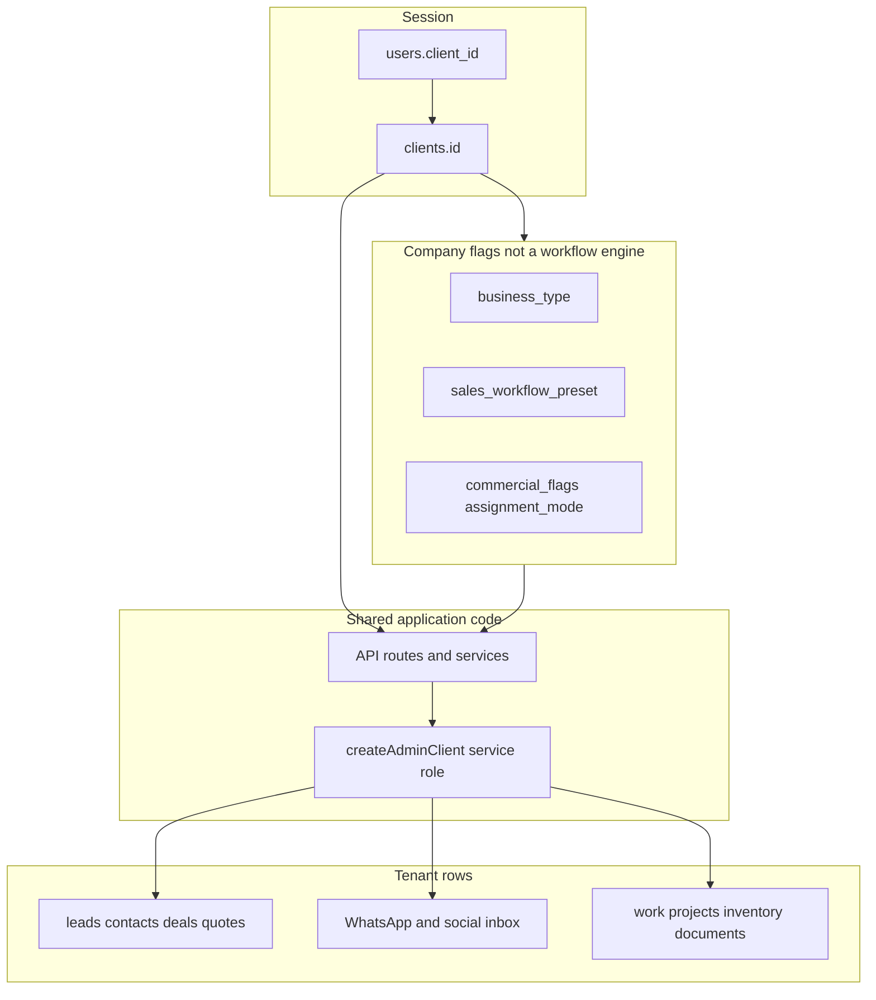

# SegmiQ Custom Workflow Architecture Audit

**Status:** Audit only. No application code, migrations, configuration, or customer data were changed.
**Date:** 9 October 2026
**Scope:** Repository evidence from frontend, API routes, services, and `supabase/migrations`. Live database policies were not queried. Where a migration comment and the SQL agree, that is treated as the intended database contract. Behaviour that exists only in a UI label or a table name is marked unverified or unused.

**Tenant vocabulary:** SegmiQ calls a customer company a `clients` row. The tenant key is `client_id`. There is no `company_id` column and no `company_members` table. In a few agent and attention types, `companyId` is a variable name for that same client id. No production company UUID was found driving workflow branches.

---

## 1. Executive Summary

SegmiQ is already one application with one database. A new trades or real-estate company can be created from data: agency invite, manual activation, accepted proposal, or Cloud signup. Users belong to one organisation through `users.client_id`. Leads, deals, quotations, inventory, WhatsApp, and real-estate records are stored per client.

That shared core is the right foundation. It is not yet a configurable workflow platform.

Commercial stages are a global database check: `QUALIFIED`, `SCOPING`, `PROPOSAL_SENT`, `NEGOTIATING`, `WON`, `LOST` (`supabase/migrations/088_deals_lead_to_deal_architecture.sql` lines 18–22). Login roles are three values: `SUPER_ADMIN`, `CLIENT_MANAGER`, `SALESPERSON` (`types/index.ts` line 1). Industry differences are flags and presentation overlays:

- `clients.business_type` is `trades` or `real_estate` (`supabase/migrations/082_real_estate_vertical.sql` lines 6–8).
- `clients.sales_workflow_preset` is `GENERAL_TRADES` or `SOLAR_INSTALLATION` (`supabase/migrations/20261006023000_solar_sales_workflow.sql` lines 6–17).

Solar site visits, assessments, and work-project handoff are real, and they are hardcoded. Real-estate listings, viewings, offers, and a derived pipeline are real, and they still persist the shared lead status enum. Tyre retail exists as a demo dataset, not a product template. There is no pipeline-stage table, no custom-field schema, no department model, and no module registry.

Company Brain, Instant Forms, quotation approval policies, assignment mode, and commercial flags are genuine per-company configuration. They configure copy, questions, thresholds, and a closed flag list. They do not let an administrator define a new sales process.

**Verdict: PARTIALLY.** SegmiQ can evolve into one shared platform with tenant configuration. It cannot safely host different company workflows today. The smallest safe move is a tenant pipeline definition read by the existing deal board, stage writer, and company reports, plus fail-closed tenant filters on the tables that definition will touch. A rewrite is not justified.

---

## 2. Overall Architectural Verdict: PARTIALLY

| Question | Answer |
|---|---|
| One shared codebase today? | Yes |
| Isolated customer data by organisation id? | Yes, in application queries. Database RLS is not the backstop |
| Different workflows per company, safely, today? | No |
| Different features without core code changes? | Only inside existing flags, forms, quote policies, and agent playbooks |
| Incremental evolution practical? | Yes |
| Major redesign required? | No |

The existing solar and real-estate work is evidence of both the opportunity and the risk. Each vertical was added as shared tables plus TypeScript overlays. That kept one product. Repeating it for construction, tyres, and the next ten customers will hardcode more stage lists into reports, agents, inbox filters, and crons.

---

## 3. Current Architecture Diagram

```text
                    NextAuth session
                    users.client_id  --->  clients.id
                           |
         +-----------------+------------------+
         |                 |                  |
    CLIENT_MANAGER    SALESPERSON       SUPER_ADMIN
    (+ also_sells)                      (platform; client data
                                         via support grant or
                                         impersonation)
                           |
              createAdminClient()  (service role, RLS bypass)
                           |
     +---------------------+----------------------+
     |          |          |          |           |
   leads     deals    quotations   WhatsApp    inventory
   contacts  events   approvals    social      documents
                           |
         business_type: trades | real_estate
         sales_workflow_preset: GENERAL_TRADES | SOLAR_INSTALLATION
                           |
         +-----------------+------------------+
         |                                    |
   Trades board                         Real-estate board
   DealStage enum                       derived RE stages
         |                                    |
   optional SOLAR overlay               listings, viewings,
   derived display stages               offers, compliance
   sales_site_visits                    (viewings have no client_id)
   work_projects
```



Onboarding does not fork the codebase. `activateClientFromProgress` writes company fields, sets `business_type` to `real_estate` or `trades`, inserts the owner, and seeds form schemas (`lib/onboarding/finish.ts`). A new industry, plan id, or workflow preset still requires a `CHECK` constraint and TypeScript switches.

---

## 4. Multi-Tenant Isolation Assessment

### What is implemented

- Organisation record: `public.clients` (`supabase/migrations/001_initial_schema.sql` lines 6–25).
- Membership: one `public.users` row, `client_id` nullable for platform admins (lines 27–37). Email is globally unique (line 31). Documented as deferred membership in `docs/SEGMIQ_TENANT_SECURITY.md` lines 7–13.
- Session propagation: `lib/auth.ts` copies `user.client_id` into the JWT `clientId`. Middleware uses that id for billing and home redirects. It does not select a tenant from the request.
- Fail-closed helper: `requireTenantClientId` throws when a customer role has no client (`lib/auth/tenant-context.ts` lines 31–36). Tenant users cannot substitute a body or query client id (lines 38–53). This helper is not the default on every route. It is imported by weekly team report access. Other routes use their own `canAccessClient` / `.eq("client_id")` checks.
- Deal reads: `canReadDeal` loads the deal, then requires the session `clientId` to match for managers and salespeople (`lib/sales/deals/permissions.ts` lines 54–76). Salespeople are further limited to `owner_id`.
- Impersonation replaces the session client with the target user’s `client_id` and keeps `realUserId`.
- Most CRM tables `ENABLE ROW LEVEL SECURITY` and add no `CREATE POLICY`. Migration comments state the intended effect: anon and authenticated are denied; the service role bypasses RLS (`001_initial_schema.sql` lines 138–147; `048_customer_hub_contacts.sql` lines 25–26).

### Creation paths (all via service role)

| Path | Evidence | New company needs a code change? |
|---|---|---|
| Super-admin invite | `POST` `app/api/clients/route.ts` creates a pending shell and onboarding token | No, for trades or real estate |
| Manual activate | `app/api/clients/manual/route.ts` | No |
| Accepted proposal | `lib/proposals/provision.ts` | No. Comment: draft subscription does not gate access |
| Cloud signup | `app/api/cloud/signup/route.ts` creates an active client and a manager with no admin approval | No |

Wizard steps are company, account, branding, team, review. They do not choose a custom pipeline.

### RLS reality

Policies found in migrations are the exception. Examples that were read:

- `project_milestones` owner policy uses `auth.uid()` (`supabase/migrations/023_project_milestones.sql`). CRM login is NextAuth against `public.users`, not Supabase Auth. This policy does not protect the CRM session path.
- `USING (true)` / `WITH CHECK (true)` for the `authenticated` role on `marketing_submissions`, `blog_posts`, and status tables. These are platform content tables, not CRM tenants. They are still an open Data API if a Supabase user key can reach them. Live grants were not queried.
- `salesperson_saved_items` has `client_id` and no `ENABLE ROW LEVEL SECURITY` in `059_salesperson_saved_items.sql`.
- `viewings` has RLS enabled and no `client_id` column (`082_real_estate_vertical.sql` lines 107–128). Isolation depends on `listings.client_id` and `contacts.client_id`. A query that selects viewings by id without joining the parent can cross tenants if the caller already knows the id.
- `call_logs` and `notifications` are keyed by lead or user, not `client_id`, in the original schema. Later notification changes were not fully re-audited.

`docs/SEGMIQ_TENANT_SECURITY.md` lines 93–104 matches the code: application filters are the control; full RLS is future work. `docs/SEGMIQ_SECURITY_ARCHITECTURE.md` is aligned on the service-role boundary. Its impersonation description (MFA, step-up, short TTL) does not match `lib/auth/impersonation.ts`, where the TTL is 8 hours and the default reason is platform debugging. `isSessionElevated` exists and is not referenced from `app/` routes. MFA for super admin is environment-gated.

### Feature enablement

| Mechanism | What it actually does | Status |
|---|---|---|
| `clients.plan` `starter \| professional \| business` | Stored on the client. Mapped to billing plans in `mapClientPlanToCrmPlan` (`lib/billing/plans.ts` lines 96–106) | Partial |
| `CRM_PLAN_FEATURES` | Marketing headline strings (lines 38–58). Not checked before opening WhatsApp, AI, inventory, or real estate | Display only |
| Salesperson seats | Enforced on invite from `subscriptions.plan` against `CRM_PLAN_SEATS` (`app/api/clients/[clientId]/users/route.ts` lines 165–188). Starter 5, growth 15, scale unlimited. If the subscription plan is not a CRM plan key, the limit is skipped | Implemented for seats |
| Suspended subscription | Middleware redirects managers and salespeople | Implemented |
| `commercial_flags` | Closed key list (`lib/commercial/flags.ts` lines 1–21). `documents.enabled` is checked on document pages. `inventory.enabled` and `inventory.externalSync` are declared; inventory routes do not read them | Partial |
| `assignment_mode` | `direct`, `pool`, `round_robin` (`049_clients_assignment_mode.sql` lines 8–10) | Implemented |
| `business_type` / `sales_workflow_preset` | Gates navigation and solar/real-estate modules | Implemented, two values each |

### Strengths

- One organisation per user is simple and matches the security doc.
- Tenant override from request parameters is rejected for customer roles.
- Super-admin client-data permissions are excluded from the baseline role and added only through a support-access grant (`lib/auth/rbac/role-profiles.ts` lines 153–167).
- CRM tables are closed to the anon key by RLS-without-policies, and the service key stays server-side (`lib/supabase/admin.ts`).

### Weaknesses and risks

1. A missing `.eq("client_id", …)` on a service-role query is a cross-tenant read or write. RLS will not stop it. `updateDealStage` updates by deal id after the route has called `canModifyDeal` (`lib/sales/deals/close-deal.ts` lines 57–79; `app/api/deals/[dealId]/route.ts` lines 231–236). The service itself is not tenant-scoped. Any future caller that skips the permission helper crosses tenants.
2. `requireTenantClientId` is not universal. Coverage of every query was not verified.
3. Child tables without `client_id` (`viewings`, and historically `call_logs`) require every query to join a tenant parent.
4. Global unique email blocks the same person in two companies. That matches today’s model and blocks multi-org later.
5. Public Cloud signup creates a live tenant without approval.
6. Plan feature bullets are not entitlements. A Starter company is not technically prevented from code paths that the catalogue describes as higher tier, except seats and suspension.

---

## 5. Hardcoded Workflow Findings

### Stage lists that actually exist

| List | Where it lives | Persisted? | Editable per company? |
|---|---|---|---|
| Deal stages `QUALIFIED`, `SCOPING`, `PROPOSAL_SENT`, `NEGOTIATING`, `WON`, `LOST` | SQL check `088` lines 18–22; `DealStage` in `types/index.ts`; `DEAL_ACTIVE_STAGES` in `lib/sales/deals/display.ts` lines 8–26; `DEAL_STAGES` in `lib/company-brain/constants.ts` lines 38–45 | Yes, `deals.stage` | No |
| Lead statuses `NEW`, `CONTACTED`, `QUALIFIED`, `CONVERTED_TO_DEAL`, `NOT_QUALIFIED`, plus legacy commercial statuses | `088` lines 95–108 | Yes, `leads.status` | No |
| Legacy lead kanban `NEW`, `CONTACTED`, `NEGOTIATING`, `PROPOSAL_SENT` | `lib/sales/pipeline-display.ts` | Display of old lead board | No |
| Solar display stages, ten names from `NEW_LEAD` through `LOST` | `lib/sales/solar-workflow/types.ts` lines 12–23 | Derived. Only `SITE_VISIT_REQUIRED` and `NEGOTIATING` are stored (`20261006023000` lines 19–30) | No. Settings lists them read-only |
| Real-estate stages `new_inquiry` through `transaction_in_progress` | `lib/real-estate/pipeline.ts` lines 8–56 | Derived from lead status plus viewing and offer facts (`resolveRePipelineStage` lines 118–138). Manual stages map back to `LeadStatus` (lines 166–173) | No |
| Work-project statuses `PLANNING` through `CANCELLED` | `lib/work-projects/constants.ts` lines 1–13, and a SQL check on installation | Yes for projects | No |
| Lead lanes `call_now`, `follow_ups`, `recover`, `nurture` | `lib/lead-lanes.ts` | Scoring lanes, not pipeline stages | No |

There is no `pipeline_stages` table in migrations.

`clients.industry` is free text (`001` line 9). It is shown to the agent and to settings. It does not select stages.

`docs/SEGMIQ_LEAD_TO_DEAL_ARCHITECTURE.md` lines 121–123 explicitly defers “configurable discovery templates / industry field builders”.

### Transitions

- General trades: `updateDealStage` rejects Won/Lost and unknown values and accepts any other active stage (`lib/sales/deals/close-deal.ts` lines 41–55). Skipping Scoping is allowed. The kanban writes that stage through `PATCH /api/deals/[id]`.
- The same function writes `lead_events` and calls `hookDealStageChanged` (lines 85–103). The hook emits `deal.stage_changed` and schedules learning (`lib/agent/proactive/hooks.ts` lines 189–210). It does not create a task.
- Solar: one step at a time, and several stages are derived from visits and quotes (`lib/sales/solar-workflow/transitions.ts` lines 17–64). Dragging a card does not invent a visit or a quote (file header). A non-solar preset is rejected (lines 57–64).
- Real estate: stage is computed. Only a subset can be set by hand (`RE_MANUAL_STAGES`, `lib/real-estate/pipeline.ts` lines 150–158).

### Qualification, quotes, tasks, reporting, AI, WhatsApp

| Concern | Finding | Evidence |
|---|---|---|
| Lead qualification | One checklist for every company: requirement, service/project, interest, next step | `getDealReadiness` in `lib/sales/deals/readiness.ts` lines 71–104 |
| Solar WhatsApp qualification | Fixed fields: service, location, timeline, budget | `lib/sales/solar-workflow/engagement.ts` |
| Inbox score bands | Global Hot ≥ 70, Warm ≥ 45 | `lib/inbox/scoring.ts` |
| Per-form qualification | Facebook Instant Form rules can vary by form | `lib/facebook/qualification.ts`, migration `080` |
| Quotations | Shared lifecycle draft → sent → viewed → accepted. Accepted quote does not auto-win a deal | `lib/quotations/lifecycle.ts` |
| Quote layout | One builtin layout, Residential Premium Solar, cloned per client | `lib/quotations/layouts/registry.ts` lines 10–40; `ensureBuiltinQuoteTemplates` |
| Tasks vs stage moves | Follow-up dates are separate fields. Stage update does not write `follow_up_date`. `hasStandaloneTasks` is false in sales task data | `close-deal.ts` lines 70–76; `lib/sales/tasks/sales-tasks-data.ts` |
| Reporting | Company reports iterate `DEAL_ACTIVE_STAGES`. Funnel labels are fixed. Salesperson reports still count legacy lead statuses. Solar reports count solar display stages separately | `lib/sales/company-reports/metrics.ts`; `lib/sales/solar-workflow/reporting.ts` |
| Inactivity | Hours keyed by fixed names: NEW, CONTACTED, QUALIFIED, SCOPING, NEGOTIATING, PROPOSAL_SENT | `lib/sales/intelligence/defaults.ts` lines 9–17. Comment says managers can override later; that override is not a per-company stage editor |
| AI | Manager tool description locks the four deal stages. Solar intents are regexes and no-op unless the preset is solar. Real estate has a separate agent under `lib/agent/real-estate/` | `lib/agent/manager/tools.ts`; `lib/agent/manager/intents.ts` |
| WhatsApp Lead Intelligence | Inbox deal filters match the four active deal stages exactly. Migration `033` stores free-text `intent_category` and fixed urgency/budget enums. It does not define stages | `lib/inbox/queue-filters.ts` |

`lib/whatsapp/qualification.ts` and `lib/whatsapp/qualification-questions.ts` are empty in this tree while inbox assist still imports a default question list. Treat the live WhatsApp question catalogue as unverified.

### What breaks if configurable workflows are switched on immediately

A new stage name fails closed in the database, which is the correct failure. The damage is the shared consumers that assume the global list:

- `deals.stage` check and `leads_status_check`
- `isDealActiveStage`, kanban columns, company pipeline tabs
- Company report metrics, funnel, and stage donut colours
- `DEFAULT_STAGE_INACTIVITY_HOURS`, focus “late stage”, proactive `deal.inactive`
- Agent `update_deal_stage` and manager prompts
- Inbox `deal_*` filters
- Solar `transitionSolarSalesStage` and `getSolarSalesStage`, which assume one ordered list
- Real-estate `leadStatusForReStage`, which can only write the shared lead enum
- Company Brain `company_brain_stage_guidance.stage`, which is free text in SQL but seeded and labelled from `DEAL_STAGES`

Won/Lost semantics, quote acceptance, and “one active deal per lead” (`088` lines 75–78) would also become ambiguous if every company invented its own meaning of closed.

Creating a third industry the way solar was added means a new constant file, a new CHECK or flag, transition rules, a board component, and edits to every shared consumer. It cannot be done as data.

No company-id `if` branches were found in workflow code. The hardcoded part is the global enum, not a hidden customer special case. That is better than per-client forks, and it still blocks the goal.

---

## 6. Custom Field and Form Capabilities

| Capability | Status | Evidence |
|---|---|---|
| Company-specific CRM custom fields | Missing | Settings doc defers them (`docs/SEGMIQ_COMPANY_SETTINGS.md` lines 111 and 138). No `custom_fields` table. `leads.form_data jsonb` (`001` line 50) and `deals.metadata jsonb` (`088` line 56) are bags without a schema |
| Different lead capture forms | Partial | One `form_schemas` row per client, unique on `client_id`, `fields jsonb` (`001` lines 86–89). Many Instant Forms per client, `questions jsonb` (`054_instant_forms.sql` lines 5–21). Question types are a closed set in `types/index.ts` |
| Custom qualification questions | Partial | Company Brain playbooks store `fields` and `deal_readiness_rules` jsonb (`099_company_brain.sql` lines 112–126). They are matched for the agent (`lib/company-brain/context-service.ts`). `getDealReadiness` does not read them |
| Custom pipeline stages | Hardcoded | Section 5 |
| Quotation templates | Partial | Builtin solar template cloned per client. Presentation overrides exist. A new PDF layout needs a renderer under `lib/quotations/layouts/` |
| Custom approvals | Partial | `quotation_approval_policies` is per client. Trigger types are a fixed check: discount, margin, quotation value, payment terms, price override, special product, custom item (`094_quotation_enterprise_phase2.sql` lines 153–182). Evaluated by `lib/quotations/evaluate-send.ts` |
| Branch-specific processes | Missing as an org model | `inventory_locations.location_type` includes `BRANCH` (`20260826140000_commercial_foundation.sql` lines 224–230). That is a stock location. Users are not assigned to branches. `docs/SEGMIQ_COMPANY_DASHBOARD.md` states there is no branch or region org model |
| Departments | Missing | No department table or checks in application code |
| Different customer data requirements | Partial | Instant Form questions, one landing form schema, Brain playbook fields. Solar assessment shape is `schema_version: 1` and `emptySolarAssessment()` (`lib/sales/solar-workflow/service.ts` lines 907–918) |
| Configurable dashboards | Hardcoded | Company dashboard widgets are fixed. No `dashboard_config` table |

**What a new customer request costs today**

| Request | Schema | Backend | Frontend |
|---|---|---|---|
| Another Instant Form question of an existing type | No | No | No, if the form builder already exposes the type |
| Another approval threshold of an existing trigger | No | No | No |
| Rename a pipeline stage | Yes, CHECK constraint | Yes, every consumer | Yes |
| A solar assessment section the schema does not have | Yes, if stored as columns | Yes | Yes |
| A branch sales report | Yes, org model | Yes | Yes |
| A new login role | Yes, `users_role_check` | Yes, permission profiles | Yes |

### Data-modelling recommendation

Use three layers. Do not pick only JSONB or only EAV.

1. **Typed core fields** stay columns: name, phone, email, owner, value, currency, Won/Lost, quote status, stock quantity. These are what reports, RLS, and indexes need. `deals.value_status` and the lead/deal split are already this layer and should stay.
2. **Relational custom-field definitions plus typed values** for company fields that must be filtered, required, or shown on a form: `field_definitions(client_id, entity, key, type, required)` and `field_values(entity_id, definition_id, value_text/value_number/value_date)`. One definition table, not a new column per customer. Indexes exist only for fields a company marks filterable.
3. **JSONB** for low-volume, display-only payloads that already exist: Instant Form answers inside `form_data`, quote presentation, assessment drafts. JSONB is appropriate for a document. It is a poor primary store for “show me every tyre lead whose tyre size is 265” once that question is a business filter.

Tradeoff: relational custom fields cost a join and a migration of the definition tables once. JSONB-only costs unpredictable query plans and no required/type guarantees. Adding nullable columns per industry costs a migration and a UI change for every customer and pollutes trades rows with real-estate columns (the pattern already started on `contacts` buyer fields and `leads.deal_side` in `082` lines 75–100).

New vertical columns on shared tables should stop. Optional modules should own their tables (`listings`, `sales_site_visits` already do this) and reference `leads` / `deals` / `contacts`.

---

## 7. Roles and Permissions Assessment

Login roles cannot vary by company.

```1:1:types/index.ts
export type UserRole = "SUPER_ADMIN" | "CLIENT_MANAGER" | "SALESPERSON";
```

The database check matches (`083_super_admin_agency_managed.sql`). `normalizeUserRole` maps legacy `AGENCY_ADMIN` to `SUPER_ADMIN` and rejects anything else (`lib/auth/roles.ts`). `also_sells` adds personal sales writes for managers (`lib/auth/rbac/role-profiles.ts` lines 137–150). Unknown permission strings deny (`lib/auth/rbac/resolve.ts`).

`docs/SEGMIQ_PERMISSIONS.md` and `docs/SEGMIQ_COMPANY_TEAM.md` match the code: team tabs are Salesperson and Client Manager. Custom roles and a permission matrix are omitted (`docs/SEGMIQ_COMPANY_SETTINGS.md` lines 94 and 133). Dynamic RBAC is listed as future work (`docs/SEGMIQ_TENANT_SECURITY.md` lines 107–110).

| Layer | Enforcement |
|---|---|
| UI | UX only. Comment in `lib/auth/rbac/permissions.ts`: frontend checks are not the security boundary |
| API | `requirePermission` derives grants from the session role and `alsoSells`, not the request body |
| Service | `canReadDeal` / `canModifyDeal`, lead equivalents, solar assignee check against the same `client_id` (`service.ts` lines 880–886) |
| Database | `users_role_check`. RLS enabled, policies mostly absent |
| RLS | Not the live control while `createAdminClient()` is the data plane |

**What already looks like roles and is not login RBAC**

- Work-project member labels: `OWNER`, `PROJECT_MANAGER`, `ENGINEER`, `TECHNICIAN`, `INSTALLER`, `FIELD_AGENT`, `MEMBER` (`lib/work-projects/constants.ts` lines 61–84). These are assignment tags on a project. They do not pass `permissionsForOrgRole`.
- Real-estate “agent” is a `SALESPERSON` with a terminology label (`lib/terminology.ts`).
- Quotation `approver_role` is a string on a policy row, not a new login role.

A solar company cannot have a technical-visitor login that is allowed to submit site findings and forbidden to send quotes, unless that person is a salesperson (too much access) or the findings screen re-checks assignment (solar visits do re-check assignee or manager in `loadSalesSiteVisit`). A tyre branch manager cannot be scoped to one branch. A real-estate administrator cannot exist as a role distinct from Client Manager.

### Secure direction for configurable roles

Keep three platform classes: platform operator, organisation admin, organisation member. Below that, store per-company permission grants, not new global enums.

- `company_roles(client_id, key, name)` seeded from Sales and Manager.
- `company_role_permissions(role_id, permission)` where permission is one of the existing `P.*` catalogue. Unknown strings stay denied.
- `team_memberships(client_id, user_id, role_id, scope_type, scope_id)` so a branch or department is a scope, not a role name.
- Work-project member roles stay assignment labels and should map to a permission such as “submit field assessment”, not to `users.role`.
- RLS or a mandatory repository filter must include `client_id` and, when scope is set, the scope id. UI hiding is not sufficient.
- Do not let a company invent permissions. They assign from the catalogue. That prevents one tenant from granting itself platform or cross-tenant rights.

---

## 8. Automation Readiness

### What exists

| Foundation | Status | Evidence |
|---|---|---|
| Domain events | Implemented as a fixed catalogue and an outbox | `DOMAIN_EVENT_TYPES` in `lib/agent/proactive/registry.ts` lines 18–55. `emitDomainEvent` stores an idempotency fingerprint |
| Stage-change handler | Partial | `hookDealStageChanged` emits `deal.stage_changed` and schedules learning. It does not run customer rules |
| Trigger actions | Hardcoded defaults | `NO_ACTION`, `SCHEDULE_EVALUATION`, `CREATE_TASK`, `NOTIFY` (`registry.ts` line 11). `TRIGGER_REGISTRY` is source code |
| Notifications | Named functions | `lib/notifications.ts`: new lead, follow-up, deal won, uncontacted lead, SLA, WhatsApp inbound, bulk reassignment |
| Assignment rules | Three modes | `direct`, `pool`, `round_robin` |
| Approvals | Quote policies only | Section 6 |
| Scheduled jobs | Vercel crons | `vercel.json`: daily scoring and reminders; follow-ups every minute; weekly digest; WhatsApp campaigns; health. No `supabase/functions` directory. `instrumentation.ts` only checks production secrets |
| Webhooks | Provider-specific | Meta signature verification; website lead API key. No inbound webhook registry |
| Retry | Partial | Facebook and website ingest often return HTTP 200 after logging, which avoids provider retries. Groq retries are LLM rate limits. There is no shared integration retry queue |
| Idempotency | Partial | Deal creation uses a unique partial index and a `create_deal_from_lead` RPC (`docs/SEGMIQ_LEAD_TO_DEAL_ARCHITECTURE.md` lines 117–119). Domain events take an idempotency key. Solar visit insert does not show an idempotency key |

Follow-up cron queries leads by date and status. The explored reminder query is not scoped by a single `client_id` first; it scans due follow-ups across tenants and then notifies. That is an operational coupling: one slow tenant affects the minute cron for everyone.

### Solar site-visit example, traced

The requested sequence was: on Site Visit Required, create a task, assign a technician, notify the salesperson, record activity, accept findings, notify on completion, then allow a quote.

What the code does:

1. A manager sets `sales_workflow_preset` to `SOLAR_INSTALLATION` (`lib/sales/solar-workflow/service.ts` around the preset writer). It is not applied automatically (migration comment, lines 16–17).
2. Display stage is derived (`getSolarSalesStage`). Manual intents are only `SITE_VISIT_REQUIRED` and `NEGOTIATING`.
3. `transitionSolarSalesStage` allows `QUALIFIED` → `require_visit`, then schedule, complete, `create_quote`, `send_quote` (`transitions.ts` lines 33–50 and 53–80).
4. `scheduleSalesSiteVisit` (lines 855–920) checks the stage, requires a deal, checks the assignee’s `client_id`, inserts `sales_site_visits` and a draft assessment. It stores `notify_customer`. It does not call `notify*`, `emitDomainEvent`, or create a task.
5. Findings use the fixed solar assessment object. Completed assessments are immutable in the solar migration.
6. Quotation is a separate transition into the shared quote and approval path. `hookQuotationSent` is the automation hook, not the visit.
7. After Won, `planWonProjectHandoff` (`lib/sales/solar-workflow/handoff.ts` lines 23–44) can create a work project only when the deal stage is `WON`, and it starts delivery in `PLANNING` unless payment and equipment are both ready.

So assignment and findings exist. Task creation, salesperson notification, and an activity event for the visit are missing. The sequence cannot be configured. It can be extended in solar-specific code, which is the pattern to stop repeating.

### Could this be configuration later?

Yes, after pipelines are data. A safe engine is a closed action catalogue, not customer SQL or JavaScript.

Example rule, stored as rows:

- Trigger: stage entered `site_visit_required` on pipeline version N.
- Actions: create task from a template, assign by role key `technical_visit` inside the company, notify the deal owner, write an activity event.
- Guard: quote action enabled only when assessment status is `COMPLETED`.

Requirements before that engine is trustworthy:

- Tenant id on every job, copied from the entity, never from the rule author at run time.
- Versioned definitions. Running jobs keep the version they started with.
- Idempotency key: `client + rule + entity + trigger occurrence`.
- Permission check at execution using the acting system principal limited to that client and the action’s permission.
- Loop guard: a rule cannot emit the event that triggers itself; depth limit and a per-entity rate limit.
- Audit row for every fire, skip, and failure.
- Retry with backoff for notification and integration actions. Business writes that already committed must not be repeated.
- No arbitrary code. Actions are `create_task`, `assign_user`, `notify`, `require_field`, `create_record` of a registered module type.

Company Brain playbooks are the closest existing configuration, and they feed the agent prompt. They are not this engine. Promoting them into CRM stage automation without versioning and idempotency would double-apply tasks.

---

## 9. Industry Template Readiness

Solar and real estate are flags inside one app, not separate products.

- Navigation swaps menus: `getCompanyNavigation` returns real-estate or trades navigation (`lib/sales/navigation/company-nav-config.ts`).
- Real-estate pages call `redirectIfNotRealEstate` (`lib/real-estate/gating.ts`). Listing create rejects other business types.
- Solar board is empty unless the preset is solar (`lib/sales/solar-workflow/service.ts`). Real-estate companies do not get the solar workflow settings section (`lib/settings/company-settings-config.ts`).
- Work projects are a trades nav item and are removed from real-estate sales nav.
- Demo tyres live under `lib/demo/industries/tyres/rossi/`. That is seed data. There is no apply-template function.

| Template piece | Can it be applied as data today? |
|---|---|
| Pipeline stages | No |
| Custom fields | No |
| Forms | Partially. Instant Form templates are TypeScript (`lib/instant-form-templates/`). A company can edit questions inside the closed type set |
| Roles | No. Terminology can relabel Salesperson as Agent |
| Default tasks | No task templates tied to stages |
| Automations | No |
| Agent playbooks | Yes, per client, for the assistant only |
| Module on/off | Only `business_type`, solar preset, and a few commercial flags |

An industry template should be a versioned data pack that is copied onto a new `clients` row at onboarding:

- pipeline stages and allowed transitions
- field definitions and form layouts
- role presets (labels plus permission sets)
- default task templates
- automation rules from the closed catalogue
- enabled module keys: `solar.site_visits`, `real_estate.listings`, `inventory`, `quotations`

After copy, the company owns its rows. Editing the solar template later must not rewrite existing customers. That is how one customer’s process stays isolated without a second codebase.

Do not build a module registry, a rules engine, and a template marketplace in one step. The registry can start as a TypeScript map of optional modules that already exist (`listings`, `sales_site_visits`, `work_projects`, `inventory`, `documents`) plus a `client_modules(client_id, module_key, enabled)` row. Templates come after pipelines and fields have somewhere to land.

---

## 10. Integration Extensibility

Zoho Books does not appear anywhere in TypeScript, SQL, or docs. There is no generic connector registry. `lib/integrations/` contains `token-vault.ts` only. Connected Apps is a fixed list: WhatsApp, Facebook Lead Ads, and social channels.

| Extension point | Reusable for a future Zoho connector? | Limit |
|---|---|---|
| WhatsApp `providerForType` (`lib/whatsapp/providers/resolver.ts` lines 6–24) | Pattern only | Providers are a closed TypeScript map: `META_CLOUD`, `TEMPORARY_WEB`, `META_COEXISTENCE` |
| `sealIntegrationToken` with AAD `integration:{kind}:{clientId}` (`lib/integrations/token-vault.ts` lines 20–26) | Yes, if `IntegrationTokenKind` grows | Kinds today are `fb_page`, `fb_user`, `meta_wa` only. Ciphertext still sits in existing client text columns |
| `InventoryProvider` (`lib/inventory/provider.ts` lines 30–39) | Closest adapter for stock sync | `syncProducts` / `syncInventory` are optional. External mode still reads SegmiQ balances (`lib/inventory/service.ts`). `inventory.externalSync` is unused by routes |
| Website `POST /api/external-leads/submit` | Inbound lead pattern | API key hash on the client, field map is purpose-built, listing mapping runs for real estate |
| Facebook webhook | Signature, client resolution, per-form qualification | Super-admin setup. Duplicate page/form rows are logged and the newest active row is used. Processing errors return 200 |
| Domain events | Outbound “something happened” bus | Catalogue is fixed. No subscriber registry per company |
| `inventory_settings.external_id` and location `external_id` | Mapping columns | No general field-mapping table |

A Zoho Books connector should be an optional module with:

- credentials sealed per `client_id`, same envelope and AAD pattern as Meta tokens
- a mapping table from SegmiQ quotation or invoice fields to Zoho fields, owned by that client
- outbound work queued from `quotation.accepted` or `deal.closed`, with retry and a dead-letter row
- inbound webhooks verified and resolved to one client, never “all clients”
- no Zoho branches inside `updateDealStage` or the quote renderer

The quote and deal core should emit events. The connector should subscribe. That split does not exist yet as a registration API, but `emitDomainEvent` is the right seam to grow.

---

## 11. Technical Debt and Security Risks

| Risk | Severity | Why it compounds with customisation |
|---|---|---|
| Service role is the data plane; RLS is not a tenant backstop | High | Every new config table and worker is another query that must remember `.eq("client_id")` |
| `viewings` and other children without `client_id` | High | Workflow actions that load “the viewing” by id can cross tenants |
| `updateDealStage` trusts the caller for tenant scope | Medium | Automation workers will call it without a user session |
| Global stage CHECK plus solar and real-estate overlays | High | Reports, AI, and inbox already disagree (legacy lead statuses vs deal stages vs solar display vs RE display) |
| Vertical columns on shared `leads` and `contacts` | Medium | The next industry adds more nullable columns every trades row carries |
| Three global roles | High | Industry staffing becomes permission hacks or extra booleans like `also_sells` |
| Plan features are copy, flags are a closed list | Medium | “Turn this module off for this company” is a code change |
| Crons scan all active clients and all due leads | Medium | Automation load scales with the busiest tenant and with tenant count together |
| Company Brain stage guidance looks configurable and does not drive the pipeline | Medium | Admins will believe they changed the process when they changed agent copy |
| Empty WhatsApp qualification modules | Low, unverified | Callers may be importing defaults from a hollow file |
| Impersonation TTL and step-up differ from the architecture doc | Medium | Support access into a more configurable tenant needs a short, audited session |
| Global unique email | Low now | Blocks consultants who work across companies later |

Positive debt to keep: lead versus deal split, quote lifecycle independent of stage, work projects as a separate module, site visits as their own table, token sealing with tenant AAD, and the permission catalogue that denies unknown keys.

---

## 12. 20 / 100 / 1,000 Tenant Growth Risks

No load test was run. No row counts or latency numbers are claimed.

Tenant count, data volume, concurrent users, automation, and integrations fail differently.

| Scale | Tenant-count risk | Data and concurrency risk | Automation and integration risk | Maintenance risk |
|---|---|---|---|---|
| 20 companies | Low if every company is trades or one of the two presets. Onboarding already works | Current `client_id` indexes on leads, deals, listings, inventory balances, and work projects are the right shape. Not measured under load | Daily cron already loops every active client and then every open lead (`lib/lead-scoring.ts`). Fine at small N only if lead volume stays modest | Each extra solar-style preset is a regression matrix of 20 × pipelines. Two presets are already enough to fork reports |
| 100 companies | Still fine as rows. Not fine as code branches. Unique email and one-client-per-user start to hurt groups and franchises | Minute follow-up scan without a tenant partition becomes a hot query. Stage and status indexes are global (`idx_deals_stage` on `stage` alone, `088` line 73) and will not isolate one company | WhatsApp template sync loops companies every few minutes. A slow external API stalls the shared cron. Facebook “return 200 on error” hides failures instead of retrying per tenant | QA cannot manually click every industry overlay. Need fixture tenants: general, solar, real estate, and one custom pipeline |
| 1,000 companies | Configuration must be data. A CHECK constraint migration per industry will not ship safely | Service-role-only isolation is the wrong boundary at this size. One missing filter is a large incident. Connection pooling and cron fan-out need per-tenant budgets. Unmeasured | Per-tenant automation rate limits, queues, and dead letters become mandatory. A rules engine without loop protection is an outage | One shared release must stay backward compatible with thousands of pipeline versions. Templates must be copied, not referenced live |

Deployment safety today is “one schema for everyone”, which is good. The danger is a migration that tightens or expands `deals.stage` while solar code and real-estate code assume different meanings. Backward compatibility means: existing clients keep a seeded pipeline that matches today’s six stages, and new stages are rows, not a new global check.

---

## 13. Recommended Target Architecture

The proposed three-layer model fits this codebase. The core modules already exist as shared tables and services. The configuration layer exists only in fragments. The template layer does not exist.

```text
SEGMIQ CORE (shared code, shared tables)
  Leads and contacts
  Deals, with a stable lifecycle: open, won, lost
  WhatsApp and social inbox
  Tasks and follow-ups
  Quotations
  Products and inventory
  Work projects
  Reporting and AI that read configuration

TENANT CONFIGURATION (rows keyed by client_id)
  Company settings and enabled modules
  Pipeline definition and stage labels
  Custom field definitions
  Form layouts
  Role grants and team scopes
  Automation rules (closed action catalogue)
  Integration credentials and mappings

INDUSTRY TEMPLATES (versioned packs, copied at onboarding)
  Solar, construction, real estate, retail, general services
```

### How core code should see a stage

Keep platform semantics small and stable:

- Lead: new, working, qualified, disqualified, converted.
- Deal: open or closed (won / lost), plus an ordered stage id that belongs to that company’s pipeline.
- Reports that mean “won revenue” use `WON`, not a display name.
- Reports that mean “by stage” group by the company’s stage rows.
- Solar “site visit completed” remains a fact on `sales_site_visits`, and a pipeline stage can point at that fact. Do not store the same truth only as a label.

Today solar already derives display from facts (`types.ts` lines 3–6). That idea is right. The missing piece is that the general board, reports, and agent still speak the global enum, so solar companies have two pipelines on screen.

### What not to do

- Do not fork repositories per client.
- Do not add `if (clientId === "…")`.
- Do not add `business_type = 'tyres'` as the third vertical if the only differences are stages, fields, and branches.
- Do not let tenants submit SQL or JavaScript.
- Do not rewrite leads, deals, quotes, or WhatsApp.

Optional modules that are genuinely different objects should stay modules: listings, site visits, installations, stock locations. A retail company enables inventory and a short pipeline. A solar company enables site visits and work projects. A real-estate company enables listings. All three use the same lead, deal, quote, and permission services.

---

## 14. Phased Migration Roadmap

Estimates are relative engineering size for this codebase, not calendar commitments. Dependencies are ordered. Do not start Phase 3 before Phase 1 is in production for existing tenants.

### Phase 0 — Tenant isolation blockers

**Changes**

- Make a single repository helper the only way services load tenant rows: require `clientId`, always filter, 404 on mismatch.
- Add `client_id` to child tables that workflows will automate, starting with `viewings`. Backfill from `listings.client_id`.
- Add `client_id` filters inside `updateDealStage`, `closeDealWon`, and `closeDealLost`, not only in the route.
- Enable RLS on `salesperson_saved_items`. Add real tenant policies only on tables that are still accessed with the service role if those policies would never run; the useful work is a second path for user-scoped reads, or database checks in security definer functions. Do not add policies that look strict while every request uses the service role and ignores them. Prefer: Postgres functions or explicit tests that fail when a query omits `client_id`.
- Align impersonation with a short TTL and an audit reason. Fix the doc or the code so they describe the same control.

**Existing files:** `lib/supabase/admin.ts`, `lib/auth/tenant-context.ts`, `lib/sales/deals/close-deal.ts`, `lib/sales/deals/permissions.ts`, `supabase/migrations/082_real_estate_vertical.sql`, `059_salesperson_saved_items.sql`, `docs/SEGMIQ_TENANT_SECURITY.md`.

**Schema:** `viewings.client_id` not null after backfill; indexes `(client_id, scheduled_at)`. No change to stage enums.

**Compatibility:** Existing rows gain a redundant tenant key. Application behaviour stays the same.

**Risks:** Backfill must fail closed if a viewing’s listing and contact disagree on client. Do not guess.

**Security:** Cross-tenant tests for deals, viewings, site visits, and quotations. A salesperson from client A must receive 404 for client B ids.

**Tests:** Two fixture clients. Query helpers reject missing client id. Permission tests already in `lib/sales/deals/permissions.ts` extended to the write path.

**Complexity:** Medium.

**Depends on:** Nothing.

### Phase 1 — Company pipelines without breaking current companies

**Changes**

- Add `pipelines`, `pipeline_stages`, `pipeline_transitions` scoped by `client_id`.
- Seed every existing client with one pipeline whose stages match `DEAL_ACTIVE_STAGES` plus Won and Lost, in today’s order, with stable keys `QUALIFIED`, `SCOPING`, `PROPOSAL_SENT`, `NEGOTIATING`, `WON`, `LOST`.
- `deals.stage` keeps those keys for seeded companies. New stages use a stage id foreign key. During migration, accept either the legacy key or the stage id, and write both until consumers are moved.
- Point the trades kanban, `updateDealStage`, company pipeline metrics, and the stage donut at the company’s stages.
- Leave solar derivation and real-estate derivation in place, reading the same deals. Do not delete them in this phase.
- Company settings can rename and reorder stages. Adding or removing a stage is allowed only when no open deal uses it, or with an explicit move map.
- Won and Lost remain protected system stages.

**Existing files:** `lib/sales/deals/display.ts`, `lib/sales/deals/close-deal.ts`, `components/sales/pipeline/DealsBoard.tsx`, `lib/sales/company-pipeline-metrics.ts`, `lib/sales/company-reports/metrics.ts`, `lib/company-brain/constants.ts`.

**Schema:** new tables plus `deals.pipeline_stage_id` nullable. Do not drop the CHECK in the same release as the first read path. Drop it only after every writer uses the stage id and a constraint guarantees the stage belongs to the deal’s client.

**Compatibility:** Seeded pipelines reproduce today’s board. Solar and real-estate screens stay on their overlays until Phase 2.

**Risks:** Reports that count by stage name will split if keys change. Freeze keys; let labels change. Inactivity hours move to a column on the stage row, defaulting to `DEFAULT_STAGE_INACTIVITY_HOURS`.

**Security:** Stage rows are readable and writable only inside the client. A transition cannot target another client’s stage id.

**Tests:** Snapshot today’s board for a general-trades fixture. Second fixture with a renamed stage sees the new label and the same won/lost totals. Agent stage tool rejects unknown stage ids.

**Complexity:** High. This is the highest-leverage product change.

**Depends on:** Phase 0 write-path tenant filters.

### Phase 2 — Fields, forms, templates, team responsibilities

**Changes**

- Field definitions and values for lead, contact, deal, and quote (Section 6).
- Bind Instant Forms and the single `form_schemas` row to those definitions so answers land in typed values, not only `form_data`.
- Role grants from the existing permission catalogue. Optional scope: inventory location / branch.
- Branch is a first-class place only if a customer needs it: a `locations` or reuse of `inventory_locations` plus user scope. Do not invent departments until a customer process needs them. A department can be the same scope type later.
- Industry template applicator: copy pipeline, fields, forms, and role presets. First packs: General trades (today’s defaults), Solar (current solar stages as labels over facts), Real estate (current RE labels). Retail and construction can be packs once a real customer confirms the stages. Do not invent their processes in code.
- Map solar display stages onto the company pipeline where the stage is real (`SITE_VISIT_REQUIRED`) and keep fact-derived stages as computed when they mirror visits and quotes.
- Quote template selection stays per client. The solar PDF remains a module renderer, chosen by template key, not by industry `if`.

**Existing files:** `054_instant_forms.sql`, `001` `form_schemas`, `lib/quotations/layouts/`, `lib/auth/rbac/role-profiles.ts`, `lib/real-estate/pipeline.ts`, `lib/sales/solar-workflow/`, `lib/work-projects/constants.ts`, `inventory_locations`.

**Schema:** `field_definitions`, `field_values`, `company_roles`, `company_role_permissions`, `client_modules`, `industry_templates` and `template_versions`. Template rows are global and immutable; client rows are copies.

**Compatibility:** Empty definitions mean “core fields only”, which is today’s behaviour. Existing Instant Form JSON keeps rendering until each form is migrated.

**Risks:** Dual-writing `form_data` and field values during migration. Reporting must declare which fields are filterable so JSONB queries do not become the default.

**Security:** Field values inherit the parent entity’s client and permission. A custom field cannot store credentials. Role editor cannot grant `platform.*` or another client’s data.

**Tests:** Solar fixture and retail fixture submit different forms into the same lead API. A branch-scoped user cannot read another branch’s deals once scope exists. Real-estate fixture still resolves viewings.

**Complexity:** High.

**Depends on:** Phase 1 pipelines. Role scope depends on Phase 0.

### Phase 3 — Controlled automation and integrations

**Changes**

- Rule table: trigger from `DOMAIN_EVENT_TYPES` plus “stage entered”, actions from a fixed list.
- Implement the solar visit side effects as rules on the solar template: create task, assign by role, notify owner, record activity. Keep assessment submission in the site-visit module.
- Worker: per-client queue, idempotency, retries, loop guard, audit.
- Connector interface beside the token vault: credentials, mappings, outbound jobs, inbound webhook verification. First new connector only when a paying customer needs it (Zoho Books is a candidate, not a built-in).
- Inventory external sync implements the existing `InventoryProvider` methods instead of a parallel stock system.

**Existing files:** `lib/agent/proactive/registry.ts`, `events.ts`, `hooks.ts`, `lib/notifications.ts`, `lib/integrations/token-vault.ts`, `lib/inventory/provider.ts`, `lib/whatsapp/providers/resolver.ts`, `scheduleSalesSiteVisit`.

**Schema:** `automation_rules`, `automation_runs`, `integration_connections`, `integration_mappings`, `integration_jobs`.

**Compatibility:** Companies with zero rules behave as today. Solar companies can keep hardcoded transitions until the equivalent rules are verified, then the hardcoded side effects are deleted. Do not run both.

**Risks:** Double notifications if hooks and rules both fire. Feature-flag the rule worker per client. Idempotency keys must include rule version.

**Security:** Worker principal is tenant-bound. Webhook resolves to exactly one connection. Secrets never returned to the browser. Rules cannot call arbitrary URLs unless the connector allow-list contains that host.

**Tests:** Property tests for idempotency and loop depth. Solar scenario in Section 15 runs from rules. A failed Zoho call retries without creating a second invoice. Tenant A’s rule cannot load tenant B’s deal.

**Complexity:** Very high if the engine is general. Medium if the first release only supports stage-entered → task, assign, notify, and require-field.

**Depends on:** Phase 1 stages and Phase 2 roles (assignment targets).

### Phase 4 — Admin configuration UI, only where the data model is already safe

**Changes**

- Pipeline editor, field editor, form editor, role editor, rule editor, template picker on onboarding.
- Skip visual workflow canvases, plugin sandboxes, and customer-written expressions until Phase 3 has run in production without cross-tenant incidents.

**Complexity:** Medium for forms that edit Phase 1–3 rows. Very high for a general workflow designer.

**Depends on:** The phase that owns the rows being edited.

---

## 15. Customer Scenario Assessments

### Scenario A — Solar installation company

Needs: lead qualification, technical site visits, quotations, follow-ups, installation tracking.

| | Assessment |
|---|---|
| Works today | Opt-in solar preset, derived stages, site-visit scheduling with same-company assignee, fixed assessment form, shared quotations and approval policies, follow-up dates, work projects and installation tables, handoff after Won (`handoff.ts`). WhatsApp, Company Brain, and lead-to-deal all apply |
| Configuration, no code | Preset flag, assignment mode, quote approval thresholds, Instant Form questions, Brain playbooks, catalogue items, quote presentation overrides |
| Needs code today | A technician login that is not a salesperson; automatic task and notify on visit; assessment questions outside schema version 1; a stage name that is not in `SOLAR_SALES_STAGES`; installation steps outside `WORK_PROJECT_STATUSES` |
| Reuse | Leads, deals, quotes, `sales_site_visits`, work projects, notifications, domain events, permission catalogue |
| Shared-architecture risk | Company reports and the general deal board still speak `QUALIFIED` / `SCOPING` / `PROPOSAL_SENT`. Solar metrics are a second implementation. A solar-only change to shared deal code breaks trades and real estate |
| With the target architecture | Solar template copies stages and rules. Site visit and installation stay modules. Reports group by the company’s stages and by Won. Technicians receive a company role whose permissions are “complete assessment” and “read assigned visit” |

### Scenario B — Tyre company, four branches, two salespeople per branch

Needs: branch sales, stock enquiries, quotations, walk-in customers, pipelines, branch reporting.

| | Assessment |
|---|---|
| Works today | Shared lead and deal pipeline, manual lead source for walk-ins, quotations, inventory locations typed `BRANCH`, stock balances per location, round-robin or direct assignment across the whole company |
| Configuration, no code | Location rows named as branches, products, quote templates cloned from the solar builtin (the layout is solar-branded, so the PDF is wrong for tyres even though the quote engine is generic), approval thresholds |
| Needs code today | Binding a user to a branch; branch-only pipeline or branch filters on reports; a stock-enquiry stage; walk-in as a process rather than a source tag; a non-solar quote layout if the PDF must not say roof and kWp |
| Reuse | Leads, deals, quotes, `inventory_locations`, `InventoryProvider`, company reports once they accept a branch dimension |
| Shared-architecture risk | Turning on solar or real-estate flags to “get more stages” would show the wrong modules. Adding `business_type = 'tyres'` would copy the real-estate pattern and special-case navigation again. Seat cap: growth allows 15 salespeople (`CRM_PLAN_SEATS`); eight salespeople fit on growth if the subscription plan is `growth`. Managers do not consume salesperson seats |
| With the target architecture | Retail template: short pipeline (enquiry, quote, won/lost), inventory module on, quote renderer key `standard`. Four branch scopes, two users each. Reports filter by scope. No tyre module unless stock behaviour cannot live in inventory |

### Scenario C — Real-estate agency, 20 agents, one manager

Needs: agents, viewings, property enquiries, negotiations, contracts.

| | Assessment |
|---|---|
| Works today | `business_type = real_estate`, terminology, nav, listings, viewings, offers, compliance cases, transactions, derived pipeline, website lead API, agent as salesperson. Twenty agents fit on CRM plan `scale` (unlimited seats). They do not fit on `starter` (5) or `growth` (15) |
| Configuration, no code | Business type, listing content, website API key, assignment mode, Brain copy |
| Needs code today | A stage that is not in `RE_ACTIVE_STAGES`; an administrator role that is not Client Manager; per-agent permission differences; contract types beyond the transaction milestones already shipped |
| Reuse | Almost the whole real-estate module. Do not rebuild it as generic stages only. Viewings and offers are real entities |
| Shared-architecture risk | `viewings` has no `client_id`. Manual RE stages write shared `leads.status`, so a new RE label can collide with trades meaning. Pipeline UI is a separate board from deals, so “one pipeline” is not true for this vertical yet |
| With the target architecture | Real-estate template enables the listings module and a pipeline whose manual stages map to lead status only at the platform boundary (qualified, won, lost). Viewings gain `client_id`. Agents are salespeople with a company role. Contract tracking stays the transaction module, not a renamed deal stage |

---

## 16. Prioritized Recommendations

1. **Phase 0 tenant filters on write paths and `client_id` on `viewings`.** Do this before any workflow designer. Evidence: service-role bypass; `updateDealStage` filters by deal id only; viewings lack `client_id`.
2. **Phase 1 seeded, per-company pipelines**, with Won/Lost reserved. Point the trades board and company reports at them. Do not add a third `sales_workflow_preset`.
3. **Stop adding industry columns to `leads` and `contacts`.** New facts go in module tables.
4. **Treat Company Brain, Instant Forms, and quote policies as the configuration style to copy**, and stop treating them as if they already were the CRM workflow.
5. **Company roles as grants over the existing permission catalogue**, with optional branch scope when the tyre scenario is real.
6. **Encode the solar visit side effects as the first automation rules** after pipelines exist, then delete the duplicate hardcoded notifications if any are added before that.
7. **Integration adapter** only for the next real connector, using the token vault and domain events.
8. **Template copy-on-onboarding** for general trades, solar, and real estate once pipelines and modules are data.

---

## 17. What We Should Not Build Yet

- A second codebase or a per-tenant deploy.
- A general JavaScript or SQL rules sandbox.
- A visual BPMN designer.
- A plugin marketplace.
- Zoho Books inside quote or deal services “while we are here”.
- Custom dashboards before stage and field definitions exist. Dashboards should bind to those definitions later.
- Dynamic permissions that allow a tenant to create new permission strings.
- Full RLS theatre on every table while all access uses the service role. Add RLS where a non-service role will actually connect, and add query guards either way.
- Rewriting WhatsApp, quotations, or the lead/deal split.
- More `business_type` values for one-off customers.
- Departments, approval chains for every entity, and multi-org users, until a signed customer requires them. Branch scope is the exception if the tyre company is real.

---

## 18. Final CTO Recommendation

Keep one product. Do not redesign the CRM core. The lead, deal, quotation, inbox, and inventory boundaries are sound. The debt is the growing set of hardcoded overlays on top of one stage enum and three roles.

Authorize Phase 0 and Phase 1 only. Phase 0 makes tenant writes fail closed. Phase 1 lets a company rename and, carefully, extend stages while every current customer keeps today’s pipeline by seed. Solar and real estate keep working as they do now until their labels are moved onto that pipeline in Phase 2.

Judge success by this test: a new company with a different stage list is onboarded by inserting configuration rows, the trades board and company report render those rows, Won revenue still means `WON`, and a test proves that company cannot read another company’s stages or deals. Until that test exists, industry work should be paused rather than copied into another `SOLAR_SALES_STAGES`-style file.

### Answers to the ten questions

1. **Can the current architecture support different workflows per company safely?** No. Two presets and a real-estate overlay share one deal-stage check. Custom stages are rejected by the database and by `isDealActiveStage`.
2. **Can different customers use different features without modifying the core codebase?** Only inside existing switches: business type, solar preset, commercial flags, assignment mode, Instant Forms, quote approval policies, and Company Brain. A new module or stage still requires code.
3. **Are we creating long-term technical debt?** Yes. Solar and real estate already fork display, transitions, reports, and agents while persisting the same enums. The next industry copied the same way will be more expensive than a pipeline table.
4. **What breaks if we allow custom workflows immediately?** The stage CHECK, lead status CHECK, kanban, company reports, inactivity and focus logic, manager agent tools, inbox deal filters, solar transitions, and real-estate mapping back to `LeadStatus`. Won/Lost and “one active deal per lead” become ambiguous.
5. **Refactor or major redesign?** Refactor in phases. The core entities stay. Add a configuration layer and move consumers onto it. A rewrite would throw away tenant-scoped CRM, quotes, WhatsApp, and real-estate modules that already work.
6. **Highest-priority architectural improvement?** Per-company pipeline definitions seeded from today’s stages, read by the deal board, stage writer, and company reports, with Won and Lost reserved as platform outcomes. Immediately before that, tenant filters on the stage write path.
7. **How do we prevent one customer’s customization from affecting another?** Configuration rows keyed by `client_id`, templates copied rather than live-linked, no client-id conditionals in shared code, stage ids that cannot point across tenants, and tests with two fixtures on every workflow change. RLS remains a backstop only where the database role is not service-role-for-everything; the mandatory filter is the control that matches this codebase.
8. **How do we create industry workflows without duplicating modules?** A template copies stages, fields, forms, role presets, and rules onto the company. Listings, site visits, inventory, and work projects stay optional modules behind `client_modules`. Shared services render whatever pipeline the company owns.
9. **How can administrators configure workflows without developers?** After Phase 1, they rename, reorder, and add stages in settings. After Phase 2, they edit fields, forms, and role grants. After Phase 3, they attach closed actions to stage entry. They never paste code. Developers still add a new module when the business needs a new kind of object.
10. **What should SegmiQ build first?** Seeded company pipelines and tenant-safe stage writes. Not a rules engine, not Zoho, not a new vertical flag.

---

## Capability matrix

| Capability | Status | Evidence | Risk if ignored | Next action |
|---|---|---|---|---|
| One org per user via `client_id` | Implemented | `001_initial_schema.sql` lines 27–37; `docs/SEGMIQ_TENANT_SECURITY.md` lines 7–13 | Multi-org needs a new membership model later | Keep. Do not add `company_id` |
| Service-role data access | Implemented | `lib/supabase/admin.ts`; migration comments in `001` lines 146–147 | Missing filter is a cross-tenant bug | Phase 0 mandatory filter helper |
| Tenant RLS policies | Missing on CRM tables | RLS enabled, policies rare; milestone policy uses `auth.uid()` in `023` | False sense of isolation | Query guards first; RLS where a non-service role connects |
| `viewings` tenant key | Missing | `082` lines 107–128 | Cross-tenant read by id | Add and backfill `client_id` |
| Company onboarding without code | Implemented for two verticals | `app/api/clients/route.ts`, `lib/onboarding/finish.ts`, Cloud signup | New vertical still needs a CHECK | Templates in Phase 2, not new enums |
| Plan feature entitlements | Partial | Seats in users route lines 165–188; `CRM_PLAN_FEATURES` is copy | Catalogue promises features the code does not gate | Gate modules only when `client_modules` exists |
| Deal pipeline stages | Hardcoded | `088` lines 18–22; `lib/sales/deals/display.ts` | Every new industry edits shared code | Phase 1 pipeline tables, seeded |
| Solar workflow | Implemented and hardcoded | `20261006023000`; `lib/sales/solar-workflow/types.ts`; `transitions.ts`; `scheduleSalesSiteVisit` lines 855–920 | Second source of truth vs deal stages | Keep module; move labels onto pipeline in Phase 2 |
| Real-estate pipeline | Implemented as a derived overlay | `lib/real-estate/pipeline.ts` lines 1–173 | Manual stages write the shared lead enum | Keep listings module; map only platform outcomes |
| Tyre / retail workflow | Demo only | `lib/demo/industries/tyres/rossi/` | Pressure to add `business_type` | Retail template after Phase 1, using inventory locations |
| Add, remove, rename stages | Missing | Settings lists solar stages; CHECK rejects unknown deal stages | Admins cannot match their process | Phase 1 editor for labels and safe add/remove |
| Stage transitions | Partial | Free among four deal stages; solar one-step; RE fact-derived | Configurable transitions would be ignored by these three writers | One transition service fed by pipeline rows |
| Lead qualification rules | Hardcoded, with Brain and Facebook exceptions | `readiness.ts` lines 71–104; Brain playbooks in `099` lines 112–126; Facebook rules | Playbooks change the agent and not Create Deal | Point readiness at field definitions in Phase 2 |
| Tasks independent of stages | Implemented | Stage update does not set follow-up; hook does not create a task | Solar visit never becomes a task | Phase 3 action `create_task` |
| Reporting on fixed names | Hardcoded | `lib/sales/company-reports/metrics.ts`; `defaults.ts` lines 9–17 | Custom stages vanish or crash reports | Reports group by stage rows; Won stays semantic |
| AI assumes shared stages | Hardcoded | Manager tools; solar intents; separate RE agent | Wrong next action for a custom pipeline | Agent reads stage guidance for the company’s pipeline |
| WhatsApp Lead Intelligence | Partial | Inbox filters use deal stages; `033` categories are free text | Filters hide custom stages | Filters use stage category open/won/lost plus company labels |
| Custom CRM fields | Missing | Settings doc lines 138; `form_data` / `metadata` jsonb only | Schema migrations per customer | Phase 2 definitions and typed values |
| Lead forms | Partial | `form_schemas` one per client; `instant_forms` many | Answers are unstructured | Bind questions to field definitions |
| Quote templates | Partial | Solar builtin in `lib/quotations/layouts/registry.ts` | Tyre and agency PDFs look like solar | Template key selects a renderer |
| Quote approvals | Partial | `094` lines 153–182 | Only quote triggers, fixed list | Keep. Do not generalize until Phase 3 |
| Branches | Partial, stock only | `inventory_locations.location_type` includes `BRANCH` | Tyre reporting and assignment are company-wide | User scope on location in Phase 2 |
| Departments | Missing | No schema | — | Do not build until required |
| Dashboards | Hardcoded | Company dashboard docs and fixed widgets | Custom stages have no widget | Defer until pipeline rows exist |
| Login roles | Hardcoded, three | `types/index.ts` line 1; `role-profiles.ts` | Cannot express technician vs salesperson | Phase 2 grants from `P.*` |
| Work-project member roles | Implemented as tags | `lib/work-projects/constants.ts` lines 61–84 | Mistaken for RBAC | Map tags to permissions, do not add `users.role` values |
| Domain events | Implemented, fixed catalogue | `lib/agent/proactive/registry.ts`; `hookDealStageChanged` | No per-company subscribers | Phase 3 rules subscribe to this bus |
| Solar visit automation | Partial | Insert visit and assessment; no task, notify, or event | The example process cannot be configured | First Phase 3 rule pack |
| Crons | Implemented, global scans | `vercel.json`; daily route; follow-up route | Noisy neighbour at 100+ tenants | Per-client budgets when automation ships |
| Module registry | Missing | Flags and two enums only | Nav conditionals keep growing | `client_modules` in Phase 2 |
| Industry templates | Missing | Demo seeds and TS stage lists | Copy-paste verticals | Copy-on-apply after pipelines exist |
| WhatsApp providers | Implemented adapter | `lib/whatsapp/providers/resolver.ts` | Closed map | Follow this pattern for new channels only |
| Token vault | Implemented for three Meta kinds | `lib/integrations/token-vault.ts` lines 20–26 | New secrets stored in ad hoc columns | Extend kinds, keep AAD |
| Inventory connector | Interface only | `lib/inventory/provider.ts`; external sync flag unused | Zoho-like stock sync has nowhere to run | Implement provider methods with the first connector |
| Zoho Books | Missing | No references | One-off integration inside quotes | Connector module on domain events |
| Generic webhooks | Missing | Facebook and website are bespoke | Every customer endpoint is a new route | Phase 3 connection plus allow-list |
| Company Brain | Implemented for the agent | `099_company_brain.sql`; `context-service.ts` | Admins think playbooks change the CRM | Label it agent guidance until Phase 2 binds readiness |

---

*This document is an architectural assessment of the repository at the time of writing. It is not an implementation plan that has been scheduled, and it does not authorize migrations.*
