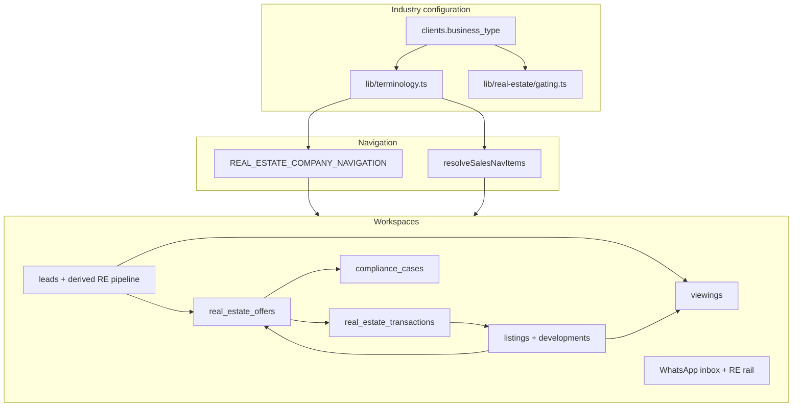
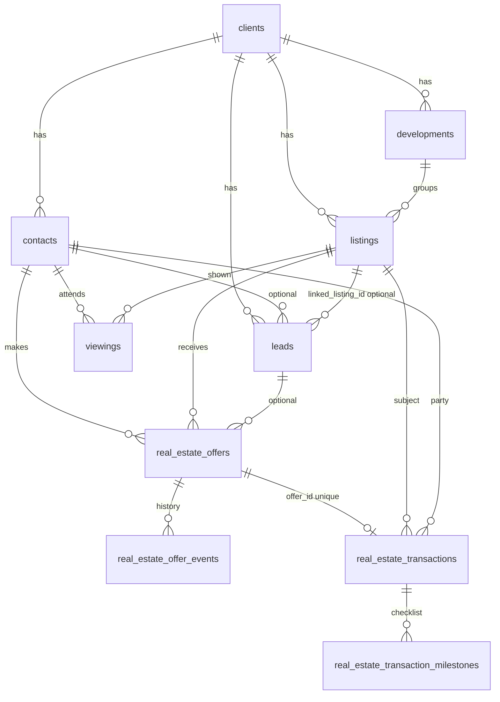

# SegmiQ Real Estate — Complete Existing Implementation Audit

**Phase 0: Discovery, architecture assessment, and gap analysis**

| | |
|---|---|
| Date | 16 October 2026 |
| Scope | Read-only audit of the Real Estate vertical as implemented in this repository |
| Method | Source inspection of application code, navigation, services, tests, and Supabase migrations |
| Not done | Live database queries, authenticated UI sessions, production data inspection |
| Application changes | None. This file is the only artifact created by the audit |

### Evidence labels used throughout

| Label | Meaning |
|---|---|
| **Verified in source code** | Behavior read from application or migration source in this repository |
| **Verified in database definitions** | Present in `supabase/migrations`. The live database was not queried |
| **Verified through UI** | Not used. No authorised test session was available |
| **Inferred from implementation** | Follows from the code, but was not executed |
| **Not verified** | Could not be confirmed from the repository |

A component, route, or table is not treated as a working feature unless the read and write path was traced.

---

## SECTION 1 — Executive Summary

Real Estate is a real product vertical, not a terminology skin. An organisation becomes a Real Estate workspace when `clients.business_type` is `real_estate`. That flag switches company and salesperson navigation, renames leads to inquiries and salespeople to agents, and unlocks listings, viewings, offers, compliance, transactions, marketing attribution, and a Real Estate WhatsApp agent.

The implementation is a **buyer-and-tenant sales layer on top of the shared CRM**, plus an **agency listing register** and a **post-offer transaction checklist**. It is mature enough to record a listing, match a contact’s budget and area, schedule a viewing, record an offer with a history, open a compliance case, and track sale or rental milestones through to completion.

It is **not** an agency operating system with three separate operational domains. Property acquisition, property owners, inspections, and mandates are not first-class records. Buyer requirements live as a single set of columns on `contacts`. One lead still has one `linked_listing_id`. Commission is two percentage fields on a transaction, not an allocation ledger. There are no branches.

### Maturity

| Area | Maturity | Evidence |
|---|---|---|
| Industry gating and navigation | Substantial | `lib/terminology.ts`, `lib/sales/navigation/company-nav-config.ts`, `lib/sales/navigation/sales-nav-config.ts` |
| Listing register and approval | Substantial | `listings` table, `lib/real-estate/listings.ts`, listings API |
| Buyer matching | Basic and usable | `lib/real-estate/helpers.ts` `contactMatchesListing` |
| Viewings | Substantial | `viewings` table and viewing service |
| Offers and negotiation history | Substantial | `real_estate_offers` + `real_estate_offer_events` |
| Transactions and after-sales | Substantial as a checklist | `real_estate_transactions` and milestone tables |
| Compliance (customer due diligence) | Substantial for offers | `compliance_cases` and document requirements |
| Property acquisition | Thin | Sell-side is a lead `deal_side`, not its own pipeline |
| Owners, mandates, inspections | Columns or milestone labels only | No owner, mandate, or inspection tables |
| Commissions | Partial | Percent and amount columns; no ledger, dispute, or payment evidence |
| Branches and handover | Absent | No branch model; assignment is the generic lead owner |

### Most important limitations

1. **One lead is still the unit of work.** Buyers, sellers, landlords, and tenants share one derived pipeline. A person with several properties, or a buyer negotiating on several homes, cannot be represented cleanly.
2. **A listing is not a property, and it has no owner.** Mandate type and expiry sit on the listing. There is no owner profile and no acquisition record that exists before an approved listing.
3. **Completing one transaction marks the whole listing sold or let, and marks the linked lead won.** A fallen-through or cancelled transaction does not restore the listing. Rejecting an offer does not mark the lead lost, which is correct, but the listing status machine is still listing-global.
4. **Tenant isolation for Real Estate tables is application-layer only.** Migrations enable row level security and this repository contains **no** `CREATE POLICY` statements. APIs use the service-role admin client after a session check.
5. **The proposed navigation does not match the current sidebar.** Today’s information architecture is Overview, Sales, Marketing, Properties, Team, Compliance, Operations, and System.

### Verification boundary

Runtime behavior was **not** confirmed in a browser or against a live database. Status “Implemented but not runtime-verified” means the read/write path exists in source and, where noted, in unit tests. It does not mean the feature was exercised with real records.

---

## SECTION 2 — Current Real Estate Architecture

### How the industry is defined

**Verified in source code** and **verified in database definitions.**

- `clients.business_type` is `text NOT NULL DEFAULT 'trades'` with a check of `trades` or `real_estate`.  
  `supabase/migrations/082_real_estate_vertical.sql` lines 6–18.
- `isRealEstate()` is a strict equality check: `businessType === "real_estate"`.  
  `lib/terminology.ts` lines 65–70.
- Presentation copy is swapped in `getTerminology()`: Lead → Inquiry, Salesperson → Agent, Project → Property, Site Visit → Viewing. Database column names are not renamed.  
  `lib/terminology.ts` lines 45–57.
- An organisation is created as Real Estate during onboarding when the wizard’s company type is `real_estate` (`lib/onboarding/finish.ts`, business type written onto the client). It can also be patched later through the client API (`app/api/clients/[clientId]/route.ts`). There is no separate module flag.

Trades companies that hit a Real Estate-only route are redirected by `redirectIfNotRealEstate()` in `lib/real-estate/gating.ts` lines 4–13.

### Route map

Company routes live under `app/client`. Salesperson routes live under `app/sales`. Both call the same `/api/clients/[clientId]/…` APIs.

### Primary code areas

| Layer | Location | Role |
|---|---|---|
| Terminology and gating | `lib/terminology.ts`, `lib/real-estate/gating.ts` | Vertical switch and route guard |
| Company navigation | `lib/sales/navigation/company-nav-config.ts` `REAL_ESTATE_COMPANY_NAVIGATION` (line 378) | Manager sidebar |
| Sales navigation | `lib/sales/navigation/sales-nav-config.ts` `resolveSalesNavItems` (line 266) | Agent sidebar |
| Pipeline presentation | `lib/real-estate/pipeline.ts` | Derived stages over shared `leads.status` |
| Domain services | `lib/real-estate/*.ts` | Listings, viewings, offers, transactions, compliance, marketing, matching, reports |
| Agent tools | `lib/agent/real-estate/*` | WhatsApp agent search, match, requirements, viewings |
| UI | `components/real-estate/*` | Company and agent workspaces |
| Schema | Six migrations listed in Section 6 | Tables and columns |
| Tests | `tests/real-estate-*.test.ts`, `tests/re-agent-*.test.ts` | Unit and source-contract tests, not end-to-end |

### API surface verified in source

| API | Purpose |
|---|---|
| `app/api/clients/[clientId]/listings/route.ts` and `[listingId]` | List, create, update listings; matching on create |
| `…/listings/[listingId]/send-match/route.ts` | Notify a matched contact |
| `…/listings/[listingId]/marketing/route.ts` | Listing marketing |
| `…/viewings/route.ts` | List, schedule, complete, feedback |
| `…/offers/route.ts` and `[offerId]` | Offer lifecycle |
| `…/transactions/route.ts` and `[transactionId]` | Transaction and milestone mutations |
| `…/developments` | Development CRUD |
| `…/leads/[leadId]/real-estate/route.ts` | Inquiry workspace read and stage/requirements patch |
| `…/compliance` | Cases, documents, settings |
| Complaints, testimonials, after-sales, operations-report | Feedback and reports |
| `app/api/agent/real-estate/manager-dashboard/route.ts` | Manager agent overnight summary |
| `app/api/cron/viewing-reminders/route.ts` | Viewing reminder job |

Authorization pattern, verified in `app/api/clients/[clientId]/listings/route.ts` lines 23–39 and 93–117:

1. `requireClientAccessFromRequest` or `getServerSession` plus `canAccessClient`.
2. Role checks such as `canSubmitListings` / `canApproveListings`.
3. `createAdminClient()` (service role) with `.eq("client_id", params.clientId)`.
4. `business_type !== "real_estate"` returns 403 on create.

### What is shared with other industries

Leads, contacts, users, WhatsApp conversations, tasks (`follow_up_date` and call logs), documents, calendar, team, settings, billing, social inbox, goals, won/lost, and the sales copilot are shared. Real Estate branches are usually `if (isRealEstate)` inside those pages. Quotations, products, inventory, packages, and solar work projects are omitted from Real Estate navigation. Work projects are blocked for Real Estate in the work-projects service. Those shared modules remain in the codebase for trades and solar.

---

## SECTION 3 — Current Sidebar and Navigation

### Company / manager sidebar

**Verified in source code:** `REAL_ESTATE_COMPANY_NAVIGATION` in `lib/sales/navigation/company-nav-config.ts` lines 378–614. Section order is lines 152–161. Role visibility is not per-item inside this array. Access is the company shell (manager), not a per-link permission map. Salespeople use the separate sales navigation.

Mobile: items with `mobileSlot: "primary"` are Overview, Inquiries, Pipeline, Viewings, and WhatsApp. Everything else is `more`.

| Section | Item | Route | Shared? | Functional? |
|---|---|---|---|---|
| Overview | Overview | `/client/dashboard` | Shared dashboard with RE widgets | Yes, source-traced |
| Sales | Inquiries | `/client/leads` | Shared leads, RE labels | Yes |
| Sales | Pipeline | `/client/leads/pipeline` | Shared route, RE board when Real Estate | Yes, derived stages |
| Sales | Offers | `/client/offers` | Real Estate only (gated) | Yes |
| Sales | Transactions | `/client/transactions` | Real Estate only (gated) | Yes |
| Sales | Viewings | `/client/viewings` | Real Estate only (gated) | Yes |
| Sales | WhatsApp | `/client/inbox` | Shared inbox + RE intelligence rail | Yes |
| Sales | Social Inbox | `/client/social-inbox` | Shared | Yes, not RE-specific |
| Marketing | Marketing | `/client/marketing` | Shared route; RE workspace when Real Estate | Partial |
| Marketing | Lead Sources | `/client/marketing/sources` | Real Estate gated | Yes |
| Marketing | Website Leads | `/client/marketing/website-leads` | Real Estate gated | Yes |
| Properties | Listings | `/client/listings` | Real Estate gated | Yes |
| Properties | Developments | `/client/developments` | Real Estate gated | Yes |
| Team | Agents | `/client/team` | Shared team, label remap | Yes |
| Team | Agent Performance | `/client/agents/performance` | Real Estate gated | Yes, read aggregates |
| Compliance | Compliance Cases | `/client/compliance` | Real Estate gated | Yes |
| Compliance | Reviews | `/client/compliance/reviews` | Same compliance page, `under_review` tab | Yes |
| Operations | Documents | `/client/documents` | Shared document module | Yes, not listing-mandate verification |
| Operations | Calendar | `/client/calendar` | Shared | Partial for viewings |
| Operations | Reports | `/client/reports` | Shared route; RE operations report when Real Estate | Partial |
| Operations | Feedback | `/client/feedback` | Real Estate gated | Yes |
| Operations | Customers | `/client/customers` | Shared contacts | Partial |
| System | Settings | `/client/settings` | Shared | Yes |
| System | Billing | `/client/billing` | Shared SaaS billing | Yes, not agency commission |

### Salesperson sidebar

**Verified in source code:** `resolveSalesNavItems` in `lib/sales/navigation/sales-nav-config.ts` lines 266–316.

When `business_type` is `real_estate`:

- Quotations are removed.
- Projects and My work are removed.
- Leads is relabelled **Inquiries**.
- Listings (`/sales/listings`), Offers (`/sales/offers`), and Transactions (`/sales/transactions`) are inserted after Inquiries.

Items that remain from the generic sales nav: Dashboard, My Pipeline, WhatsApp Sales Hub, Social Inbox, Calendar, Tasks, Command, Reports, Won & Lost, Goals, Toolbox.

There is **no** salesperson nav item for Viewings, Developments, Compliance, Marketing, Feedback, or Agent Performance. Viewings are reached from the inquiry workspace and from APIs. Company managers see Viewings; agents do not have a first-class Viewings destination.

Mobile primary slots on the generic sales nav are Dashboard, Pipeline, WhatsApp, and Tasks (`SALES_MOBILE_PRIMARY_IDS`, line 248). Listings, Offers, and Transactions are `mobileSlot: "more"`. **Inferred from implementation:** an agent’s property work sits in the More sheet.

### Hidden routes that remain valid

The company nav comment at lines 374–377 says products, inventory, packages, and quotations are omitted from navigation and **routes remain valid**. Also not in the Real Estate company nav, but present as app routes for other industries: `/client/agent`, `/client/command`, `/client/contacts`, marketing campaigns/journeys/templates. Whether a Real Estate user can open them by URL was **not verified** in the UI. Gating is per-page, not a global middleware deny list for every trades route.

### Navigation problems

| Problem | Evidence | Priority |
|---|---|---|
| Acquisition, owners, inspections, and mandates have no destinations | No routes or nav ids | P1 for the redesign, not a defect of a feature that was promised in code |
| Buyer sales and seller acquisition share Inquiries + Pipeline | `deal_side` is a badge, not a board split. `lib/sales/get-real-estate-pipeline-data.ts` loads all non-archived leads | P1 |
| Viewings are manager-nav only | Sales nav has no viewings item | P2 |
| Offers, transactions, and listings are buried in More on mobile | `mobileSlot: "more"` | P2 |
| Reviews duplicates Compliance | Same `CompanyCompliancePage`, different initial tab | P3 |
| Customers and Inquiries both represent people | Contacts vs leads | P2 |
| Billing is SaaS subscription billing, not commissions | Nav label “Billing” next to agency operations | P2, naming |

### Before and proposed-after comparison

This is a mapping for planning. Nothing was moved.

| Proposed destination | Closest current item | Fit |
|---|---|---|
| Dashboard | Overview `/client/dashboard` and sales Dashboard | Keep, retarget metrics |
| Sales Inbox | WhatsApp | Keep |
| My Activities | Sales Tasks; company has no equivalent first-class item | Partial; tasks are lead follow-ups |
| Property Opportunities | Not found. Closest: sell-side inquiries | Build |
| Property Owners | Not found. Closest: Customers | Build |
| Inspections | Not found. A transaction milestone is named inspection | Build |
| Mandates | Fields on the listing form, not a page | Restructure into its own record later |
| Buyers & Tenants | Inquiries + Customers + `deal_side` | Restructure |
| Property Matching | Inside inquiry workspace, listing detail, and agent tools | Improve, then give it a destination |
| Viewings | `/client/viewings` | Keep; add to agent nav |
| Offers & Deals | Offers + Transactions + Pipeline | Keep offers; separate deals from the generic lead |
| Property Listings | Listings | Keep |
| Transactions | Transactions | Keep |
| Team Management | Agents | Keep |
| Commissions | Transaction commission fields; not a page | Build |
| Reports & Analytics | Reports, Agent Performance, Feedback | Improve |
| Settings | Settings | Keep |

**Preserve:** Overview, WhatsApp, Inquiries (as a work queue, not as the property model), Pipeline presentation patterns, Viewings, Offers, Listings, Developments, Transactions, Compliance, Documents, Team, Settings.

**Rename candidates:** Inquiries (too broad once buyers and sellers split), Customers (people, not “customers” in an agency sense), Billing (do not use this label for commission), Reviews (it is a compliance filter).

**Merge candidates:** Reviews into Compliance; Feedback’s viewing comments with Viewings; Agent Performance with Reports once metrics are trustworthy.

**Move candidates:** Listings stay under properties. Offers and viewings move under buyer sales. Mandate fields move off the listing form once a mandate record exists. Marketing stays optional, not in the core three systems.

**Missing destinations:** Property Opportunities, Property Owners, Inspections, Mandates, Buyers & Tenants as profiles, Property Matching, Commissions, and an agent-visible Viewings item.

---

## SECTION 4 — Page-by-Page Feature Inventory

### Existing system inventory

Status key: **NR** = implemented but not runtime-verified. **Partial** = partially implemented. **Broken** = broken or inconsistent in source. **NF** = not found. **BE** = backend-only. **UD** = unable to determine.

| Feature | Route / location | Primary code | Database | Status | Evidence |
|---|---|---|---|---|---|
| Industry switch | Onboarding and client settings | `lib/terminology.ts`, `lib/onboarding/finish.ts` | `clients.business_type` | NR | Check constraint in `082` lines 6–8 |
| Company sidebar | Company shell | `company-nav-config.ts` 378–614 | None | NR | Static config |
| Agent sidebar | Sales shell | `sales-nav-config.ts` 266–316 | None | NR | Static config |
| Overview | `/client/dashboard` | `lib/sales/get-company-sales-dashboard-data.ts` ~1288–1437 | listings, viewings, leads, offers, transactions | Partial | Live counts plus generic CRM widgets. UI not opened |
| Agent dashboard | `/sales/dashboard` | `lib/sales/get-agent-real-estate-dashboard.ts` | leads, viewings, offers | Partial | Priority derived from `resolveRePipelineStage` |
| Inquiries | `/client/leads`, `/sales/leads` | Company/sales leads pages, `lib/real-estate/requirements.ts` | `leads`, `contacts` | NR | Shared CRM with RE labels and requirement summary |
| Pipeline | `/client/leads/pipeline`, `/sales/pipeline` | `components/real-estate/RealEstatePipelineBoard.tsx`, `lib/real-estate/pipeline.ts` | `leads` plus viewing/offer facts | Partial | Stages derived. No drag-and-drop in the board component |
| Inquiry workspace | Opened from pipeline | `components/real-estate/RealEstateInquiryWorkspace.tsx`, `app/api/clients/[clientId]/leads/[leadId]/real-estate/route.ts` | leads, contacts, listings, viewings, offers | NR | Manual stage patch limited to `RE_MANUAL_STAGES` |
| Offers | `/client/offers`, `/sales/offers` | `OffersWorkspace`, `lib/real-estate/offer-service.ts` | `real_estate_offers`, `real_estate_offer_events` | NR | Agents scoped to `buyer_agent_id` |
| Transactions | `/client/transactions`, `/sales/transactions` | `TransactionsWorkspace`, `lib/real-estate/transaction-service.ts` | `real_estate_transactions`, milestones, events | NR | Complete path updates listing and lead |
| Viewings | `/client/viewings` | `CompanyViewingsPage`, `lib/real-estate/viewing-service.ts` | `viewings` | NR | No agent nav item. Server-loaded list |
| Listings | `/client/listings`, `/sales/listings` | `ListingsManager`, listings API | `listings` | NR | Approval: agent pending, manager can approve (`listings.ts` 120–129) |
| Listing detail | `/client/listings/[listingId]` | `CompanyListingDetailPage` | listings, contacts | Partial | Buyer matches via `contactMatchesListing` |
| Developments | `/client/developments` | `DevelopmentsManager` | `developments` | NR | Name, units, location. Not a second inventory |
| Marketing | `/client/marketing` | `RealEstateMarketingWorkspace` | `re_marketing_campaigns`, attributions | Partial | RE branch of a shared route |
| Lead sources | `/client/marketing/sources` | `CompanyLeadSourcesPage`, `lib/real-estate/lead-sources.ts` | `marketing_attributions`, leads | NR | Server `getMarketingDashboard` |
| Website leads | `/client/marketing/website-leads` | `CompanyWebsiteLeadsPage`, `lib/real-estate/website-ingest.ts` | leads source WEBSITE, attributions | NR | API key hash on clients |
| Compliance | `/client/compliance` | `ComplianceWorkspace`, `lib/real-estate/compliance-service.ts` | `compliance_*` | NR | Offer-linked CDD, not title deeds |
| Reviews | `/client/compliance/reviews` | Same page, `initialTab="under_review"` | compliance cases | NR | Filter, not a separate system |
| Feedback | `/client/feedback` | `FeedbackWorkspace` | viewings.feedback, complaints, testimonials, after-sales | NR | Mixed purposes on one page |
| Agent performance | `/client/agents/performance` | `lib/real-estate/agent-supervision.ts` | leads by `assigned_to_id` | NR | Read-only aggregates |
| Reports | `/client/reports` | `RealEstateReportsWorkspace`, `lib/real-estate/operations-report.ts` | listings, leads, viewings, offers, transactions | Partial | Date windows are inconsistent. See Section 13 |
| Customers | `/client/customers` | Shared customers UI | `contacts` buyer columns | Partial | One requirement set per contact |
| Documents | `/client/documents` | Shared documents | documents tables | NR | Not mandate or title verification |
| Calendar | `/client/calendar`, `/sales/calendar` | Shared calendar | follow-ups / appointments | Partial | Viewings are a separate table |
| Tasks | `/sales/tasks` | `lib/sales/tasks/sales-tasks-data.ts` | lead `follow_up_date`, call logs | Partial | No listing/viewing/offer task type |
| WhatsApp | `/client/inbox`, `/sales/inbox` | `TeamInbox`, `RealEstateIntelligenceRail.tsx` | conversations, leads | Partial | RE context panel only when Real Estate |
| RE agent tools | WhatsApp agent runtime | `lib/agent/real-estate/policy.ts` 5–13 | listings, contacts, viewings | NR | Settings-gated. Confirm viewings off by default |
| Viewing reminders | Cron | `app/api/cron/viewing-reminders/route.ts` | `viewings.reminder_sent_at` | BE | Not UI-verified |
| After-sales | Feedback and transaction complete | `lib/real-estate/after-sales-service.ts` | `real_estate_after_sales` | NR | Seeded when a transaction completes |
| Team | `/client/team` | Shared team | `users` | NR | Display remap to Agent. Same roles |
| Settings / billing | `/client/settings`, `/client/billing` | Shared | clients, billing | NR | Billing is SegmiQ subscription |
| Won & Lost, Goals, Command, Toolbox, Social | Sales routes | Shared sales modules | leads, goals | Partial | Not Real Estate domain models |
| Mandate fields | Listing form | `ListingsManager.tsx` ~847–862 | `listings.mandate_type`, `mandate_expiry_date` | Partial | No mandate entity, renewal, or document |
| Commission fields | Transaction mutation | `lib/real-estate/transactions.ts` 160–178 | leads pct columns and transaction pct/amount | Partial | No commission page. Managers can view offer commission |
| Deal side | Inquiry badge | `terminology.ts` 73–84, `requirements.ts` 101–106 | `leads.deal_side` | Partial | Unset side is treated as demand |
| Property owners | — | — | — | NF | No table, no listing owner FK |
| Acquisition opportunities | — | — | — | NF | No table |
| Inspections | Transaction milestones | `transactions.ts` 94–96 | milestone keys only | NF as a record | Checklist labels, not an inspection |
| Branches | — | — | — | NF | No branch table |
| Separate buyer searches | — | Contact columns | `contacts.buyer_*` | NF | One preference row per contact |
| External listing publication | — | — | — | NF | Website ingest is inbound leads, not outbound listings |
| Title / ownership verification | — | Compliance docs are ID, address, source of funds | `compliance_document_requirements` | NF | Not a title-deed workflow |
| Staff handover workflow | Generic lead assignment | users `ON DELETE SET NULL` on listing/viewing agents | — | NF | No contribution-preserving handover |
| Commission ledger | — | — | — | NF | Amounts stored on the transaction row |
| Multi-role person | — | One `deal_side` per lead | — | NF | A person is not buyer and landlord at once except as separate leads |
| Listing status machine | Offer accept and transaction complete | `offers.ts` 331–335, `transaction-service.ts` 583–620 | `listings.status` | Broken | See Section 10 |
| RLS policies for RE tables | Migrations | `ENABLE ROW LEVEL SECURITY` only | All RE tables | UD live / verified absent in repo | No `CREATE POLICY` anywhere under `supabase/` |

### Counts from this inventory

| Status | Count |
|---|---|
| Implemented but not runtime-verified | 21 |
| Partially implemented | 14 |
| Backend-only | 1 (viewing reminder cron) |
| Broken or inconsistent | 1 (listing status machine; report date windows and null deal-side sit inside partial rows) |
| Not found | 10 |
| Unable to determine | 1 (live database RLS; policies are absent from this repository) |
| Implemented and verified through UI | 0 |
| UI-only / placeholder | 0 confirmed. No mock listing or offer dataset was found in these modules |

These 48 rows are the inventory above, not a count of every shared CRM control.

**Relevant page routes discovered: 45.**

- 24 company sidebar destinations.
- 15 salesperson sidebar destinations after the Real Estate rewrite (Dashboard, Pipeline, WhatsApp, Social, Inquiries, Listings, Offers, Transactions, Calendar, Tasks, Command, Reports, Won & Lost, Goals, Toolbox).
- 6 additional detail routes traced: `/client/listings/[listingId]`, `/client/deals/[dealId]`, `/sales/deals/[dealId]`, `/client/team/[memberId]`, `/client/reports/weekly`, `/client/reports/weekly/[reportId]`.

### Page notes (purpose, data, mobile, blast radius)

UI rendering was **not verified**. Mobile notes are from layout classes in source.

| Page | Current purpose | What the code does | Problems | Mobile (code) | Blast radius | Recommendation |
|---|---|---|---|---|---|---|
| Overview | Company home | RE stock, viewing, offer, and transaction counts mixed with generic CRM dashboard | Acquisition and commission received are not first-class | Shared dashboard responsive patterns. Not opened | Shared with trades if the RE branch is edited carelessly | Keep shell. Replace RE metric set later |
| Inquiries | Work queue | Shared leads list with RE requirement summary and deal side | Does not distinguish a search from a property deal | Shared leads layout | Shared page | Keep as a queue. Stop using it as the property model |
| Pipeline | Kanban of inquiries | Five columns grouping 13 derived stages. Opens inquiry workspace. Stage buttons for manual stages only | Drag does not exist. Seller and buyer cards share columns. Rejected offers fall through to earlier stages | Column chips scroll horizontally (`RealEstatePipelineBoard`) | RE board is gated by `isRealEstate` | Restructure into separate boards after the data model splits |
| Inquiry workspace | Work one lead | Requirements, linked listing, viewings, offers, compliance card, manual stage | One `linked_listing_id` | Panel layout. Not opened | RE-specific component | Keep as the agent work surface for a single interest, not for the whole person |
| Listings | Agency register | Filter, create, edit, approve, photos as URL strings | No owner. Mandate is two fields. Photos are not an upload pipeline in the create handler (`photos: body.photos ?? []`) | Table `min-w-[860px]` at `md`, cards below | RE-only route | Keep. Add owner and approval meaning before redesigning the form |
| Listing detail | One property | Detail plus buyer matches | Match is budget, beds, suburb substring | Stacked split | RE-only | Keep matching here |
| Viewings | Schedule and feedback | Server-rendered company list. Complete requires follow-up date under RE discipline | Agents have no nav item. `viewings` has no `client_id` | Table `min-w-[920px]` at `lg`, cards below | RE-only | Keep. Scope queries by client through listings, which the page already does |
| Offers | Negotiation | Create, counter, accept, reject, withdraw. Event history | Accept sets listing `under_offer` globally | Table `min-w-[860px]` at `md` | RE-only | Keep the offer entity |
| Transactions | Post-accept checklist | Milestones differ for sale vs rental. Deposit is an amount plus timestamp | Complete marks listing sold/let and lead WON. Fallen through does not restore the listing. Deposit is not a verified payment | Stacked panels under 768px | RE-only | Keep milestones. Change listing status rules before relying on them |
| Developments | Project shells | CRUD name, units, date, location | A development is not a property inventory of units | Table `min-w-[720px]` | RE-only | Keep if agencies sell developments. Do not pretend it is acquisitions |
| Compliance | Customer due diligence | Case, parties, document statuses | Document status is for CDD, not ownership | Panel layout | RE-only | Keep for buyer/seller KYC. Do not reuse as title verification without saying so |
| Marketing / sources / website leads | Where inquiries came from | Attribution and website API ingest | Does not publish listings out | Tables with card fallbacks | Marketing route is shared; RE components are branched | Keep attribution. Do not block trades marketing |
| Feedback | Comments and complaints | Viewing feedback, complaints, testimonials, after-sales | Four jobs on one page | Cards | RE-only | Split viewing feedback back to viewings when restructuring |
| Agent performance | Supervision | Counts per assignee | Not branch-aware. Not commission | Table plus cards | RE-only | Keep the query approach. Fix definitions before managers trust it |
| Reports | Operations | Stock, enquiry, viewing, offer, transaction, commission sums | Offers and transactions are not limited to the report date range (Section 13) | RE frame | RE branch of shared reports route | Fix the date window before adding metrics |
| Customers | People | Shared contact hub plus buyer columns | Cannot hold two searches or an owner role | Shared | Shared | Extend contacts with roles. Do not fork a second people table |
| WhatsApp | Conversations | Shared hub. RE rail shows deal side, requirements, matches, viewing route | Rail assumes one lead context. Unset deal side is treated as a buyer | Rail can go full screen on mobile (`mobileFullScreen` prop) | `TeamInbox` branches on business type | Keep the hub. Add explicit seller vs buyer actions |
| Tasks / calendar | Follow-ups | Lead follow-up dates | Cannot attach a task to a viewing or mandate | Shared sales tasks | Shared | Extend the existing activity model. Do not build three task engines |
| Sales listings / offers / transactions | Agent copies of company pages | Same components, `canApprove={false}` or `variant="agent"` | Agent sees all company listings on GET, but offers only where they are `buyer_agent_id` | Same table/card split | RE-only pages | Preserve. Revisit who can see another agent’s drafts |

---

## SECTION 5 — Existing Workflows

### What the pipeline actually is

**Verified in source code.** `lib/real-estate/pipeline.ts` lines 1–3 and 118–137.

There is one pipeline. It is a **presentation** over shared lead status, not a stored Real Estate stage enum.

Derived order inside `resolveRePipelineStage`:

1. Lead status `NOT_QUALIFIED`, `LOST`, or `WON` wins.
2. Else offer snapshot `accepted` plus an active transaction → `transaction_in_progress`.
3. Else `accepted` → `offer_accepted`; `countered` → `negotiating`; `submitted` → `offer_submitted`.
4. Else `form_data.re_interested` → `interested`.
5. Else completed viewing, else upcoming viewing, else any interested or linked listing → matched.
6. Else lead status `QUALIFIED` / `CONTACTED` / default `new_inquiry`.

**Rejected offers are not in this function.** After rejection, the lead snapshot can be `offer_status = rejected` (`offers.ts` lines 515–529 set the offer to rejected and `syncLead: true`) and the stage falls through to viewing or match. The lead is **not** set to `LOST`. **Verified in source code.**

Manual stages an agent can set: `new_inquiry`, `contacted`, `qualified`, `interested`, `lost`, `not_qualified` (`pipeline.ts` lines 151–172). Matching, viewing, and offer stages are rejected by the inquiry API if posted directly. **Inferred from implementation:** moving a card is not how work advances. The board has no drag-and-drop handlers.

`deal_side` is displayed. It does not select a different stage list. Demand side is `buy_side`, `tenant_side`, or **null** (`requirements.ts` lines 101–103). Supply side is `sell_side` or `landlord_side`. Matching runs only for demand side.

### Workflow A — Buyer or tenant enquiry

```mermaid
flowchart LR
  IN["WhatsApp, website, manual, or ad lead"] --> LEAD["leads row + optional contact"]
  LEAD --> SIDE{"deal_side"}
  SIDE -->|buy, tenant, or empty| REQ["contacts.buyer_* requirements"]
  REQ --> MATCH["contactMatchesListing"]
  MATCH --> LINK["optional linked_listing_id and interested_listing_ids"]
  LINK --> VIEW["viewings row"]
  VIEW --> OFF["real_estate_offers + events"]
  OFF -->|accept| UND["listing status under_offer"]
  UND --> CDD["compliance case"]
  CDD --> TXN["real_estate_transactions + milestones"]
  TXN -->|complete| SOLD["listing sold or let AND lead WON"]
```

**Verified in source code** for each arrow that has a service. The full path was not executed.

Consequences that are real in code:

- Creating a viewing appends the listing id onto `contacts.interested_listing_ids` (`appendInterestedListingIds` in `lib/real-estate/helpers.ts` lines 9–22).
- Accepting an offer sets the listing to `under_offer` when the current status is `available` or `reserved` (`offers.ts` 331–335, applied in `offer-service.ts` 457–471).
- Completing a transaction sets listing status from `listingStatusAfterTransactionComplete` (`transactions.ts` 152–157) and sets the linked lead to `WON` (`transaction-service.ts` 593–607).
- `fallen_through` and `cancel` update the transaction only (`transaction-service.ts` 611–629). They do not set the listing back to `available`.

### Workflow B — Seller or landlord

**Partially implemented.** An agent can set `deal_side` to `sell_side` or `landlord_side` on a lead. That blocks matching. There is no inspection, mandate negotiation, or “convert opportunity to listing” transition. The practical path in code is: create a lead, then create a listing separately and optionally set `linked_listing_id`. Listing create by an agent lands in `pending_approval` unless the actor is a manager (`listings.ts` 120–129, listings POST route lines 122–125).

A listing does not require a sell-side lead. The two records are not the same object.

### Workflow C — Rental versus sale

**Verified in source code.**

| Concern | Sale | Rental |
|---|---|---|
| Listing `transaction_type` | `sale` | `rental` (also `new_development`, `property_management`) |
| Terminal listing status on transaction complete | `sold` | `let` for rental, `under_management` for property management |
| Milestones | Agreement, deposit, conveyancing, inspection, keys, commission | Agreement, deposit, inspection, keys, commission. No conveyancing keys |
| Deal side | `buy_side` / `sell_side` | `tenant_side` / `landlord_side` |
| Offer mechanics | Same offer table | Same offer table |

There is no separate rental-application entity. Lease term is `listings.lease_term_months`.

### Answers to the workflow questions

| Question | Answer | Evidence |
|---|---|---|
| One generic pipeline for everything? | Yes | `pipeline.ts` |
| Acquisition and buyer sales the same workflow? | They share leads. Only buyer-shaped stages are modelled | `RE_STAGE_GUIDANCE` is buyer language (lines 88–99) |
| One buyer, many properties? | Many offers, many viewings, many ids in `interested_listing_ids`. One `linked_listing_id` per lead | Migration `082` lines 82–93 |
| One property, many buyers negotiating? | Yes, many offer rows. No unique on `(listing_id, contact_id)` | Offers migration comment and schema |
| Buyer returns to search after a failed negotiation? | Rejection does not set LOST. There is still only one requirement set on the contact, and the listing may stay `under_offer` if another offer was accepted | `offers.ts` reject branch; `resolveRePipelineStage` |
| Listings and deals separate? | Yes. `listings` is stock. `leads` is the pipeline. `real_estate_offers` and `real_estate_transactions` are further records | Schema |
| Can agents skip stages? | They can set manual stages. Fact-driven stages jump when data exists | `RE_MANUAL_STAGES` |
| Does moving a card do anything? | The board does not move cards | `RealEstatePipelineBoard.tsx` has no drag handlers |
| Does a stage change create a follow-up? | Completing a viewing can require `follow_up_date`. A generic stage button does not create a task by itself | Viewing PATCH and `follow-up-discipline.ts` |
| Multiple transactions without marking the property sold? | Completing any one transaction writes `sold` or `let` on the listing | `transaction-service.ts` 593–600 |
| One lead equals one property equals one deal? | The lead link is one listing. Offers and viewings are many. The pipeline still treats the lead as the deal | `linked_listing_id` |

---

## SECTION 6 — Database and Relationships

### Existing model

**Verified in database definitions.** Live rows were not read.

Shared tables extended for Real Estate:

- `clients.business_type`, website API key hash, `compliance_settings`.
- `contacts`: `buyer_budget_min`, `buyer_budget_max`, `buyer_bedrooms_wanted`, `buyer_area_preference`, `buyer_timeline`, `interested_listing_ids` jsonb.
- `leads`: `deal_side`, `linked_listing_id`, `offer_amount`, `offer_status`, `listing_agent_commission_pct`, `selling_agent_commission_pct`.
- `users.can_review_compliance`.
- `agent_company_settings` Real Estate agent toggles in `20260831140000_re_agent_foundation.sql`.

Dedicated tables:

| Table | Migration | Owns |
|---|---|---|
| `developments` | `082` lines 24–38 | Named scheme, not a unit register |
| `listings` | `082` lines 41–73, altered in `20260831120000` | The property register used by the product |
| `viewings` | `082` lines 107–128 | Appointment between a contact and a listing |
| `real_estate_offers` | `20260829120000` lines 6–42 | Negotiation |
| `real_estate_offer_events` | same, lines 56–76 | Offer history |
| `compliance_cases` and children | `20260829140000` | CDD |
| `re_marketing_campaigns` | `20260829160000` | Campaigns optionally tied to a listing |
| `marketing_attributions` | same | One attribution per lead |
| `customer_complaints` | `20260831120000` | Complaints |
| `real_estate_transactions` | `20260906220000` lines 9–57 | One row per accepted offer (`offer_id` unique) |
| `real_estate_transaction_milestones` | lines 71–99 | Checklist |
| `real_estate_transaction_events` | lines 104–125 | Transaction history |
| `real_estate_after_sales` and events | lines 148–232 | Post-completion |

There is no `property_owners`, `mandates`, `inspections`, `buyer_searches`, `branches`, or `commissions` table. Search of migrations found those names only as columns or unrelated `owner_id` fields on other products.

### Critical relationship answers

| # | Question | Finding |
|---|---|---|
| 1 | Property separate from a sales lead? | Yes. `listings` vs `leads` |
| 2 | Owner separate from the property? | No owner entity |
| 3 | One owner, many properties? | Not representable as a relationship |
| 4 | Contact with multiple roles? | Only by creating multiple leads with different `deal_side` |
| 5 | Multiple simultaneous searches? | No. One buyer column set per contact |
| 6 | Multiple viewings and offers? | Yes |
| 7 | Buyer search separate from a property deal? | No |
| 8 | Listing separate from a physical property? | The listing **is** the only property record. No underlying property, no second listing of the same house |
| 9 | Acquisition separate from an approved listing? | No. Approval is `listings.approval_status` |
| 10 | Multiple agents on a transaction? | `buyer_agent_id` and `listing_agent_id` only |
| 11 | Commission contributions? | Two percentages and two amounts on the transaction |
| 12 | Activity history? | Offer events, transaction events, compliance events, lead events. Not one universal activity stream |
| 13 | Document verification? | `compliance_document_requirements.status` for CDD files |
| 14 | Reassign without losing history? | Changing `agent_id` overwrites. Event `created_by` can remain. User delete sets agent FKs null |
| 15 | Branch and organisation? | Organisation is `client_id`. No branch |
| 16 | Redundant concepts? | `leads.offer_amount` / `offer_status` duplicate the offer table as a snapshot. `let` and `rented` are both terminal rental statuses |

### Constraints worth preserving

- Offer amounts must be greater than zero.
- `real_estate_offers.listing_id` and `contact_id` are `ON DELETE RESTRICT`.
- `real_estate_transactions.listing_id` and `contact_id` are `ON DELETE RESTRICT`.
- `real_estate_transactions.offer_id` is unique, so one offer produces at most one transaction.
- Viewings cascade when the contact or the listing is deleted.

### Cascade and integrity risks

| Risk | Priority |
|---|---|
| Deleting a client cascades almost all Real Estate rows | Expected tenant delete. Dangerous if used as “offboard”. P1 operational |
| Deleting a listing deletes viewings, but is blocked if offers or transactions exist | Asymmetric history. P2 |
| Deleting a contact deletes viewings, but is blocked if offers exist | Same. P2 |
| `interested_listing_ids` is jsonb with no foreign key | Stale ids after listing delete. P2 |
| `viewings` has no `client_id` | Tenant scope depends on joining `listings`. A bug that forgets the join can mix tenants in memory. P1 |
| No check that `contacts.client_id` equals `listings.client_id` on a viewing | Cross-tenant link possible if a service inserts the wrong ids. P1 |

### Multi-tenant isolation

**Verified in source code** for the listings API: session must belong to the client, then queries filter `client_id`, using the service role.

**Verified in database definitions:** RLS is enabled on every Real Estate table listed above. **Verified in source code:** `CREATE POLICY` does not appear under `supabase/`. The contacts migration documents the intended pattern as service-role access. The live database was **not** inspected, so production policies created outside this repository are **not verified**.

UI filtering is not the control. The control is every API remembering `canAccessClient` and `client_id`. That is consistent today on the routes read for this audit. It is fragile for any future browser Supabase client.

### Proposed future data adjustments (not implemented)

Keep `clients`, `contacts`, `users`, `leads` (as enquiries), `listings` (evolve into properties), `viewings`, `real_estate_offers`, `real_estate_transactions`, and compliance tables.

Add, in a later migration with a backfill plan:

1. `property_parties` or an owner role on contacts, plus `listing.owner_contact_id`, so one person can own many listings without a second people table.
2. `acquisition_opportunities` separate from `listings`, converting into a listing only on approval.
3. `mandates` as rows (type, start, expiry, document status) referencing the opportunity or listing.
4. `buyer_requirements` as rows, many per contact, with intent `buy` or `rent`.
5. `listing_interests` as a real table replacing `interested_listing_ids` jsonb.
6. `commission_allocations` as rows, not two fixed columns.
7. `client_id` on `viewings`, backfilled from `listings`.

Do not split into three databases. These systems should share `contacts`, `listings`, `users`, and an activity table.

Migration risk: `linked_listing_id`, `interested_listing_ids`, and `leads.offer_status` are already written by production-shaped code. A redesign that drops them without a dual-read period will break the inquiry workspace, matching, and the pipeline. Rollback means keeping the old columns nullable until the new tables are populated.

---

## SECTION 7 — WhatsApp and CRM Integration

### What exists

**Verified in source code.**

- Sales and company inboxes are the shared WhatsApp hub.
- `TeamInbox` renders `components/inbox/RealEstateIntelligenceRail.tsx` when `businessType === "real_estate"`. Other industries keep their own panels.
- The rail loads `/api/agent/conversations/[leadId]` and shows deal side, handoff, linked property, buyer requirements, viewing routing, and matches (`lib/agent/real-estate/intelligence.ts` types).
- Agent tools (`lib/agent/real-estate/policy.ts` lines 5–13): `listing.search`, `listing.get`, `property.match`, `buyer_requirements.update`, `listing.send_match`, `viewing.get_availability`, `viewing.request_approval`, `viewing.schedule`.
- Defaults: property search, send property info, and update requirements are allowed. Offering slots and confirming viewings are off. `re_require_viewing_approval` defaults on (`lib/agent/real-estate/types.ts`). ASSIST mode is limited to read tools.
- Context load uses the admin client and filters by `client_id` (`lib/agent/real-estate/context.ts`).
- Viewing assignment order (`lib/agent/real-estate/routing.ts`): lead owner, listing agent, previous assignee, campaign default, round-robin. Eligible people are salespeople, or managers who also sell.

Connection modes (QR session versus Meta API) are shared WhatsApp provider code (`supabase/migrations/20260814160000_whatsapp_provider_connections.sql` and related inbox services). This audit did not re-verify which mode a Real Estate tenant can enable. **Not verified** that both modes are on for Real Estate, or that they behave the same.

### What an agent can do from the hub

| Action | Supported in code? |
|---|---|
| Open a conversation | Yes, shared inbox |
| See buyer vs seller | Only if `deal_side` is set. Null is treated as demand |
| Create an acquisition opportunity | No tool and no entity |
| Create a buyer profile | Can update buyer columns on the existing contact if confidence ≥ 0.6 |
| Record requirements | Yes, one set on the contact |
| Link conversation to a customer | Conversation is already a lead/contact in the shared inbox |
| Tie an enquiry to one property | `linked_listing_id` and `listing.send_match` |
| See listings while chatting | Yes, via tools and the rail |
| Recommend a property | `listing.send_match` appends interested ids and can send WhatsApp |
| Schedule a viewing | `viewing.schedule` only if the company allows autonomous confirm. Otherwise `viewing.request_approval` |
| Create a follow-up | Shared follow-up tool. `allowCreateFollowups` exists in settings and is not itself an RE tool |
| See history | Lead, requirements, viewings for that contact, matches |
| Manage offers | No offer tool in `RE_AGENT_TOOL_NAMES` |
| Switch among several searches | No. One lead context |

### Lead intelligence fit

The rail is more useful than a generic solar or trades qualification panel because it knows listings and viewings. It still assumes **one conversation, one lead, one requirement set, one linked listing**. A homeowner who also wants to buy would need a second lead. A buyer discussing three houses is flattened to one linked listing plus a jsonb interest list.

Personal WhatsApp sessions versus shared company inbox are a shared-inbox concern. Real Estate code does not add a second privacy model. Offers are agent-scoped; listings are company-visible. Conversation visibility follows the shared inbox rules. **Not verified** against a live session.

Attachments use the shared media path. Listing photos are URL strings, not a property document pack.

### Reuse versus gaps

**Reuse:** inbox shell, conversation list, composer, copilot panel, agent policy gate, viewing approval escalation, match function, send-match notification.

**Missing Real Estate actions:** create seller opportunity, set deal side explicitly, attach a mandate, record an offer, book a viewing onto a chosen listing from a picker, show other active searches for the same person.

**Industry isolation:** tools are registered behind Real Estate policy (`evaluateRealEstateToolPolicy` returns “not available” without RE settings). Changing the rail’s render condition would not by itself change trades. Changing shared `TeamInbox` layout or the shared follow-up tool would.

---

## SECTION 8 — Tasks, Activities, and Follow-ups

**Verified in source code.**

Real Estate follow-up discipline (`lib/real-estate/follow-up-discipline.ts`) refuses to clear `follow_up_date` on an active lead and can require a next date when a viewing is completed. That is lead-level, not viewing-level.

The sales task list (`lib/sales/tasks/sales-tasks-data.ts`) is built from lead `follow_up_date` and `call_logs.callback_at`. Types are follow-up, call, quote review, and WhatsApp. There is no foreign key from a task to a listing, viewing, offer, transaction, or mandate.

Viewing reminders are a cron (`viewings.reminder_sent_at`), separate from the task list.

| Link needed | Can the current task system do it? |
|---|---|
| Acquisition opportunity | No such record |
| Owner | No |
| Property | No direct link |
| Buyer search | No |
| Viewing | Indirect: completing a viewing pushes a lead follow-up |
| Offer | Offer events exist; tasks do not point at the offer |
| Transaction | Milestone dates exist; they are not tasks |
| Mandate renewal | A date column on the listing, no reminder job found |

One shared activity system can serve all three future domains **if** activities gain a subject type and subject id (lead, listing, viewing, offer, transaction, mandate) and keep assignee, due date, and completion on the existing pattern. A second and third task engine would duplicate reminders, mobile task UI, and manager overdue lists that already exist for leads.

Ownership, reassignment, and manager visibility of tasks follow the shared sales task rules. **Not verified** in the UI. Recurring tasks and appointment types for inspections versus viewings were **not found** as Real Estate types.

**Preserve** lead follow-ups, viewing reminders, and the discipline rule that an active enquiry should have a next date. **Extend** them with a subject link. Do not invent per-system task tables unless measurement shows the shared list cannot filter by subject.

---

## SECTION 9 — Roles, Security, and Collaboration

### Roles that exist

**Verified in source code.** Real Estate does not add roles. `displayRoleColumn` renames Salesperson and Sales Executive to Agent (`terminology.ts` lines 86–96). Stored roles remain `SALESPERSON`, `CLIENT_MANAGER`, `SUPER_ADMIN`, and the rest of the shared set.

| Capability | Who |
|---|---|
| Approve listings | `CLIENT_MANAGER` or `SUPER_ADMIN` (`listings.ts` 120–122) |
| Create listings | Those roles, plus `SALESPERSON` (lands in `pending_approval`) |
| See commission on an offer | Manager or super admin (`offers.ts` 337–339) |
| Update transaction commission | Transaction mutation. UI writer for the **lead** percentage columns was not found |
| Review compliance | `users.can_review_compliance` plus case service checks |
| List offers and transactions | Salesperson query is forced to `buyer_agent_id = actor` (`offer-service.ts` 526–529). Same pattern on transactions and compliance |
| List listings and viewings | Company-wide for the client. GET listings does not filter `agent_id` (`listings/route.ts` 40–45) |

There is no branch role, no finance role, no marketing-only role, and no transaction-administrator role beyond manager.

### Collaboration scenario

Agent A lists the property (`listings.agent_id`). Agent B brings the buyer (`real_estate_offers.buyer_agent_id` and `listing_agent_id`). The schema can store both ids on the offer and on the transaction.

What the permission code does:

- Agent B sees the offer because they are `buyer_agent_id`.
- Agent A does **not** see that offer in the salesperson offer list unless they are also `buyer_agent_id`. **Verified in source code** at the scope filter. The listing agent is not added to the scope.
- Both can see the listing, including drafts, because listing GET is company-wide.
- WhatsApp conversations follow inbox assignment, not the offer’s two-agent model.
- A manager sees company offers, transactions, and the agent performance page.

This is enough to **store** a joint deal and enough for a manager to supervise it. It is not enough for the listing agent to work the same offer without a manager, and it does not hide unrelated conversations.

### Handover

Reassignment of leads uses the shared `assigned_to_id`. Overwriting `listings.agent_id` or `viewings.agent_id` replaces the current agent. Historical offer events keep `created_by`. There is no handover object that freezes “Agent A sourced this listing” while Agent C becomes the assignee. Deleting a user sets those FKs to null (`ON DELETE SET NULL`).

### Enforcement

Navigation hiding is not the security boundary. APIs check the session and then use the service role. RLS policies are absent in this repository. A salesperson who can call the listings API can read every listing in the company, which may be intentional for an agency register and is too wide for draft stock or owner contact details once owners exist.

**P0:** none confirmed as a cross-tenant exploit in the routes read. Cross-tenant safety depends on `canAccessClient` being present on every handler. **P1:** no database policies, viewings without `client_id`, and listing-agent blindness on offers.

---

## SECTION 10 — Listings, Offers, and Transactions

### Listings

**Verified in source code and database definitions.**

A listing has type (`sale`, `rental`, `new_development`, `property_management`), status (`available`, `under_offer`, `reserved`, `sold`, `let`, `rented`, `under_management`), approval (`draft`, `pending_approval`, `approved`, `rejected`), price, beds, baths, size, address, suburb, description, `photos` jsonb, mandate type (`sole`, `joint`, `open`), mandate expiry, lease term, external reference, optional development, and optional agent.

`isListingLive` is approved **and** `available` (`listings.ts` 112–118). New live listings trigger `notifyPropertyMatch` (listings POST, from line 159).

Not present: owner, title reference, verification of ownership, price history, withdrawn status (rejection is approval rejection, not a withdrawn mandate), photograph upload pipeline, or publication to an external portal.

Owner-supplied facts are whatever the agent typed. Nothing in the listing form marks a field as verified.

### Offers

**Verified in source code.** Statuses: `draft`, `submitted`, `countered`, `negotiating`, `accepted`, `rejected`, `withdrawn`, `expired`. Events cover created, submitted, seller counter, buyer revised, accepted, rejected, withdrawn, expired, note.

Multiple offers per listing are expected. `listRealEstateOffers` computes `multiOfferListings` when more than one active offer exists.

Accept copies the offer toward a transaction and moves the listing to `under_offer`. Reject writes the offer and syncs the lead snapshot. It does not close the lead and does not restore a listing that was already `under_offer`.

### Transactions

**Verified in source code.** Statuses: `draft`, `pending_compliance`, `in_progress`, `completed`, `fallen_through`, `cancelled`. Moving to `in_progress` can be blocked until the compliance case is `approved` (`transaction-service.ts` 562–576).

Sale milestones include agreement drafted and signed, deposit received, conveyancing started and complete, inspection booked and complete, balance received, keys, commission invoiced, commission settled (`transactions.ts` 89–101). Rental milestones drop conveyancing and balance (`103–111`).

`record_deposit` stores `deposit_amount` and a received timestamp. It does not distinguish pending, reported, verified, and settled. A user with access to the mutation can mark a deposit recorded. That is an operational status, not evidence of cleared funds. **Verified in source code** at the `record_deposit` branch (line 631 onward).

Completion is the only path that sets the listing to sold or let and the lead to `WON`. It then seeds after-sales. Fallen through records a reason and leaves the listing status untouched. **Inferred from implementation:** a collapsed sale can leave the home looking under offer or, if completion was pressed, sold.

Agreement status is milestone rows, not a document with a signature state. Conveyancing is two milestones, not a matter with a conveyancer.

---

## SECTION 11 — Commissions and Financial Tracking

**Verified in source code.**

What exists:

- Optional `listing_agent_commission_pct` and `selling_agent_commission_pct` on `leads` (migration `082` lines 99–100). No component was found that writes them.
- The same percentages, plus computed amounts, `commission_settled_at`, and `commission_notes` on `real_estate_transactions`.
- `commissionAmounts` multiplies agreed price by each percentage (`transactions.ts` 160–178).
- Transaction action `update_commission`.
- Milestones `commission_invoiced` and `commission_settled`.
- Operations report sums the two amount columns on transactions loaded for the client.

What does not exist:

- A commission rate card per agency.
- Splits among more than two roles.
- An introducer or third agent.
- Approval separate from a manager editing the row.
- Disputes.
- Expected versus earned versus received versus paid as separate ledgers.
- Payment evidence files tied to commission.
- A commissions report page distinct from the operations total.
- Permissions beyond “managers can see offer commission” and whoever can mutate the transaction.

Financial records are not the trades quotation module. Real Estate navigation removes quotations. Billing in the sidebar is SegmiQ’s own subscription billing.

Any future commission model must be configurable per organisation. Hardcoding a Zimbabwe percentage would be wrong for this codebase and was not done.

---

## SECTION 12 — AI and Automation

| Capability | In Real Estate? | Real Estate context? | Reads | Writes | Tenant check | Buyer vs seller |
|---|---|---|---|---|---|---|
| RE agent tools | Yes, when business type and settings allow | Yes | Listings, contact buyer fields, viewings, lead deal side | Requirements, interested ids, viewing request or create, WhatsApp send | `client_id` on admin queries | Explicit supply side blocks matching. Null does not |
| Inbox intelligence rail | Yes | Yes | Same context | Navigation and display | Session on the conversation API | Shows the badge if set |
| Lead scoring | Shared CRM (`032_lead_scoring.sql` and related) | Generic lead score | Leads | Score fields | Shared | Does not understand a failed offer on one house |
| Sales copilot | Shared, catalogue flags listings when Real Estate (`lib/sales-copilot/runtime.ts` ~125–161) | Partial | Catalogue and listings | Copilot actions under shared policy | Shared session | Not a property-search model |
| Follow-up recommendations / daily focus | Agent dashboard derives priority from pipeline stage | Partial | Leads and viewings | No | Assigned leads | Buyer-shaped stages |
| Manager overnight summary | `lib/agent/real-estate/manager-dashboard.ts` | Yes | Agent runs, handoffs, viewing approvals | No | `client_id` | Not split by acquisition |
| Weekly team report | Shared reports route | **Not verified** that the weekly narrative uses listings | Shared report tables | Report rows | Shared | Unknown |
| Document understanding | Shared documents / company brain | **Not verified** against title deeds | Documents | Classifications | Shared | No |
| Viewing reminder cron | Yes | Yes | Viewings | `reminder_sent_at`, notifications | Must be checked inside the job. **Not line-audited** in this pass | N/A |
| Property match notification | Yes, on live listing create | Yes | Contacts with buyer fields | Notification | Client on the insert path | All contacts with a preference signal, not only buyers |

**Unsafe assumption, verified in source:** `isDemandSide` treats a missing `deal_side` as a buyer (`requirements.ts` 101–103). An unclassified WhatsApp lead can be matched and can receive property alerts.

**Unsafe assumption, inferred:** lead status `LOST` or `WON` is global to the lead. If a future agent treats `WON` as “this person is done”, a buyer who completed one purchase disappears. Today, rejection alone does not do that. Completion of a transaction does set `WON`.

Tests: `tests/real-estate-sales.test.ts`, `real-estate-offers.test.ts`, `real-estate-compliance.test.ts`, `real-estate-marketing.test.ts`, `real-estate-gating.test.ts`, and `tests/re-agent-*.test.ts`. They cover pure functions, permission helpers, and source contracts. They do not cover a live WhatsApp round trip, RLS, or commission settlement.

---

## SECTION 13 — Dashboard and Reporting

### What a manager can see today

**Verified in source code** from `getRealEstateOperationsReport` (`lib/real-estate/operations-report.ts`) and company dashboard queries.

| Question | Available? | How it is calculated |
|---|---|---|
| Opportunities generated | No acquisition entity | Lead count in the date range is the nearest number |
| Owners contacted | No | — |
| Inspections | No | Milestone name only, not in this report |
| Mandates secured or expiring | No | Columns exist, report does not query them |
| New enquiries | Yes | Leads created in range, not archived, limit 4000 |
| Qualified | Partial | Lead status in `QUALIFIED_LEAD_STATUSES`, which is the shared CRM set |
| Viewings | Yes | `viewings.scheduled_at` in range, then filtered to this client’s listing ids |
| Viewing feedback | Count of non-null `feedback_text` | Not outcomes such as “proceed” |
| Offers | Count loaded | **Not filtered by the report date range** (lines 110–114) |
| Negotiations | Offer statuses exist in the offers table | Report uses them mainly as popularity bumps |
| Completed sales | Transaction rows with completed status, and separately leads with `WON` | Two different definitions |
| Lost reasons | Lead lost exists in CRM | Not a property-level lost reason in this report |
| Agent performance | Separate page | Counts of that agent’s leads |
| Stock available, under offer, sold | Yes | All listings, not limited to the range. Correct for stock, easy to misread as period activity |
| Commission total | Sum of stored amounts | Not cash received. Includes whatever rows were loaded, **without a date filter** (lines 115–122) |
| Branch performance | No | — |

### Reliability problems

**Verified in source code.**

1. **Offers and transactions ignore the selected range** while leads and viewings respect it. A conversion such as viewing-to-offer mixes a ranged denominator with an unranged numerator (`operations-report.ts` 155–172).
2. **Enquiry-to-viewing** joins on contact id, so one viewing can attach to every lead for that contact in the period.
3. **Popular properties** count linked-listing leads in range, but all viewings in range and all offers ever.
4. **`WON` leads are not the same as completed transactions.** A lead can be marked won only when a transaction completes. A transaction can also exist with a null `lead_id` (`ON DELETE SET NULL`). Those completions would not appear as won leads.
5. **Accepted offers are not counted as sold** by the listing status machine. Sold is completion only. That part is sound.
6. **Deposit recorded is not revenue received.** The report’s commission total is the sum of calculated commission amounts, including transactions that are not completed, because the query does not filter status before the sum is applied in the rest of the function. The select has no status filter (lines 115–122). **Inferred:** in-progress deals can inflate “commission”.
7. **Limits of 4000** silently truncate large agencies.

Company dashboard tiles for available listings, scheduled viewings, active inquiries, under-offer stock, and active transactions are simpler counts (`get-company-sales-dashboard-data.ts` around 1288–1326). They are closer to stock snapshots than to a funnel. They are still **not runtime-verified**.

---

## SECTION 14 — UX and Mobile Experience

**UI was not opened.** Findings below are from component structure. Treat them as likely, not as screenshots.

| Issue | Where | Why it matters |
|---|---|---|
| Wide tables become cards below `md` or `lg` | Listings, offers, viewings, developments, agent performance | The intent is a card fallback. Whether cards hide actions was not clicked |
| Primary mobile nav omits listings, offers, and transactions | Sales `mobileSlot` | An agent on a phone is steered to dashboard, pipeline, WhatsApp, and tasks |
| Company primary nav omits listings | Company nav `mobileSlot` | Stock is under More |
| Pipeline is a column chip scroller on narrow screens | `RealEstatePipelineBoard` | Five columns are not a phone board. Acceptable if the inquiry workspace is the real tool |
| One inquiry workspace carries requirements, listing, viewing, offer, and compliance | `RealEstateInquiryWorkspace.tsx` | High click depth, but it is the right place for a single interest |
| Listing form asks for mandate fields beside marketing fields | `ListingsManager.tsx` | Agents can create a public-looking listing before an owner or mandate exists |
| Photos are a list of strings | Listings create payload | Poor capture on mobile if there is no picker. **Not verified** in the form UI beyond the schema `z.array(z.string())` |
| Feedback page combines four jobs | `CompanyFeedbackPage.tsx` | Hard to learn |
| No dedicated empty-state audit | Various skeletons exist (`*Skeleton.tsx`) | Loading skeletons exist. Error and empty copy were not exercised |

Shared shell, sidebar collapse, and sales UI primitives are reused. Real Estate pages that import `components/real-estate/*` do not restyle trades pages. The risk is shared pages (`leads`, `pipeline`, `inbox`, `dashboard`, `reports`) where an unguarded change would affect solar and trades. Those pages currently branch on `isRealEstate`.

---

## SECTION 15 — Three-System Gap Analysis

Legend: **Exists** = usable records and UI. **Partial** = a field, badge, or nearby feature. **Reuse** = shared platform can carry it. **New** = needs new entities or workflows.

### System 1 — Property acquisition

| Capability | Status | Notes |
|---|---|---|
| Acquisition opportunities | New | Leads can be marked sell-side. That is not an opportunity |
| Owner profiles | New | Reuse `contacts` |
| Owner relationship management | Reuse | Shared timeline and WhatsApp, once the owner link exists |
| Sourcing and referrals | Partial | Lead source and referral exist on shared leads |
| Inspections | New | Milestone label only |
| Property details and condition | Partial | Listing description and size. No condition assessment |
| Asking price and valuation | Partial | `listings.price` only. No valuation history |
| Mandates | Partial | Two columns on the listing |
| Mandate expiry and renewal | Partial | Date column. No renewal job |
| Acquisition follow-ups | Reuse | Lead follow-up, if the opportunity is a lead or a new subject |
| Acquisition pipeline | New | Do not reuse the buyer stage list |
| Assign opportunities to agents | Reuse | `assigned_to_id` pattern |
| Management approval before listing | Exists | `approval_status` on listings |
| Document collection | Partial | Shared documents and CDD statuses. Not mandate packs |
| Convert to approved listing | Partial | Approval exists. Conversion from a pre-listing record does not |

### System 2 — Buyer and tenant sales

| Capability | Status | Notes |
|---|---|---|
| Buyer and tenant profiles | Partial | Contact plus `deal_side` |
| Search requirements | Partial | One column set |
| Budget and location | Exists | On the contact. Area match is substring |
| Purchase or rental readiness | Partial | `buyer_timeline` free text. Intent is deal side, and null means buyer |
| Property matching | Exists | Basic overlap |
| Match buyers to a new listing | Exists | `notifyPropertyMatch` on live create |
| Match listings to a buyer | Exists | Inquiry workspace and `property.match` |
| Enquiry management | Exists | Leads |
| Viewing scheduling | Exists | |
| Viewing feedback | Exists | Text plus sentiment |
| Viewing history | Exists | Rows per contact and listing |
| Recommendations | Exists | Send match |
| Offers and counteroffers | Exists | Event history |
| Offer history | Exists | |
| Buyer follow-ups | Partial | Lead follow-up |
| Deal management | Partial | Transaction after accept. The “deal” before that is the lead |
| Search status separate from one property | New | |
| Rental application journey | Partial | Rental milestones, no application |
| Buyer-to-property relationships | Partial | Jsonb plus offers and viewings |
| Agent collaboration | Partial | Two agent ids. Listing agent cannot see the offer list |

### System 3 — Agency operations

| Capability | Status | Notes |
|---|---|---|
| Central property register | Exists | `listings` |
| Listing administration | Exists | Approval |
| Agent management | Exists | Shared team |
| Branch management | New | |
| Assignment | Partial | Several agent id columns, no handover |
| Internal sharing | Partial | All agents can read listings |
| Transaction coordination | Exists | Milestones |
| Agreements and documents | Partial | Milestones and shared files. No agreement packet |
| Milestones | Exists | |
| Approvals | Partial | Listing approval and compliance approval |
| Commission tracking | Partial | Two amounts |
| Commission allocation | Partial | Exactly two roles |
| Payment verification | New | Deposit timestamp is not verification |
| Activity oversight | Partial | Performance page and overnight agent summary |
| Company reporting | Partial | Operations report, with the date-window defect |
| Shared calendar | Partial | Shared calendar. Viewings are separate |
| Staff handover | New | |
| Role-based access | Partial | Manager vs salesperson. Not finance, not branch |
| Operational intelligence | Partial | Generic AI plus a thin RE context |

The three systems can share contacts, users, listings, activities, files, and WhatsApp. They cannot share a single lead-shaped pipeline without continuing to collapse a search, a property, and a negotiation into one card.

---

## SECTION 16 — Keep / Improve / Restructure / Remove / Build

| Item | Group | Why | Depends on | Other industries? |
|---|---|---|---|---|
| `business_type` gate | Keep | Clean vertical switch | — | Trades stay default |
| Shared contacts and WhatsApp | Keep | People and conversations are already multi-tenant | — | Yes. Do not fork |
| Listings register and approval | Keep | Matches “approved stock” | Add owner later | No |
| Developments | Keep | Useful for new schemes. Optional in nav if unused by an agency | — | No |
| Viewings, feedback, reminders | Keep | Real appointment records | Add `client_id` | No |
| Offers and offer events | Keep | Correct many-to-many negotiation | Fix listing status side effects | No |
| Transaction milestones, sale vs rental | Keep | Right shape for coordination | Do not treat milestones as cash | No |
| Compliance cases | Keep | Separate from title deeds. Say so in the UI later | — | No |
| Marketing attribution and website ingest | Keep | Inbound leads | — | Marketing route is shared; RE UI is branched |
| RE agent tools and inbox rail | Keep | Already property-aware | Fix null deal side | Gated |
| Derived pipeline as a **view** | Improve | Good that stages are not a second stored enum fighting the data | Must not be the only workflow | RE board is gated |
| Matching | Improve | Budget, beds, suburb only. No intent, no multi-search | `buyer_requirements` rows | No |
| Operations report | Improve | Fix date filters and definitions before adding KPIs | — | RE branch |
| Follow-up discipline | Improve | Right idea, wrong subject | Activity subject id | Shared task list |
| Mandate columns | Restructure | Promote to `mandates` when acquisitions exist | Listing id | No |
| Deal side on leads | Restructure | Keep as the enquiry type. Stop using one lead as the whole relationship | Parties and searches | No |
| `interested_listing_ids` | Restructure | Replace with a link table. Keep writing the jsonb until backfill | — | No |
| Lead offer snapshot columns | Restructure | Keep as cache of the latest offer. Offers table is the source of truth | — | Trades leave them null |
| Customers vs Inquiries | Restructure | One person, many enquiries | Contact roles | Shared customers page |
| Reviews nav item | Remove or retire **from nav only** | Same page as Compliance | None | No |
| Generic quotations in RE nav | Already hidden | Leave the module for trades | — | Yes. Do not delete |
| Products, inventory, packages | Already hidden | Leave for trades | — | Yes. Do not delete |
| Solar projects | Already hidden and blocked | Leave | — | Yes |
| Property owners | Build | One person, many properties | Contacts | New tables, RE only |
| Acquisition opportunities | Build | Pre-listing work | Owners, activities | New |
| Inspections | Build | Condition and visit, distinct from buyer viewings | Opportunities or listings | New |
| Mandate records | Build | Type, expiry, document, renewal | Opportunities | New |
| Buyer requirement rows | Build | Many searches, buy vs rent | Contacts | New |
| Interest and match tables | Build | Replace jsonb | Listings and requirements | New |
| Commission allocations | Build | Configurable splits, statuses, evidence | Transactions | New. No default percentage |
| Handover | Build | Reassign current owner, freeze historical agent ids | All agent FKs | Could be shared later. Start RE |
| Branches | Build only if a customer needs them | Not in the schema. Do not invent branches for a single-office agency | Org model | New, optional |
| Listing status rules | Build the correction | Accept/complete/fallen-through must not strand or falsely close stock | Offers and transactions | No |

### Removal risks

Do not drop shared CRM tables. Do not drop `listings` to “start over”; offers and transactions restrict deletes. Do not remove quotations code to clean the Real Estate sidebar. Hiding is already the right isolation.

If mandate columns are later replaced, backfill `mandate_type` and `mandate_expiry_date` into `mandates` and keep the columns until every reader is moved. Rollback is to read the columns again.

---

## SECTION 17 — Architecture Risks

| Risk | Severity | Confidence | Notes |
|---|---|---|---|
| Service-role access with RLS enabled and no policies in repo | P1 | High in repo, unknown in production | One missed `client_id` filter is a cross-tenant read. Confirm live policies before a redesign |
| `viewings` without `client_id` | P1 | High | Join-based scoping |
| Listing marked sold by any completed transaction | P1 | High | `transaction-service.ts` 593–600 |
| Fallen through leaves listing `under_offer` | P1 | High | No listing update in that branch |
| Null `deal_side` treated as buyer | P1 | High | Matching and WhatsApp alerts |
| One requirement set per contact | P1 for the redesign | High | Blocks the buyer-search model |
| No owner | P1 for the redesign | High | Blocks acquisition |
| Offer list hidden from the listing agent | P1 | High | Collaboration scenario fails for Agent A |
| Report date windows | P2 | High | Managers will misread commission and conversion |
| Jsonb interest list without FK | P2 | High | Drift |
| `let` and `rented` duplicate | P3 | High | Reporting double-counts if both are used as “rented” — the report treats them as one bucket, so display is merged. Data is still inconsistent |
| 4000-row report caps | P2 | High | Silent truncation |
| Shared page edits | P1 process risk | High | Pipeline, inbox, dashboard, and reports are shared files with branches |
| Cascade delete of viewings | P2 | High | History loss |

No confirmed P0 cross-tenant bug was executed. The absence of policies is a standing hazard, not a demonstrated breach.

---

## SECTION 18 — Recommended Implementation Phases

Planning only. No work was started.

### Phase 1 — Make the current stock and deal path truthful

- Define listing status transitions: which events set `under_offer`, which restore `available`, which set `sold` or `let`, and what happens when a second offer is still active.
- Stop treating a null `deal_side` as a buyer when sending matches.
- Fix operations-report date filters and label commission as calculated, not received.
- Add `client_id` to `viewings` with a backfill from `listings`, and review RLS.
- Let the listing agent read offers on their listing.

Depends on nothing new. Low migration risk if status rules are code-only. The `client_id` backfill needs a rollback column or a nullable add.

### Phase 2 — Separate people, searches, and stock

- Contact roles (buyer, tenant, owner, landlord) as rows, not a single lead enum.
- `buyer_requirements` rows.
- Replace jsonb interests with a link table, dual-written at first.
- Keep leads as inbound enquiries that point at a person and, optionally, one interest.

Do this before new navigation. Otherwise the new sidebar will open empty concepts.

### Phase 3 — Acquisition

- Opportunity, inspection, and mandate records.
- Conversion into the existing listing and approval flow.
- Activities pointed at those records using the shared task mechanism.

### Phase 4 — Agency operations

- Commission allocation rows, configurable, with explicit statuses: expected, approved, received, paid. No default rate.
- Handover that copies current assignee and preserves original agent ids.
- Manager reports fed by the new events, not by lead `WON` alone.
- Navigation restructure only after the records exist.

### Phase 5 — WhatsApp and matching on the new model

- Rail shows the person, their roles, their open searches, and the listing in the conversation.
- Matching reads requirement rows and approved listings only.
- Seller conversations create opportunities, not buyer matches.

Industry isolation rule for every phase: new tables are unused by trades; shared UI changes stay behind `isRealEstate`; do not rename `leads` or `contacts`.

---

## SECTION 19 — Unanswered Questions

These cannot be settled from the repository:

1. Which Zimbabwean agencies need sole, joint, and open mandates, and who may sign them?
2. Is listing approval a legal step, a manager quality check, or both?
3. What commission structures must be represented in the first release: listing agent plus selling agent only, or introducers and splits that change per deal?
4. When is commission “earned” — offer accepted, agreement signed, or funds received?
5. Should every agent see every approved listing? Drafts? Owner phone numbers?
6. Are branches in scope for the first agencies, or is one organisation one office?
7. Do rentals need a different offer object, or is the current offer table acceptable for lets?
8. Which external portals, if any, must receive listings?
9. What evidence is required before a deposit or commission is marked received?
10. Should a departed agent’s WhatsApp conversations move, stay readable by managers, or freeze?
11. Is customer due diligence required before marketing a listing, before an offer, or only before completion? The code gates transaction progress, not listing approval.

These **can** be answered from the code and already are in this report: whether owners, searches, branches, and commission ledgers exist; how stages are derived; what completion does to a listing; how navigation is chosen; how RLS is expressed in migrations.

---

## SECTION 20 — Final Architectural Recommendation

Introduce the three systems as **domains inside the existing multi-tenant application**, not as three apps or three databases.

**Keep**

- One `clients` row per agency and `business_type = 'real_estate'` as the switch.
- `contacts` as the only person record.
- `listings` as the approved stock record, extended rather than replaced.
- `viewings`, `real_estate_offers`, `real_estate_offer_events`, `real_estate_transactions`, milestones, and compliance tables.
- The shared WhatsApp hub, task list, documents, and team, with Real Estate subject links added.
- Service-layer authorization, and add real RLS policies that match it so the database is not only a deny-all shell.

**Add**

- Acquisition opportunities, inspections, and mandates.
- Requirement rows and interest rows.
- An owner link from listing to contact.
- Commission allocation rows.
- Activity subjects beyond the lead.

**Do not**

- Force sellers through the buyer stage list.
- Create a second contact table for owners.
- Create a second WhatsApp product.
- Delete trades modules that Real Estate navigation already hides.
- Hardcode commission percentages.
- Treat pipeline column names as the system of record. The rows (listing, offer, viewing, transaction) are already more honest than the kanban.

**Trade-off.** Evolving `listings` and `leads` in place is slower than a greenfield schema, and dual-writes will exist for a while. A greenfield schema would orphan offers, viewings, compliance, and the agent tools that already work. The in-place path preserves those investments and keeps solar and trades on their current tables.

The first implementation slice should be the listing and transaction status rules, the null deal-side guard, report correctness, and `viewings.client_id`. Those are defects in the system you already have. New acquisition and commission modules will sit on sand if a completed deal can still mark the wrong stock as sold.

---

## Appendix A — Tests that cover this vertical

| File | What it locks |
|---|---|
| `tests/real-estate-gating.test.ts` | Route guard and business-type checks |
| `tests/real-estate-sales.test.ts` | Pipeline mapping, matching, permissions, tenant source contracts |
| `tests/real-estate-offers.test.ts` | Offer transitions and agent versus manager scope |
| `tests/real-estate-compliance.test.ts` | CDD checklist and gates |
| `tests/real-estate-marketing.test.ts` | Sources, ingest, funnel helpers |
| `tests/re-agent-foundation.test.ts`, `re-agent-matching.test.ts`, `re-agent-viewings.test.ts`, `re-agent-phase5.test.ts`, `re-agent-hub-ux.test.ts` | Agent policy, routing, prompts, hub contracts |

Not covered: browser flows, live RLS, WhatsApp delivery, commission payment, photo storage, handover.

## Appendix B — Files changed by this audit

Only `docs/audits/SEGMIQ_REAL_ESTATE_COMPLETE_AUDIT.md` was created. No application code, configuration, environment variables, migrations, policies, or customer records were modified.
