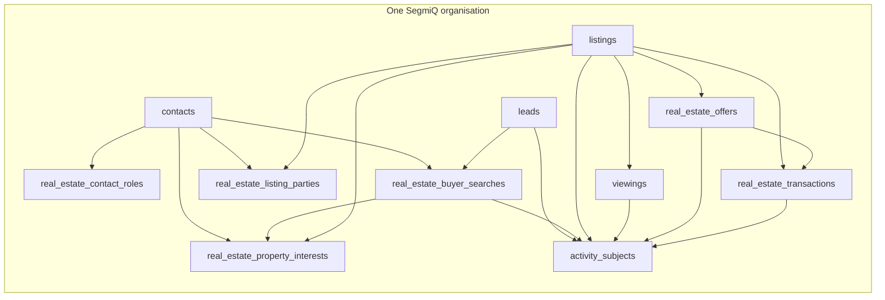

# SegmiQ Real Estate — Phase 1 implementation report

Phase 1 stabilises listing availability, stops unclassified enquiries from being treated as buyers, scopes deal visibility to the people on the deal, corrects operations-report windows, and adds the shared Real Estate data foundation. Solar, Construction, and Trades pipelines were not retargeted.

The migration file was **not** applied to any database. No production data, RLS, or deployment was changed.

## 1. Summary

Listing status changes that follow from offers and transactions now go through one decision module (`lib/real-estate/listing-availability.ts`) and one writer (`lib/real-estate/listing-availability-service.ts`). Accepting an offer reserves the listing. A second accept is refused while that reservation or an active transaction still exists. Completing a sale marks the listing `sold`; completing a rental marks it `let`; property management marks it `under_management`. A fallen-through or cancelled transaction releases the listing only when nothing else still holds it, and never restores sold, let, rented, or under-management stock.

`deal_side` null is unclassified. Buyer matching, WhatsApp match readiness, and listing-match notifications require an explicit `buy_side` or `tenant_side` lead, or an active buyer search. Old null rows are not rewritten as buyers.

Offers and transactions are visible to the buyer’s agent, the offer’s listing agent, and the listing’s responsible agent. An unrelated agent in the same company does not see the deal. Commission figures and commission edits stay with managers.

The operations report separates current stock from period activity. Commission on that report is calculated commission on transactions completed in the period, not cash received. A result that hits the row cap is flagged instead of being presented as complete.

New tables cover contact roles, buyer and tenant searches, property interests, listing parties, listing status events, migration reviews, and shared activity subjects. Existing contacts, leads, listings, viewings, offers, and transactions keep their ids and columns.

## 2. Files changed

New:

- `lib/real-estate/listing-availability.ts`
- `lib/real-estate/listing-availability-service.ts`
- `lib/real-estate/deal-access.ts`
- `lib/real-estate/foundation-plan.ts`
- `lib/real-estate/foundation-sync.ts`
- `lib/activities/subject-activity.ts`
- `supabase/migrations/20261016013000_real_estate_phase1_foundation.sql`
- `tests/real-estate-phase1.test.ts`
- `docs/implementation/REAL_ESTATE_PHASE_1_REPORT.md`

Updated:

- `lib/real-estate/requirements.ts`
- `lib/real-estate/offers.ts`
- `lib/real-estate/offer-service.ts`
- `lib/real-estate/transaction-service.ts`
- `lib/real-estate/viewing-service.ts`
- `lib/real-estate/operations-report.ts`
- `lib/agent/real-estate/readiness.ts`
- `lib/agent/real-estate/tools.ts`
- `lib/sales/get-real-estate-pipeline-data.ts`
- `app/api/clients/[clientId]/listings/route.ts`
- `app/api/clients/[clientId]/listings/[listingId]/route.ts`
- `app/api/clients/[clientId]/leads/[leadId]/real-estate/route.ts`
- `components/real-estate/DealSideBadge.tsx`
- `components/real-estate/RealEstatePipelineBoard.tsx`
- `components/real-estate/RealEstateReportsWorkspace.tsx`
- `tests/real-estate-sales.test.ts`

## 3. Database migration

`supabase/migrations/20261016013000_real_estate_phase1_foundation.sql` is forward-only and additive. It was written to match the repository timestamp style and was **not** applied.

It adds:

- `viewings.client_id`, backfilled from the listing only when the contact belongs to the same organisation. Mismatches are inserted into `real_estate_migration_reviews` and left without a guessed tenant.
- `real_estate_offers.reserves_listing`. Existing accepted offers that still have no terminal transaction are backfilled so only the newest per listing reserves the property. Older accepted offers stay accepted and do not reserve.
- Unique index `idx_re_offers_one_reserving` on `listing_id` where `reserves_listing` is true.
- Unique index `idx_re_txn_one_active_per_listing` on active transactions, created only when no listing already has two active transactions. If duplicates exist, the migration raises a notice and continues.
- `real_estate_listing_status_events`
- `real_estate_migration_reviews`
- `real_estate_contact_roles`
- `real_estate_buyer_searches`, with a unique legacy index on `(client_id, contact_id)` where `provenance = 'legacy_contact_fields'`
- `real_estate_property_interests`, unique on `(client_id, contact_id, listing_id)`
- `real_estate_listing_parties`
- `leads.buyer_search_id`
- `activity_subjects`
- Before-insert/update triggers that refuse a viewing, search, interest, role, or listing party whose related rows belong to different organisations
- Idempotent SQL backfill of legacy buyer columns into searches, explicit deal sides into roles, and in-tenant `interested_listing_ids` into interests
- `REVOKE ALL` from `PUBLIC`, `anon`, and `authenticated` on the new tables and the existing Real Estate tables, with row level security enabled and no permissive policies

Application writes that depend on `viewings.client_id` or `reserves_listing` retry without the new column when PostgREST reports it is missing, so a development process can keep running before the migration. The uniqueness rules do not exist until the migration is applied. Apply the migration before relying on those constraints.

## 4. Old and new relationships

| Concept | Still true | Added in Phase 1 |
| --- | --- | --- |
| Person | `contacts` | Many roles on `real_estate_contact_roles`. A role is not proof of legal ownership. |
| Enquiry | `leads` | Optional `buyer_search_id`. The lead is not the buyer journey. |
| Buyer demand | `contacts.buyer_*` columns, kept | `real_estate_buyer_searches` is authoritative for new searches. `needs_review` is not matched. |
| Interest | `contacts.interested_listing_ids`, still written | `real_estate_property_interests`. One active row per contact and listing. |
| Listing responsibility | `listings.agent_id` | `real_estate_listing_parties` for reported owners or representatives. |
| Viewing | Listing and contact | `viewings.client_id`, required to match both. |
| Offer / transaction | Existing tables and events | `reserves_listing`, listing status events, one reserving offer and one active transaction per listing. |
| Work | Lead `follow_up_date` and call logs, unchanged for Solar and Trades | `activity_subjects` can point at a lead, search, listing, viewing, offer, transaction, or contact. Rows are not deleted when the subject closes. |

## 5. State transition matrix

| Event | Listing result |
| --- | --- |
| Accept an offer on `available` or `reserved`, and nothing else reserves it | `under_offer`. The offer’s `reserves_listing` becomes true. |
| Accept while another offer already reserves the listing, or another transaction is `draft`, `pending_compliance`, or `in_progress` | Refused (409). No second reservation. |
| Accept on `sold`, `let`, `rented`, or `under_management` | Refused. |
| Reject or withdraw an offer | That offer stops reserving. The listing moves only if it was `under_offer` and nothing else holds it. |
| Transaction `fallen_through` or `cancelled`, no other hold, listing was `under_offer` and approval is `approved` | Previous held-from status when that was `reserved`; otherwise `available`. |
| Same release, approval is not `approved` | `reserved`, so the listing is not live. |
| Same release, another reserving offer or active transaction remains | Stays `under_offer`. |
| Release while status is already `sold`, `let`, `rented`, or `under_management` | No change. |
| Complete a sale, agreement recorded, no other active transaction | Listing `sold`. Offer reservation cleared. Linked lead set to `WON`. Buyer search is not closed. |
| Complete a rental | Listing `let`. |
| Complete property management | Listing `under_management`. |
| Complete again | Returns the existing completed transaction and retries the listing status if it was missed. No second completion event on the early return. |
| Complete without `agreement_signed_at` or an agreement milestone of `done` or `skipped` | Refused. |
| Manual PATCH to `sold`, `let`, or `rented` without a completed transaction | Refused. |
| Manual PATCH to `available` while a reservation or active transaction exists | Refused. |

An accepted offer is not a completed sale. Sale and rental targets stay distinct.

## 6. Security changes

SegmiQ authorises with NextAuth and then queries through the service role. The service role bypasses row level security, so policies alone do not protect these APIs. Phase 1 keeps direct Data API access closed and checks the tenant in the server.

- New and existing Real Estate tables: RLS enabled, `REVOKE ALL` from `PUBLIC`, `anon`, and `authenticated`, no new `USING (true)` policies.
- Viewings gain `client_id`. The trigger rejects a contact and listing from different organisations.
- Offer and transaction reads and writes for a salesperson require the user to be the buyer agent, the listing agent on the row, or `listings.agent_id`. Managers of that organisation see the company. A user whose session organisation does not match the resource is refused, including a manager of another company.
- `SUPER_ADMIN` remains a platform role and can participate across organisations, which matches the existing offer write rule.
- Commission amounts are removed from salesperson transaction payloads. `update_commission` is manager-only.
- Listing match lists and new-listing match notifications only include contacts with explicit buyer or tenant demand, or an active search.
- Activity creation checks that the subject row’s organisation matches, and that the assignee belongs to that organisation.
- Live database policies were **not** inspected. If production already has policies that differ from the repository, apply this migration on an authorised database and compare `pg_policies` before treating the revoke list as the live state.

## 7. Reports corrected

`getRealEstateOperationsReport` now uses these definitions, and the reports screen labels commission as calculated:

| Metric | Meaning |
| --- | --- |
| Stock | Current listings. Not filtered by the selected period. |
| Enquiries | Leads created in the period. |
| Viewings | `scheduled_at` inside the period. |
| Offers | `submitted_at` inside the period. |
| Completed sales | `completed_at` inside the period. |
| In progress | Current active transactions, not a period flow. |
| Fallen through | `fallen_through_at` inside the period. |
| Commission | Sum of stored listing and selling commission amounts on transactions completed in the period. Not cash received. |

Enquiry-to-viewing attributes each viewing to one lead. Enquiry-to-won uses distinct completed-transaction lead ids, so several leads for one customer do not multiply one sale. Date filters are separate queries, not a PostgREST `or()` string that can split on timestamp punctuation. Each query is capped at 5,000 rows. If a count exceeds the rows returned, `truncated` is true and the screen says so. A failed query throws instead of rendering an empty period.

## 8. Backfill and compatibility

SQL backfill in the migration, and `backfillRealEstateFoundation(clientId)`, are repeatable.

- A contact with buyer columns and an explicit `buy_side` or `tenant_side` lead gets one `legacy_contact_fields` search with status `active`. Intent is `purchase` unless the only demand side is `tenant_side`, which becomes `rental`.
- The same columns with a null or supply-side lead get status `needs_review`. That row is not eligible for buyer matches. The stored intent default is not treated as demand.
- Running the backfill again does not insert a second legacy search, role, or interest. The unique indexes and `omitExistingKeys` enforce that.
- `interested_listing_ids` that are not listings in the same organisation are recorded on `real_estate_migration_reviews` and are not inserted as interests.
- `legacySearchDivergence` compares contact columns with the legacy search and records a review when budget, bedrooms, area, or timeframe differ. It does not overwrite either side.
- Classifying a lead writes a contact role. A `needs_review` legacy search is promoted to `active` only for `buy_side` or `tenant_side`.
- Requirement updates for an already classified buyer or tenant also update the active search (`mirrorBuyerRequirements`). Unclassified and seller updates stay on the contact columns only.
- Marking a listing interested, sending a match, or booking a viewing also writes `real_estate_property_interests`.
- Old columns are not dropped. Matching criteria still read `contacts.buyer_*`. Eligibility no longer treats null `deal_side` as a buyer.

There is no HTTP route that runs the backfill. Call `backfillRealEstateFoundation` from an authorised server job after the migration, once per organisation, or rely on the SQL backfill inside the migration. Both can run; the second pass inserts nothing that already exists.

## 9. Tests executed and results

| Check | Result |
| --- | --- |
| `npx tsx --test` on `tests/real-estate-phase1.test.ts`, `tests/real-estate-sales.test.ts`, `tests/real-estate-offers.test.ts`, `tests/real-estate-gating.test.ts`, `tests/re-agent-matching.test.ts`, `tests/re-agent-foundation.test.ts`, `tests/re-agent-hub-ux.test.ts` | 76 pass, 0 fail |
| Later run of phase 1, real-estate sales, and `tests/solar-sales-workflow.test.ts` after report aggregation tests were added | 44 pass, 0 fail. Phase 1 suites covered acceptance, competing offers, conflicting accept, release with and without another hold, sale vs rental completion, repeated completion, missing agreement, manual sold status, unclassified and seller match readiness, agent A/B/C and cross-organisation access, backfill idempotency, legacy divergence, historical and empty report windows, multi-enquiry counting, and the 12-property cap. Solar workflow and trades isolation in that file passed. |
| Typecheck | `npm run typecheck` produced no compiler diagnostics. The process was terminated after about 50 minutes (`exit_code` 4294967295). It is not counted as a pass. |
| Lint of the whole app and `next build` | Not run in this pass. Typecheck is the first half of `npm run build`. |
| Migration applied to a database | Not run. |
| Concurrent HTTP requests against Postgres | Not run. Conditional updates and unique indexes are in the migration and services; they were not exercised on a live connection. |
| Two live organisations with forged API calls | Not run. Isolation is covered by `canParticipateInDeal` and the existing viewing/listing tenant tests, not by a database fixture. |

Phase 1 unit tests do not hide a defect by weakening an assertion. `isDemandSide(null)` is now expected to be false in `tests/real-estate-sales.test.ts`.

## 10. Unresolved problems

- The migration has not been applied, and the live database’s policies were not read. Repository migrations still contain no `CREATE POLICY` for these tables.
- Service-role queries remain the application path. A forgotten `.eq("client_id")` is not stopped by RLS.
- Offer acceptance and transaction completion are sequential service-role writes, not one Postgres transaction. A repeated complete now retries the listing status if the first listing write did not land. A crash between the two writes can still leave them apart until that retry.
- If a listing already has two active transactions, the unique transaction index is skipped and must be cleaned up by hand before it can be created.
- The reserving-offer backfill keeps only the newest still-active accepted offer. Other accepted offers remain historically accepted and stop reserving.
- Completing a transaction now requires a recorded agreement. Completions that previously succeeded without one will be refused until the agreement is recorded. An already completed transaction can still be re-requested without failing.
- Report metrics still load up to 5,000 rows per query and aggregate in the application. Larger tenants see `truncated` rather than a silent full total.
- Buyer-search criteria are not yet what the matcher reads. Contact columns remain the criteria store.
- Listing-party and activity-subject tables have services and no Real Estate screens.
- `leads.buyer_search_id` is available and is not yet filled by the enquiry UI.
- Platform `SUPER_ADMIN` can still participate across organisations.

## 11. Production rollout

Do not run `supabase db push` against an unknown remote.

1. Confirm the target is an authorised database and that `supabase_migrations.schema_migrations` already contains the migrations this file follows. This file does not rewrite older migrations.
2. On that database, apply only `supabase/migrations/20261016013000_real_estate_phase1_foundation.sql`.
3. Read the migration notices. If `idx_re_txn_one_active_per_listing` was skipped, list duplicate active transactions and resolve them before creating the index manually.
4. Review `real_estate_migration_reviews` before treating backfilled searches as active. `needs_review` rows must not be matched.
5. Compare `pg_policies` if production was changed outside the repository. This migration does not drop unknown policies; it revokes table privileges from the Data API roles.
6. Deploy the application after the migration. The application tolerates a missing column during a short skew, but the reservation constraints exist only after step 2.
7. Optionally run `backfillRealEstateFoundation` per organisation if the SQL backfill needs to be repeated after later contact edits. It is idempotent.

No customer data should be deleted as part of this rollout.

## 12. Rollback

Application rollback is a revert of the Phase 1 commit. Old columns and old rows stay valid.

Database rollback, only on the environment where this migration was applied, in this order:

1. Drop triggers `trg_viewings_enforce_tenant`, `trg_re_contact_roles_tenant`, `trg_re_searches_tenant`, `trg_re_interests_contact_tenant`, `trg_re_interests_listing_tenant`, `trg_re_parties_contact_tenant`, and `trg_re_parties_listing_tenant`. Then drop functions `re_viewings_enforce_tenant`, `re_assert_contact_tenant`, and `re_assert_listing_tenant`.
2. Drop the new indexes `idx_re_offers_one_reserving` and `idx_re_txn_one_active_per_listing` if it exists.
3. Drop new tables: `activity_subjects`, `real_estate_listing_parties`, `real_estate_property_interests`, `real_estate_buyer_searches`, `real_estate_contact_roles`, `real_estate_listing_status_events`, `real_estate_migration_reviews`.
4. Drop added columns: `leads.buyer_search_id`, `real_estate_offers.reserves_listing`, `viewings.client_id`.
5. Do not drop `contacts`, `leads`, `listings`, `viewings`, offers, transactions, or their historical events.

Rolling back the database while the new application is still deployed makes reservation uniqueness and viewing tenant checks best-effort again. Roll the application back first.

## 13. Phase 2 readiness

Phase 2 can build on these records without another people table or another task engine:

- Property acquisition can attach mandates, inspections, and owner contacts to `listings` through `real_estate_listing_parties`.
- Buyer and tenant sales can open many `real_estate_buyer_searches` per contact and relate them to viewings, offers, and `leads.buyer_search_id`.
- Agency operations can hang tasks off `activity_subjects` while Solar and Trades keep lead follow-ups.
- The listing status machine is the place to add any later exception workflow. Do not add a second writer that sets `listings.status` from an offer or transaction.
- The next functional gap is UI and matcher cutover: search screens, owner capture, activity screens, and reading search criteria instead of only `contacts.buyer_*`.

Phase 2 should still not auto-close a search when one offer fails, and should not treat a contact role as legal title.
