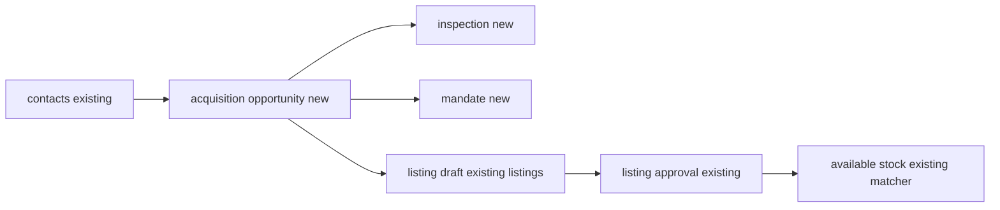

# SegmiQ Real Estate — Phase 2 property acquisition

Phase 2 adds property acquisition as its own operational domain inside a Real Estate organisation. An agent can record a possible owner before a listing exists, inspect the property, keep a price history, submit a mandate for review, and prepare one listing draft. Buyer viewings, offers, and the existing listings table stay in place. Solar and Trades navigation and pipelines were not retargeted.

The migration was **not** applied to any database. No production data or deployment was changed.

## 1. Executive summary

Acquisition opportunities are not listings. Inspections are not buyer viewings. A mandate type is not proof of legal ownership. Contacts remain the person record, so one owner can hold several opportunities. Converting an opportunity creates a single draft listing with status `reserved` and approval `draft`, which is not matchable. Manager approval of that listing marks it `available` and marks the opportunity converted. A second prepare action returns the existing draft.

## 2. Features implemented

- Quick opportunity capture with name or phone plus a location, without price, bedrooms, or photos.
- Duplicate contact warning. Nothing is merged unless the agent selects the existing contact or explicitly confirms a new one.
- Pipeline and list views of the same records.
- Stage changes that refuse inspection, mandate, and listing stages when the underlying record does not exist.
- Hold, reopen, and lost, with a required lost reason.
- Reassignment by a manager. `sourced_by_agent_id` is not overwritten.
- Inspection records, condition and utility notes, document status, and photo attachment through the existing company document upload.
- Append-only price discussions, including a manager-only professional valuation type.
- Mandate draft, submit, approve, and reject. Expired approved mandates are not treated as current. Legacy `listings.mandate_*` values are copied as `legacy_unverified` and cannot be approved in place.
- Prepare listing, idempotent on the opportunity’s `converted_listing_id`.
- Owner list grouped from opportunities on one contact.
- Inspection and mandate lists.
- WhatsApp rail action to create an opportunity from a seller or unclassified conversation. It does not run for an explicit buyer or tenant, and it does not create the record until the agent confirms.
- Real Estate navigation group for opportunities, owners, inspections, and mandates. Trades navigation is unchanged.

## 3. Database migrations

`supabase/migrations/20261016042000_real_estate_phase2_acquisition.sql`

Apply `20261016013000_real_estate_phase1_foundation.sql` first. Phase 2 extends `activity_subjects.subject_type` and stops if that table is missing.

New tables: `real_estate_acquisition_opportunities`, `real_estate_acquisition_events`, `real_estate_inspections`, `real_estate_inspection_photos`, `real_estate_price_discussions`, `real_estate_mandates`, `real_estate_mandate_events`.

`listings.acquisition_opportunity_id` is added. Unique indexes stop two opportunities sharing one listing and stop two legacy mandate rows for one listing. RLS is enabled and `REVOKE ALL` is applied for `PUBLIC`, `anon`, and `authenticated`, with no permissive policies. The application still authorises with NextAuth and the service role.

This file was not applied.

## 4. Data model and relationships

`contacts` and `listings` already existed. Opportunities, inspections, prices, mandates, and their events are new. Buyer viewings stay in `viewings`. Listing parties from Phase 1 record the reported owner when a draft is prepared. That party is `reported`, not verified title.

## 5. API endpoints

All routes require an authenticated session whose organisation matches `clientId`.

- `GET/POST /api/clients/[clientId]/acquisitions`
- `GET /api/clients/[clientId]/acquisitions/overview`
- `GET /api/clients/[clientId]/acquisitions/[opportunityId]`
- `POST /api/clients/[clientId]/acquisitions/[opportunityId]/actions`
- `GET /api/clients/[clientId]/owners`
- `GET /api/clients/[clientId]/inspections`
- `GET /api/clients/[clientId]/mandates`

`POST` accepts `Idempotency-Key`. Actions cover stage, outcome, assign, contact, price, inspection, photo, mandate, review, and prepare listing. A salesperson list is limited to opportunities they are assigned to or originally sourced. A manager of another organisation is refused.

## 6. Domain services

- `lib/real-estate/acquisition-plan.ts` — stages, evidence rules, mandate validity, conversion, access, duplicate detection, summary counts.
- `lib/real-estate/acquisition-service.ts` — creates and updates records, writes events, and prepares the listing draft.
- `lib/activities/subject-activity.ts` — subject types now include `acquisition`, `inspection`, and `mandate`. Lead follow-ups are unchanged.

## 7. Agent pages and routes

- `/sales/acquisitions`
- `/sales/acquisitions/[opportunityId]`
- `/sales/owners`
- `/sales/inspections`
- `/sales/mandates`

## 8. Manager pages and routes

- `/client/acquisitions`
- `/client/acquisitions/[opportunityId]`
- `/client/owners`
- `/client/inspections`
- `/client/mandates`

Managers can approve or reject a submitted mandate and can prepare a listing with an explicit exception when no verified mandate exists. Agents cannot review mandates.

## 9. Acquisition pipeline behavior

Stages run from New opportunity through Submitted for listing approval. Earlier conversation stages can be set without a document. Inspection scheduled, inspection completed, mandate secured, listing preparation, and submitted for approval each require the corresponding inspection, approved unexpired mandate, or listing state. Hold, nurturing, not interested, lost, and converted are statuses, not fake documents. Lost requires a reason. Reopen returns the opportunity to active.

## 10. Property owner management

Owners are contacts. Creating an opportunity with a sale or rent intent records a seller or landlord role through the Phase 1 classification sync. The owners page groups opportunities by contact, so one person can show several properties. Phone numbers are loaded on an opportunity the user is allowed to open. An unrelated agent does not receive that opportunity in the list.

## 11. Inspection implementation

Inspections have their own table and statuses from draft through completed or incomplete. The detail form covers identity, basic characteristics, utilities, condition, document status, and notes. Photos are uploaded with the existing company document presign flow and stored as `real_estate_inspection_photos` rows. Completing an inspection moves the opportunity to Inspection completed. It does not verify ownership or approve a listing. Offline capture is not implemented.

## 12. Mandate lifecycle

Statuses: draft, awaiting evidence, submitted, approved, rejected, expired, revoked, superseded, and legacy unverified. Evidence status is separate. Approval writes a mandate event with the reviewer. An approved mandate whose expiry date has passed displays as expired and does not satisfy Mandate secured or listing preparation. Renewal is a new mandate, not an automatic extension. Legacy rows copied from `listings.mandate_type` and `listings.mandate_expiry_date` stay unverified.

## 13. Pricing history

Each discussion is a new row: amount, currency, type, note, optional document, user, and time. The opportunity’s expected price is updated to the latest figure. Earlier rows remain. Professional valuation can be recorded only by a manager. There is no automated valuation.

## 14. Listing conversion

Prepare listing inserts one `listings` row as `reserved` / `draft`, links `acquisition_opportunity_id`, copies address, suburb, beds, baths, and the latest agreed or expected price, and upserts a reported owner party. A second call returns the same listing id. Existing listing approval still uses the listings API. When that approval succeeds for an acquisition-linked reserved listing, the listing becomes `available` and the opportunity becomes `converted`. Rejection sends the stage back to listing preparation. `isListingLive` still requires `available` and `approved`, so the draft is not matched. No WhatsApp marketing message is sent.

## 15. WhatsApp integration

`RealEstateIntelligenceRail` receives `clientId`. For an unclassified or supply-side conversation it shows Create property opportunity. Buyer and tenant conversations do not get that action. The create call is a normal authenticated POST with an idempotency key tied to the lead. Existing inbox and provider send paths were not duplicated.

## 16. Tasks and follow-ups

Recording a contact with a next time writes an `activity_subjects` row titled “Call owner” on the opportunity, and stores `next_action_at`. Closing or losing the opportunity does not delete that row. The overview counts overdue next actions. It does not generate a new reminder on every page load.

## 17. Permissions and tenant isolation

Organisation mismatch is rejected. Salespeople see assigned or sourced opportunities. Managers see the organisation. Mandate review is manager-only, including when the manager is not the responsible agent. An agent cannot approve a mandate. Document and storage attachments must belong to the same `client_id`. Reassignment changes `assigned_agent_id` only. User deletes are `ON DELETE SET NULL` on actor columns, so the opportunity remains. Direct Data API roles have no grants on the new tables. Service-role queries still bypass RLS, so the API checks remain required.

## 18. Mobile responsiveness

Forms use a single column, 44px-tall controls, and a bottom sheet for new opportunities. The pipeline scrolls sideways. Inspection photo input accepts `capture="environment"`. These layouts were not exercised in a browser in this pass.

## 19. Testing results

`tests/real-estate-acquisition.test.ts` covers incomplete capture, duplicate detection, one contact with three properties, stage evidence, expired and legacy mandates, single conversion, draft versus live listing eligibility, reassignment and cross-organisation access, overdue counts, and Real Estate versus Trades navigation.

The test command was started with `npx tsx --test tests/real-estate-acquisition.test.ts tests/real-estate-sales.test.ts`. Record the runner output before treating that file as passed. These tests do not open a database. The migration was not applied, so insert, photo upload, and concurrent conversion were not run against Postgres.

Typecheck and `next build` were not completed in this phase. An earlier full typecheck stalled with no compiler output.

Browser verification of the new screens was not done.

## 20. Existing functionality preserved

Listings, viewings, offers, transactions, compliance, and buyer matching stay on their current routes. Legacy listings do not need an opportunity. Their mandate columns are still written by the existing listing form. Phase 2 only adds an unverified mandate mirror. Trades sales navigation ids are unchanged. Solar workflow flags were not edited.

## 21. Deployment requirements

1. Apply the Phase 1 foundation migration if it is not already on the target database.
2. Apply only `supabase/migrations/20261016042000_real_estate_phase2_acquisition.sql` on an authorised database.
3. Do not run a broad `supabase db push` against an unknown remote.
4. Deploy the application after the migration. Photo upload still depends on the existing document storage configuration. If that is not configured, the inspection form returns the storage error instead of pretending the photo was saved.
5. Review `real_estate_mandates` rows with `provenance = 'legacy_listing_fields'`. They are not active authority.

## 22. Rollback strategy

Revert the application first. Then, on the database where this migration was applied:

1. Drop triggers `trg_re_acq_tenant`, `trg_re_inspections_tenant`, and `trg_re_mandates_tenant`, then drop `re_acq_enforce_tenant()`.
2. Drop `listings.acquisition_opportunity_id` and the foreign keys added in this migration.
3. Drop the new acquisition, inspection, price, and mandate tables.
4. Restore the previous `activity_subjects` subject-type check to the Phase 1 list.
5. Do not drop `contacts`, `listings`, `viewings`, or `listings.mandate_type` / `mandate_expiry_date`.

## 23. Known limitations

- Screens were not verified in a browser, and the migration was not applied.
- There is no full per-agent performance board beyond the overview counts of active, overdue, lost, and converted opportunities the user can see.
- Mandate renewal is a new record. There is no separate renewal workflow screen.
- Inspection photos require the existing document presign path. There is no offline queue.
- Owner profile communication links are call and WhatsApp from the phone number, plus the existing inbox. A dedicated timeline of every historical call is the acquisition event list, not a rebuilt call log.
- Professional valuation does not check that a valuation document was attached.
- `revoked` and `superseded` exist in the schema and are not yet separate buttons.
- Service-role access still bypasses RLS.

## 24. Phase 3 readiness

Buyer and tenant sales can consume approved `available` listings without reading acquisition drafts. The link `listings.acquisition_opportunity_id` tells Phase 3 which stock came from acquisition. Searches, viewings, and offers from Phase 1 remain the buyer side. Phase 3 should not reopen acquisition stages when a buyer offer fails, and should not treat a reported listing party as legal title.
