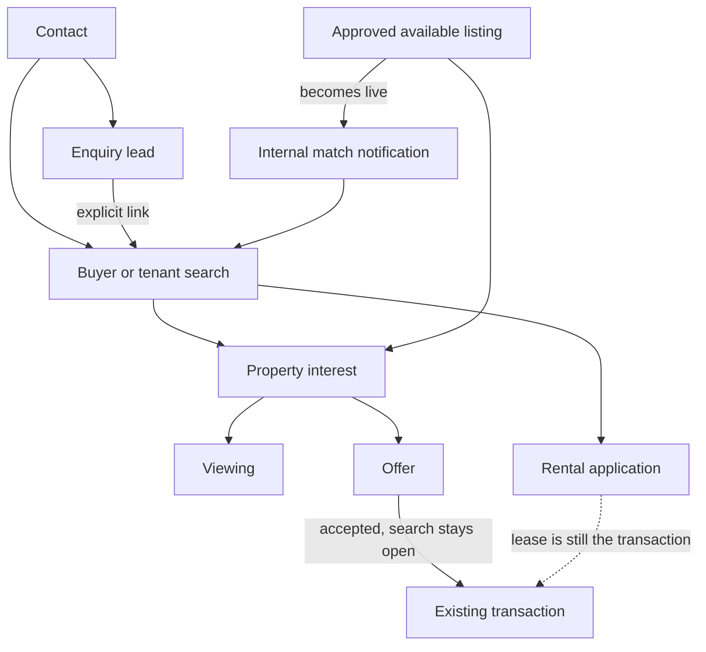

# Phase 3 — Buyer and tenant sales

## 1. Executive summary

Phase 3 adds a buyer and tenant sales workspace on top of the existing contacts, listings, viewings, offers and transactions. A person can have several searches. Each search keeps its own requirements, matches, interests, viewings and offers. Rejecting one offer or one property does not close the customer or their other searches.

The matching rules are deterministic and explained. A listing is eligible only when it is approved and available, belongs to the same organisation, and matches buy versus rent. Match alerts go to the assigned agent inside SegmiQ. They are not WhatsApp blasts.

The migration is written and has not been applied to any database. Production was not changed. The automated checks that ran are pure-function and source tests: 22 passed, 0 failed. A browser session, a database integration run, a full typecheck and a production build were not completed in this environment.

## 2. Features implemented

- Buyers and tenants list, grouped by contact, with metrics from search and offer queries.
- Create a contact only when one does not already match the phone, then create a search. A second search for the same contact does not replace the first.
- Search stages: new enquiry, requirements discovery, actively searching, viewings in progress, decision pending, paused, completed, closed.
- Search history for budget, location, property type, timeframe, stage and agent changes.
- Explainable two-way matching, with rejected properties left out.
- Internal match notifications when a listing is approved and available, deduped by listing, search and price/suburb/status fingerprint.
- Interest states: matched, recommended, sent, interested, not interested, viewing requested, viewing completed, offer. A rejection requires a reason.
- Viewing schedule, overlap warning, duplicate-click guard, reschedule, and an outcome that can mark the property not interested.
- Offers can store a nullable buyer search id. Rejecting or accepting an offer writes a search event and leaves the search open.
- Rental applications are separate from an accepted lease. A reported deposit is not verified.
- Buyer introduction requests hide the customer phone from the other agent until the owning agent or a manager accepts.
- WhatsApp rail: buyer and tenant conversations get search actions. Seller conversations keep property acquisition. Unclassified conversations ask the agent to choose.
- Agent dashboard shows buyer priorities only when the priority query returns rows.
- Manager demand gaps and a team search report. Counts of people and counts of searches are separate.

## 3. Files created or modified

Created:

- `supabase/migrations/20261016120000_real_estate_phase3_buyer_sales.sql`
- `lib/real-estate/buyer-match.ts`
- `lib/real-estate/buyer-sales-service.ts`
- `app/api/clients/[clientId]/buyer-searches/route.ts`
- `app/api/clients/[clientId]/buyer-searches/[searchId]/route.ts`
- `app/api/clients/[clientId]/buyer-sales/actions/route.ts`
- `app/api/clients/[clientId]/matching/route.ts`
- `app/api/clients/[clientId]/buyer-reports/route.ts`
- `components/real-estate/buyers/BuyerSalesWorkspace.tsx`
- `components/real-estate/buyers/BuyerSearchDetail.tsx`
- `components/real-estate/buyers/MatchingWorkspace.tsx`
- `components/real-estate/buyers/SalesViewingsList.tsx`
- `components/real-estate/BuyerSearchPriorities.tsx`
- `components/inbox/BuyerConversationActions.tsx`
- `app/client/buyers/page.tsx`
- `app/client/buyers/[searchId]/page.tsx`
- `app/client/matching/page.tsx`
- `app/sales/buyers/page.tsx`
- `app/sales/buyers/[searchId]/page.tsx`
- `app/sales/matching/page.tsx`
- `app/sales/viewings/page.tsx`
- `tests/real-estate-phase3.test.ts`

Modified:

- `lib/sales/navigation/company-nav-config.ts`
- `lib/sales/navigation/sales-nav-config.ts`
- `lib/real-estate/viewing-service.ts`
- `lib/real-estate/offer-service.ts`
- `app/api/clients/[clientId]/offers/route.ts`
- `app/api/clients/[clientId]/listings/[listingId]/route.ts`
- `components/inbox/RealEstateIntelligenceRail.tsx`
- `components/real-estate/AgentDailyWorkspace.tsx`

Existing offer, viewing, transaction, acquisition and enquiry pages were left in place.

## 4. Database migrations

`supabase/migrations/20261016120000_real_estate_phase3_buyer_sales.sql`

It refuses to run if `real_estate_buyer_searches` is missing, so Phase 1 must be applied first. It does not drop columns and does not rewrite the Phase 1 status check. `status` stays `active`, `paused`, `completed`, `closed` or `needs_review`. The agent-facing stage is the new `pipeline_stage` column.

New tables: `real_estate_buyer_search_events`, `real_estate_match_notifications`, `real_estate_buyer_introductions`, `real_estate_rental_applications`.

Additive columns: search requirements and next action; interest state and rejection reason; viewing `buyer_search_id`, confirmation, outcome, instructions and idempotency key; nullable `real_estate_offers.buyer_search_id` and `property_interest_id`.

Direct Data API access is revoked on the new tables, with RLS enabled and no policies, matching Phase 1 and Phase 2. The app uses the service role after `requireClientAccessFromRequest` and `.eq("client_id", ...)`.

This file was not applied to a local or remote database.

## 5. Buyer and tenant data model

A search row is `real_estate_buyer_searches`. Intent is `purchase` or `rental`. Requirements that can be empty at the start: property type, locations, budget, currency, bedrooms, bathrooms, land size, building size, features, amenities, timeframe, readiness, lease months, move-in date and notes. `allow_above_budget` defaults to false. `allow_alternate_locations` defaults to true.

`needs_review` rows from the Phase 1 legacy backfill are not given a pipeline stage and are not matched.

## 6. Contact and search relationships

Contacts stay in `contacts`. Creating a buyer with a phone that loosely matches an existing contact returns 409 unless the agent confirms a new person or posts the existing `contactId`. The role `buyer` or `tenant` is upserted on `real_estate_contact_roles`. Seller and landlord roles already on that contact are not removed.

`leads.buyer_search_id` is set only when the enquiry contact is the search contact in the same organisation. That is `linkEnquiryToSearch` and the optional `leadId` on create. Requirements are not copied out of unrelated lead fields.

## 7. Search lifecycle and pipeline

`coarseStatusForStage` maps the eight stages onto the coarse status. Matching uses only `status = active` and a stage in the active set. Paused, completed, closed and needs-review searches do not match.

The buyers page has a customer list and a stage board. Moving a stage is a save of `pipeline_stage`. It does not create a viewing, an offer or a transaction. Scheduling a viewing from an early stage moves that search to viewings in progress because a viewing row was created.

Closure reason is stored on `closure_reason` when the agent sets paused or closed. The search can be moved back to an active stage later.

## 8. Property matching logic

`explainSearchListing` in `lib/real-estate/buyer-match.ts`.

Hard exclusions:

- Different organisation.
- Search is not matchable.
- Listing id is in the rejected set.
- Listing is not live. Live means `isListingLive`: approval `approved` (legacy null counts as approved) and status `available`. Sold, let, reserved, under offer and unapproved stock drop out.
- Purchase searches do not match `rental`. Rental searches match only `rental`.
- Both sides have a property type and they differ. Listings still have no property-type column, so this check does not exclude current stock. See limitations.
- Price above `budget_max` unless `allow_above_budget` is true.
- Bedroom or bathroom count below the stated minimum when the listing has that number.
- Preferred locations set, none match, and alternate locations are not allowed.

A different suburb with alternate locations allowed is an **alternative**, not a hidden row. A strong match met location (or had no location preference), budget and the recorded bedroom count. A partial match is missing price or bedroom facts.

Score, when shown, is the sum of explicit weights: 40 location, 25 inside budget, 20 bedrooms, 10 bathrooms, 5 property type. It is not a probability.

Candidate listings and searches are capped at 300. The match response includes `truncated` when the listing query hit the cap.

## 9. Matching notification workflow

`discoverMatchesForListing` runs from the listing update route after the Phase 2 approval hook, and only when the listing is then approved and available. It writes `real_estate_match_notifications` for new pairs. The unique key is listing, search and fingerprint (`price|suburb|status`). The same pair is not inserted twice. Rejected interests are excluded. `notifyPropertyMatch` is not called.

A stored notification is evidence that an agent was told. The live match query decides whether the listing still fits. If the listing later becomes unavailable, old rows remain and the live query stops returning it. A later price change produces a new fingerprint, so a genuine new fit can notify again.

## 10. Recommendation and interest tracking

`setPropertyInterest` upserts the Phase 1 unique key `(client_id, contact_id, listing_id)`. One person has one interest row per listing, which is what stops the same house being offered again after a rejection. `not_interested` requires a reason: wrong location, above budget, too small, condition, layout, financing, changed plans, or other. The search status is not changed.

Recommend, interested, viewing requested, viewing completed and offer are the other states. The agent records them. The system does not invent feedback.

## 11. Viewing management

`scheduleSearchViewing` checks the search belongs to the actor, refuses a second viewing for the same contact, listing and minute, and returns a 409 warning when that agent already has a viewing within 90 minutes. The agent can confirm the overlap and save. New rows store `buyer_search_id`, instructions and a confirmation status. The original viewing status stays `scheduled` so the existing viewing tabs still treat it as upcoming.

`rescheduleSearchViewing` updates the time and sets confirmation to `rescheduled`. Customer WhatsApp is not sent from this path (`notifyCustomer: false`). The existing viewing reminder job still sees the row.

Routes:

- `/client/viewings` existing manager calendar
- `/sales/viewings` agent list of the existing viewing API
- Schedule and outcome actions: `POST /api/clients/{clientId}/buyer-sales/actions`

## 12. Viewing feedback and follow-ups

Completing a viewing requires an outcome: interested, considering, second viewing, wants offer, too expensive, location unsuitable, condition, not interested, or no show. Too expensive, location, condition and not interested also set the property interest to not interested with a mapped reason. The search stays active.

A follow-up saves `next_action_at` and creates a shared `activity_subjects` row with subject type `buyer_search`.

## 13. Offer and negotiation integration

The offer state machine is unchanged: draft, submitted, countered, negotiating, accepted, rejected, withdrawn, expired. `POST /api/clients/{clientId}/offers` accepts optional `buyer_search_id`. Historical offers do not need it.

On `OFFER_REJECTED` or `OFFER_ACCEPTED`, if the offer has a search id, a search event is inserted and the search stage is not updated. Acceptance still uses the Phase 1 reservation and transaction rules. This phase does not mark the sale complete and does not close other searches.

Negotiation history remains `real_estate_offer_events`. The search page links to the existing offers screens:

- `/client/offers`
- `/sales/offers`

## 14. Rental workflow

A rental search uses the same search record with `intent = rental`, plus lease months and move-in date. Matching returns only rental listings inside the monthly maximum.

`real_estate_rental_applications` statuses are submitted, under review, accepted and declined. Accepted here means the application was accepted as a workflow step. It does not set the listing to let and it does not create the lease. Completing a tenancy still goes through the existing transaction service, which sets a rental listing to `let` when that transaction is completed.

Deposit status moves from expected to reported when an agent reports it. Only a manager or super admin can set verified. An upload is not a verification action in this phase.

## 15. WhatsApp integration

`RealEstateIntelligenceRail` branches on deal side:

- `buy_side` or `tenant_side`: `BuyerConversationActions`
- `sell_side` or `landlord_side`: the Phase 2 acquisition action
- null or anything else: the agent picks buyer/tenant or seller/landlord before either form opens

Create search sends the conversation contact, phone and lead id. Link enquiry uses `link_enquiry` and refuses a different contact. The agent picks among that contact's searches. Nothing is sent to the customer from these buttons.

Message history, session handling and the existing inbox send path were not changed.

## 16. AI Sales Copilot integration

The existing sales copilot panel is still on the rail. Phase 3 did not add a new model tool that writes searches, prices, offers or messages. Search creation, recommendations, viewings and offers are confirmed form posts. The copilot was not given authority to accept an offer, confirm a payment or send a property blast.

## 17. Agent dashboard changes

`BuyerSearchPriorities` is rendered at the top of the existing real-estate agent dashboard. It calls `GET /api/clients/{clientId}/buyer-reports`. If there are no due follow-ups, today's viewings, waiting offers or recent internal match notifications, the block is not shown. Names come from those rows. The existing inquiry, viewing and offer panels underneath are unchanged.

Quick actions on the buyers page are Add buyer / tenant and Find matching properties. WhatsApp and call appear on a search when the agent is allowed to see the phone.

## 18. Manager analytics

`GET /api/clients/{clientId}/buyer-reports?report=operations` is manager-only. It returns distinct buyer contacts, distinct tenant contacts, search totals, active, paused, completed, closed, searches without a next action, and per-agent active search and overdue follow-up counts. The buyers page shows the team sentence when that call succeeds.

It does not treat a submitted or accepted offer as revenue. Completed sales and rentals stay on the existing transaction report.

Viewing and offer conversion rates are not fabricated. The page shows scheduled viewing count and in-progress offer count from those tables.

## 19. Property demand intelligence

`GET /api/clients/{clientId}/buyer-reports?report=demand` is manager-only. `demandGaps` groups active matchable searches by intent, first preferred location and property type. `searchCount` is searches. `contactCount` is distinct people. `eligibleListingCount` is approved available listings that match at least one search in the group. `unmatchedSearchCount` is searches with zero eligible listings.

The matching page states that these figures are this agency's recorded demand. Each gap links to Property Opportunities (`/client/acquisitions` or `/sales/acquisitions`). It does not contact owners and it does not create an opportunity by itself.

## 20. Navigation changes

Company real-estate navigation has a section, Buyer and tenant sales, with:

- `/client/buyers`
- `/client/matching`
- `/client/viewings` (existing)
- `/client/offers` labelled Offers & Deals (existing)

Sales real-estate navigation adds:

- `/sales/buyers`
- `/sales/matching`
- `/sales/viewings`
- `/sales/offers` labelled Offers & Deals

Property acquisition items are still present. Trades navigation ids are unchanged. The Phase 3 test asserts that.

## 21. Desktop and mobile UX

The buyers list is a single column of customer cards on a phone and a denser grid inside each card from the `md` breakpoint. The create form is a bottom sheet on small screens and a centred dialog from `md`. The search pipeline columns scroll sideways instead of squeezing. Filters stack. Action buttons use at least 44px height.

Matching and viewing lists are stacked cards. The search detail keeps the primary actions under the name and stacks matches, viewings and offers.

These layouts were checked in source. They were not opened in a browser at 360, 390, 430, tablet or desktop widths. That verification did not happen.

## 22. Permission model

`requireClientAccessFromRequest` is on every new route. The service then checks the actor's organisation. Super admin may cross organisations, which is the existing platform role. Managers read and update searches in their organisation and may reassign. A salesperson can read and update only searches assigned to them.

`canSeeBuyerContact` returns true for the assigned agent, a manager, a super admin, or an agent whose introduction was accepted. Otherwise the buyer-for-listing payload omits name and phone and offers Request buyer introduction. The owning agent or a manager accepts or declines.

Match notifications and introductions are stored with `client_id`. New tables are not exposed to the anon or authenticated Data API.

## 23. Migration and legacy compatibility

Phase 1 contact buyer columns, leads, viewings, offers and transactions are not dropped. Legacy searches with provenance `legacy_contact_fields` stay one per contact because of the existing unique index. New agent searches use provenance `agent`, so a second search is allowed. `needs_review` searches are not matched and are not rewritten into active demand.

Viewing status values stay inside the original check constraint. Finer confirmation lives in `confirmation_status`. Offer search links are nullable. If the new columns are missing, viewing create falls back to the legacy insert and the offer search update ignores a missing-column error. The buyers UI itself returns 503 until the Phase 3 migration exists, because the search table columns are required for that screen.

## 24. Tests executed and actual results

Executed:

`node .\node_modules\tsx\dist\cli.mjs --test tests\real-estate-phase3.test.ts`

Result: 22 passed, 0 failed, 0 skipped, exit code 0. Runtime about 58 seconds. Covered search independence, offer outcomes leaving the search open, Greendale strong match, Msasa alternative, budget ceiling, sold and unapproved and cross-company exclusion, rental versus sale, rejected listings, notification dedupe, introduction privacy, viewing overlap and duplicate clicks, deposit verification, unclassified WhatsApp mode, enquiry linking, demand counts, empty-versus-real priorities, trades navigation, and the absence of `notifyPropertyMatch` in the buyer service.

Not executed:

- Tests against a database. Phase 1, Phase 2 and Phase 3 migrations are not applied here.
- API integration tests with a session.
- Full `npm run typecheck`. Earlier runs in this environment stalled before emitting a TypeScript result.
- `npm run build`.
- Browser checks of the new pages.
- Solar and trades workflow suites beyond the navigation id assertion in the Phase 3 file.

## 25. Existing functionality preserved

Enquiry pipeline, lead records, listings, the offer state machine, transaction completion, acquisition opportunities, inspections and mandates, and the WhatsApp inbox send path were not replaced. Company viewings and offers routes are the same pages, moved into the buyer-sales navigation section. Trades navigation ids were asserted unchanged.

## 26. Known limitations

- The migration is not applied, so the new screens cannot read or write until an authorised database applies Phase 1, then Phase 2, then this file.
- Listings have no property-category column, so a search property type is stored and displayed but does not exclude stock.
- Interest is unique per organisation, contact and listing. A rejection is remembered for that person and listing across their searches. Two searches cannot keep opposite interest on the same listing.
- The agent viewing list uses the existing viewings API, which is organisation-scoped rather than limited to that agent's appointments.
- Rental application acceptance does not create a transaction or mark the listing let.
- There is no new document vault on the search page. Existing listing and transaction documents stay where they are.
- Match work is capped at 300 listings and 300 active searches per call.
- The sales copilot was not extended with search-writing tools.
- Desktop and mobile layout were not verified in a browser.

## 27. Production rollout requirements

Do not apply this migration to production without an explicit decision. Before that, confirm the remote migration history contains `20261016013000_real_estate_phase1_foundation.sql` and `20261016042000_real_estate_phase2_acquisition.sql`, and that `supabase db push` is not forced over a mismatched history. Apply this file only after those two. Then open a non-production organisation and create a search, a match, a viewing and an offer. Confirm no customer WhatsApp was sent by the match discovery step.

## 28. Rollback strategy

The migration is additive. Rollback is a forward migration that drops the new tables and the new columns if a release must be undone, after confirming no production workflow depends on them. Do not drop `contacts.buyer_*`, `viewings`, `real_estate_offers` or `real_estate_buyer_searches`. Application rollback is deploying the previous build. Old offer and viewing writes still succeed when the new columns are absent because those writes retry without them. The new buyer pages would 503, which is preferable to writing into the wrong shape.

## 29. Phase 4 readiness

Buyer and tenant destinations exist beside property acquisition. Phase 4 can reorder the whole real-estate navigation without creating a second contact book or a second offer engine. The relationship the navigation should keep is below.

## Routes and services

| Purpose | Path |
| --- | --- |
| Buyer list | `/client/buyers`, `/sales/buyers` |
| Search workspace | `/client/buyers/[searchId]`, `/sales/buyers/[searchId]` |
| Matching and demand | `/client/matching`, `/sales/matching` |
| Viewings | `/client/viewings`, `/sales/viewings` |
| Offers | `/client/offers`, `/sales/offers` |
| Search API | `/api/clients/[clientId]/buyer-searches` |
| Search detail | `/api/clients/[clientId]/buyer-searches/[searchId]` |
| Actions | `/api/clients/[clientId]/buyer-sales/actions` |
| Matching API | `/api/clients/[clientId]/matching` |
| Priorities, demand, team report | `/api/clients/[clientId]/buyer-reports` |

Domain rules live in `lib/real-estate/buyer-match.ts`. Database access lives in `lib/real-estate/buyer-sales-service.ts`.
