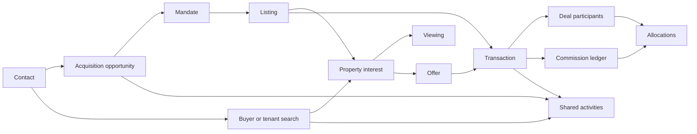

# SegmiQ Real Estate — Phase 4 Agency Operations

## 1. Executive Summary

Phase 4 adds an agency operations layer on the existing listings, offers, transactions, acquisition records, and buyer searches. Agents can be recorded as participants on one transaction. Commission is a separate integer-cent ledger. Managers can see named operational issues, hand current work to another person, and open commissions. Agents see their own allocations.

The migration is written and has not been applied to any database. Production was not changed. Browser and mobile screens were not opened. Full TypeScript and the production build were not run in this session.

Readiness: **staging validation required**. The in-repository implementation is complete enough to review. It is not production deployed and it is not staging validated.

## 2. Implemented Features

- Deal participants with explicit roles, plus collaboration requests that do not share WhatsApp.
- Commission templates, commission records, allocations, events, disputes, and payout progress. Rates are basis points or fixed cents. Nothing hardcodes a Zimbabwean rate.
- Transaction document links with review status. An upload starts as awaiting review.
- Milestone assignment to a user.
- Staff capability grants. A display title does not grant finance powers. A person cannot approve their own allocation.
- Handover of current assignments, with the original contributor id left intact.
- Manager attention on the company dashboard.
- Final real-estate sidebar for managers and agents. Trades navigation ids are unchanged.
- Mobile primary destinations for real estate: Home, Inbox, Properties, Activities, and Menu.

Not built as new products: a second inventory, a second transaction engine, a branch hierarchy, a new AI tool, or a replacement developments module.

## 3. Files Changed

Created:

- `lib/real-estate/agency-operations.ts`
- `lib/real-estate/agency-service.ts`
- `supabase/migrations/20261016180000_real_estate_phase4_agency_operations.sql`
- `app/api/clients/[clientId]/agency/route.ts`
- `components/real-estate/agency/CommissionsWorkspace.tsx`
- `components/real-estate/agency/HandoverWorkspace.tsx`
- `components/real-estate/agency/AgencyAttention.tsx`
- `app/client/commissions/page.tsx`
- `app/sales/commissions/page.tsx`
- `app/client/agency/team/page.tsx`
- `tests/real-estate-phase4.test.ts`
- `docs/implementation/REAL_ESTATE_PHASE_4_AGENCY_OPERATIONS.md`

Edited:

- `lib/real-estate/deal-access.ts` — an active participant can see the deal
- `lib/real-estate/transaction-service.ts` — fallen-through and cancelled transactions cancel unverified commission
- `app/client/dashboard/ClientDashboardMain.tsx` — attention list
- `lib/sales/navigation/company-nav-config.ts`
- `lib/sales/navigation/sales-nav-config.ts`
- `components/sales/navigation/SalesSidebar.tsx`
- `components/sales/navigation/SalesBottomNav.tsx`
- `components/company/navigation/CompanyBottomNav.tsx`
- `components/dashboard/company/team/CompanyTeamPage.tsx` — handover link
- `tests/company-nav-config.test.ts` — section order now matches the three-system sidebar
- `lib/real-estate/acquisition-plan.ts` — local numbers with a leading zero match the international form
- `lib/real-estate/compliance.ts` — individual defaults stay identification, proof of address, and source of funds. Ownership documents stay on the seller list.

No files were removed.

## 4. Database Architecture

Migration: `supabase/migrations/20261016180000_real_estate_phase4_agency_operations.sql`.

It refuses to run if `real_estate_transactions` is missing. Tables:

| Table | Purpose |
| --- | --- |
| `real_estate_deal_participants` | User, role, listing or transaction, start and end |
| `real_estate_collaboration_requests` | Assistance, introduction, participation, manager intervention |
| `real_estate_commission_templates` | Sale or rental, percent or fixed, effective dates |
| `real_estate_commissions` | Basis and gross in bigint cents, status, provenance |
| `real_estate_commission_allocations` | Beneficiary, role, amount, payout, approval |
| `real_estate_commission_events` | Status history |
| `real_estate_commission_disputes` | Open reason and decision |
| `real_estate_transaction_documents` | Category, storage reference, review status, visibility |
| `real_estate_handovers` | Manager, from user, status |
| `real_estate_handover_items` | Per-record applied or failed |
| `real_estate_staff_capabilities` | Extra capabilities granted by a manager |

`real_estate_transaction_milestones.assigned_to_id` was added. Existing listing, offer, and transaction tables were not dropped. Existing numeric commission columns on transactions were not rewritten.

Indexes cover active participants, collaboration owner, commission status, allocation beneficiary, and transaction documents. One active participant row is unique per organisation, transaction, user, and role. One legacy commission row is unique per transaction where provenance is `legacy_transaction_fields`.

Row level security is enabled and `REVOKE ALL` is applied for `PUBLIC`, `anon`, and `authenticated`. There are no permissive policies and no `auth.uid()` policies. The app uses the service role and must filter `client_id` itself.

`search_id` on collaboration requests is a uuid without a foreign key, so a request can be stored before the Phase 3 search migration is present. The service still scopes by `client_id`.

There is no SQL backfill that copies old transaction commission amounts into `unverified_legacy` rows. The table comment describes that status. Until a later, explicit backfill, old percentage fields stay on the transaction and are not labeled verified.

## 5. Agent Collaboration

Roles: sourcing agent, listing agent, buyer agent, introducing agent, transaction coordinator, supervising manager, additional participant, external agency.

`canParticipateInDeal` still allows the buyer agent, listing agent, listing owner, a same-organisation manager, and a super admin. It now also allows a salesperson whose user id is in the active participant list. A user from another organisation is refused even if that id is in the list.

`visibleDealSlice` is the information rule:

- WhatsApp is never included.
- A buyer agent sees buyer contact, not owner contact.
- A listing or sourcing agent sees owner contact, not buyer contact.
- A coordinator sees documents.
- Commission figures stay with managers or users who hold `confirm_payment` or `approve_commission`.

Approving a transaction-participation request adds an `additional` participant. The note records that WhatsApp is not shared. Approving a request does not copy a WhatsApp session.

## 6. Property Listings

The inventory remains `listings`. The manager destination is still `/client/listings`. The agent destination is still `/sales/listings`. Developments stay at `/client/developments` under More tools.

Phase 1 availability rules are unchanged: a listing is marketable only when approval is approved and status is available. Sold, let, and unapproved stock are not treated as open stock. Completing a transaction still closes the listing through the existing service. A fallen-through transaction still releases the listing according to remaining offers.

The listings page does not yet show interested-buyer, viewing, and offer counts, mandate status, or the original sourcing agent on each card. Those relationships exist in acquisition, interest, viewing, and offer tables. They are not aggregated into a new register query in this phase.

## 7. Transaction Operations

Transactions remain `real_estate_transactions` with the existing statuses: draft, pending compliance, in progress, completed, fallen through, cancelled.

Milestones stay on `real_estate_transaction_milestones`. A manager, or a user with `manage_milestones`, can set `assigned_to_id`. Completing an unrelated task does not complete a milestone; this phase does not add that coupling.

Document links store organisation, transaction, category, filename, storage reference, uploader, review status, reviewer, notes, and visibility. `documentReviewAfterUpload` returns `awaiting_review`. Review to verified or rejected requires a manager or `review_documents`. File bytes stay in the existing document storage. This phase stores the link, not a second bucket.

There is no new transaction detail screen. Milestone assignment and document review are available through `POST /api/clients/[clientId]/agency`. The existing transaction pages remain the place to open a transaction.

When a transaction falls through or is cancelled, `cancelCommissionForFailedTransaction` sets projected, earned, invoiced, reported, disputed, and unverified-legacy commission rows to cancelled and writes an event. Rows already `verified_received`, `paid`, or `partially_paid` are left for an explicit dispute or adjustment. They are not silently reversed and they are not treated as earned merely because the sale failed.

Rental milestones already omit conveyancing. This phase does not add conveyancing as a required rental step. SegmiQ does not verify title or transfer ownership.

## 8. Commission Management

Authoritative math is integer cents and integer basis points. `percentOfCents` uses half away from zero: `floor((abs(cents) * basisPoints + 5000) / 10000)`. Example: 18,000,000 cents at 300 basis points is 540,000 cents. Fifty cents at 100 basis points rounds to 1 cent.

`allocateCommission` refuses a total above the distributable amount unless `allowAboveDistributable` is set. The last line with `absorbsRemainder` receives leftover cents. The commission form sends two 50 percent lines and lets the server absorb the remainder. It does not pre-round with floating-point JavaScript.

Statuses: projected, earned, invoiced, reported received, verified received, allocation approved, partially paid, paid, disputed, cancelled, unverified legacy.

Reported receipt is not verified receipt. `canVerifyCommissionReceipt` is true for a manager, a super admin, or `confirm_payment`. `canApproveCommission` is false when the actor is the beneficiary, including when the actor is a manager.

Payouts cannot exceed the approved amount. A reported payout does not mark the commission paid. Verified payout requires an authorised user who is not the beneficiary.

Agency totals:

- Projected sums `projected` only.
- Earned sums `earned` only.
- Allocations approved sums `allocation_approved` only. That is an internal decision, not cash.
- Verified received or paid sums `verified_received`, `paid`, and `partially_paid`.

A buyer deposit is not written into this ledger. The old `commissionAmounts` helper on transactions is unchanged so existing tests keep their float behaviour. New money does not go through that helper.

Disputes insert a dispute row and move the commission to `disputed`. They do not delete allocations or events. AI is not given a tool that resolves a dispute.

Agents calling the list endpoint see only allocation lines where they are the beneficiary. Finance users see the organisation’s rows.

## 9. Staff Management

Users and roles stay on the existing SegmiQ accounts. Team Management for managers is `/client/team`, which already lists agents from live records. That page links to `/client/agency/team` for handover.

Capabilities in `AGENCY_CAPABILITIES` are granted to managers and super admins by `capabilitiesForRole`. Salespeople receive none of them from the role label. A manager can insert a row in `real_estate_staff_capabilities`.

There is no branch table. A future branch can be a nullable `branch_id` on the existing client-scoped records. Single-office agencies do not need it.

Handover:

1. Preview loads current acquisition opportunities, listings, buyer searches, viewings, and transactions where the selected user is the current assignee, scoped by `client_id`.
2. `planHandover` skips rows assigned to someone else, refuses a replacement who is the same person, and keeps `originalContributorId`.
3. Execute updates only the current assignee column, and only while that column still equals the departing user.
4. Each item is stored as pending, applied, or failed. A retry does not move rows that already changed.
5. Commission beneficiaries, historical events, and WhatsApp sessions are not rewritten. The user row is not deleted.

Account deactivation remains a separate user-admin action.

## 10. Activity System

Activities stay on the shared activity and calendar tables. Handover can reassign `activity_subjects.assigned_to_id` when an activity row is included. The preview currently loads acquisitions, listings, searches, viewings, and the two transaction agent columns. It does not yet list every activity subject in the preview.

Calendar routes are unchanged: `/client/calendar` for managers and `/sales/tasks` plus `/sales/calendar` for agents. Overlap warnings for viewings remain the Phase 3 rule. This phase does not add travel-time checks and does not cancel another appointment.

## 11. Manager Dashboard

`AgencyAttention` is rendered on the real-estate company dashboard beside the existing real-estate widgets. Each item has a title, a reason, and a link.

The feed, for managers only, loads:

- Mandates in `submitted`
- Listings in `pending_approval`
- Approved or expiring mandates whose expiry is within 30 days
- Offers in `submitted` or `countered`
- Transaction documents awaiting review for more than 7 days
- Commissions in `reported_received`, `projected`, or `disputed`
- Handovers in `partial`
- Transactions in draft, pending compliance, or in progress whose `updated_at` is older than 14 days

Empty feeds render nothing. The widget does not invent counts. It depends on the Phase 2, 3, and 4 tables, so it returns an error from the API until those migrations are applied.

## 12. Reports & Analytics

The manager destination remains `/client/reports`. Phase 2 and Phase 3 report endpoints remain the acquisition and buyer reports. This phase does not add a new analytics warehouse.

Commission figures on the commissions screen use the definitions in section 8. `reportSaleOnce` counts distinct transaction ids. Volume is the sum of the amounts the caller passes, so the caller must pass one amount per transaction. An accepted offer is not counted as a completed sale by that helper. Projected commission is not added into verified cash.

Filters for period, agent, property type, and location are the filters already on the existing report pages. This phase does not add a new filter UI.

## 13. AI Intelligence

No new copilot tool was added. Existing real-estate intelligence still reads authorised company data. Phase 4 does not let a model accept an offer, approve a mandate, verify title, confirm a receipt, approve a payout, hand over staff, or send a bulk message.

Collaboration context must not be placed into a prompt with owner or buyer contact unless the caller already has that slice. WhatsApp transcripts stay on the existing inbox assignment rules.

## 14. Final Sidebar

Manager sections, in order:

| Section | Items |
| --- | --- |
| Main | Dashboard `/client/dashboard`, Sales Inbox `/client/inbox`, My Activities `/client/calendar` |
| Property acquisition | Property Opportunities, Property Owners, Inspections, Mandates |
| Buyer & tenant sales | Buyers & Tenants, Property Matching, Viewings, Offers & Deals |
| Agency operations | Property Listings `/client/listings`, Transactions `/client/transactions`, Team Management `/client/team`, Commissions `/client/commissions`, Reports & Analytics `/client/reports` |
| More tools | Inquiries, Pipeline, Social Inbox, marketing, lead sources, website leads, Developments, Agent Performance, Compliance, Reviews, Documents, Feedback, Customers |
| System | Settings, Billing |

Billing remains subscription billing.

Agent sections, in order:

| Section | Items |
| --- | --- |
| Main | Dashboard, Sales Inbox `/sales/inbox`, My Activities `/sales/tasks` |
| Property acquisition | Property Opportunities, Property Owners, Inspections, Mandates |
| Buyer & tenant sales | Buyers & Tenants, Property Matching, Viewings, Offers & Deals |
| Agency | Property Listings `/sales/listings`, My Transactions `/sales/transactions`, My Commissions `/sales/commissions` |
| More tools | Pipeline, inquiries, Social Inbox, Calendar, Command, Reports, Won & Lost, Goals |
| System | Toolbox |

Agents do not get Team Management or the company commission ledger. Trades `SALES_NAVIGATION` ids and trades company sections `company`, `products`, `tools` are unchanged. Quotations stay on trades.

## 15. Mobile Experience

Real-estate bottom navigation is four destinations plus Menu:

- Home — dashboard
- Inbox — WhatsApp Sales Hub
- Properties — listings
- Activities — company calendar for managers, sales tasks for agents
- Menu — the remaining destinations

Trades bottom navigation stays Dashboard, Pipeline, WhatsApp, Tasks, and More. The label change to Menu is limited to `business_type = real_estate`.

Safe-area padding and the existing fixed bottom bar are unchanged. This session did not open a browser at 360, 390, 430, tablet, or desktop widths. Responsive classes were reviewed in the navigation components only. That is not a mobile test.

## 16. WhatsApp Integration

The Sales Inbox routes are unchanged. Supply conversations still use acquisition actions. Demand conversations still use buyer actions. Unclassified conversations still ask the agent to choose.

A collaboration approval does not attach a WhatsApp session. `visibleDealSlice` sets `whatsapp` to false for every role, including managers. Managers keep the inbox access they already have from assignment and company permissions. Handover does not move sessions.

Match notifications from Phase 3 remain internal. Commission failure handling does not call `notifyPropertyMatch`.

## 17. Cross-System Integration

The connected path uses existing records:

1. An acquisition opportunity still creates or links a contact and can convert to a reserved listing.
2. Manager approval still makes that listing available when the Phase 1 rule allows it.
3. An active buyer search can match that listing. A rejected interest stays excluded.
4. A viewing and an offer still hang off the listing and can reference the search.
5. An accepted offer still opens or advances one transaction. A second reserving accept is still refused.
6. Participants attach to that same transaction. They do not clone it.
7. A commission row attaches to that transaction. Allocations name the listing agent and the buyer agent without creating a second sale.
8. Completion still updates listing availability through the existing transaction service. Failure cancels unverified commission and does not delete the acquisition, search, offer, or participant history.

Legacy listings and transactions that have no acquisition or search link still use the old tables. Nothing in this migration requires those links.

## 18. Security

Every new query in `agency-service.ts` includes `client_id`. Participant access checks the user’s organisation before the participant list. Commission lists for salespeople filter to their beneficiary id. Attention, handover, document review, milestone assignment, and commission approval check the manager role or an explicit capability.

Service-role access still bypasses database policies. The revoke-all stance closes the Data API. It does not replace the `client_id` filters.

A software role named Agent is not treated as a professional registration. Finance actions require a manager role or a capability row.

Document links do not put file contents into the commission event note. Signed download remains the existing document access path.

## 19. Performance

List and attention queries use `limit` (commissions 200, most attention lists 20, open transactions 50). Handover preview limits each table to 200 rows and transactions to 100 per agent column. There is no measured load test against a 300-listing agency. No timing claim is made beyond the unit-test durations in section 20.

## 20. Test Results

`node .\node_modules\tsx\dist\cli.mjs --test tests\real-estate-phase4.test.ts`

- 12 passed, 0 failed, about 0.8 seconds.
- Covers 3 percent of 18,000,000 cents, half-cent rounding, allocation cap, remainder absorption, self-approval refusal, reported versus verified status, failure cancellation, partial payout, buyer versus owner visibility, cross-organisation participant refusal, handover attribution, attention reasons, distinct sale ids, manager versus salesperson capabilities, manager and agent navigation, and trades ids.

A combined run of Phase 4, company navigation, acquisition, compliance, offers, Phase 3, sales, social inbox, and work-project tests first reported 131 passed and 3 failed.

The three failures were fixed and re-run:

- Local `0772000000` now matches `+263772000000` when both significant numbers are at least 7 digits. Names that differ do not merge.
- Individual CDD defaults no longer require ownership documents. The tested set is identification, proof of address, and source of funds, plus client information. Seller ownership documents remain on `DEFAULT_SELLER_DOC_TYPES`.

Follow-up: `tests/real-estate-acquisition.test.ts` and `tests/real-estate-compliance.test.ts` — 30 passed, 0 failed.

The other 131 tests from the first combined run were not executed again after those two fixes. Those fixes do not change navigation.

Not run: full `npm run typecheck`, production build, database migration apply, API tests against a live database, and browser tests. Phase 2 acquisition tests that previously had no TAP output now pass in this follow-up.

## 21. Existing Customer Compatibility

Trades navigation ids still match `SALES_NAVIGATION` excluding projects and my work unless the solar workflow flag is on. Trades company sections are unchanged. Quotations remain on trades. Real-estate navigation does not include the product catalog.

Old transaction commission percentages and amounts are not migrated and are not marked received. Listings, contacts, leads, viewings, offers, and transactions are not deleted.

## 22. Migration Status

| Migration | Status |
| --- | --- |
| `20261016013000_real_estate_phase1_foundation.sql` | Prepared, not applied by this work |
| `20261016042000_real_estate_phase2_acquisition.sql` | Prepared, not applied by this work |
| `20261016120000_real_estate_phase3_buyer_sales.sql` | Prepared, not applied by this work |
| `20261016180000_real_estate_phase4_agency_operations.sql` | Prepared, not applied |

No staging or production database was contacted. No `supabase db push` was run.

## 23. Known Limitations

- The four migrations are not applied, so the new API returns a migration message until they are.
- Legacy commission amounts are not copied into `unverified_legacy` rows.
- The property register does not yet show interest, viewing, offer, mandate, and sourcing counts.
- Transaction document review and milestone assignment have API actions and no dedicated screen.
- The commission form asks for user ids. It is operable for an authorised user and it is not a polished picker.
- Handover preview does not list every activity subject.
- Expiring-mandate and overdue-document attention work only after the Phase 2 and Phase 4 tables exist.
- No branch model.
- No new AI tools.
- No browser or device-width verification.
- No full typecheck or production build in this session.
- Service role still bypasses RLS. Isolation depends on `client_id` filters.
- `reportSaleOnce` will double-count volume if the caller passes the same amount twice. It dedupes ids, not amounts.

## 24. Deployment Instructions

1. Confirm the target project and that a backup exists.
2. Apply Phase 1, then Phase 2, then Phase 3, then Phase 4, in that order. Phase 4 aborts if `real_estate_transactions` is missing.
3. Do not run a broad `db push` against a database whose migration history does not match this repository.
4. Deploy the application only after the migrations for that environment have succeeded.
5. Sign in as a real-estate manager and as an agent. Confirm the sidebar groups, that an agent cannot open another agent’s commission lines, and that reporting a receipt leaves the status at reported received until verify is used.
6. Create one commission on a test transaction. Confirm the gross cents match basis times basis points, and that the two allocations sum to that gross.
7. Fall a test transaction through and confirm an unverified commission becomes cancelled while a verified one does not.

Do not deploy this phase to production until that staging pass is done and explicitly approved.

## 25. Rollback Strategy

The new tables are additive. To disable the feature without deleting history:

- Stop routing users to `/client/commissions`, `/sales/commissions`, and `/client/agency/team` by reverting the navigation commit.
- Leave the tables in place. Existing listings, offers, and transactions do not depend on them for their previous behaviour.
- The transaction failure hook calls `cancelCommissionForFailedTransaction`. If the commission table is absent, that call should be treated as a no-op in a hotfix, or the application build that contains the hook should be rolled back together with the navigation.

Do not drop the tables if any commission, participant, or handover row has been written, unless a reviewed backup restore is the chosen path.

## 26. Final Readiness Assessment

**Staging validation required.**

Development implementation is in the repository: services, API, commission and handover screens, attention, navigation, and unit tests. Staging has not applied the migration and has not exercised the screens. This is not ready for production review and it is not production deployed.

